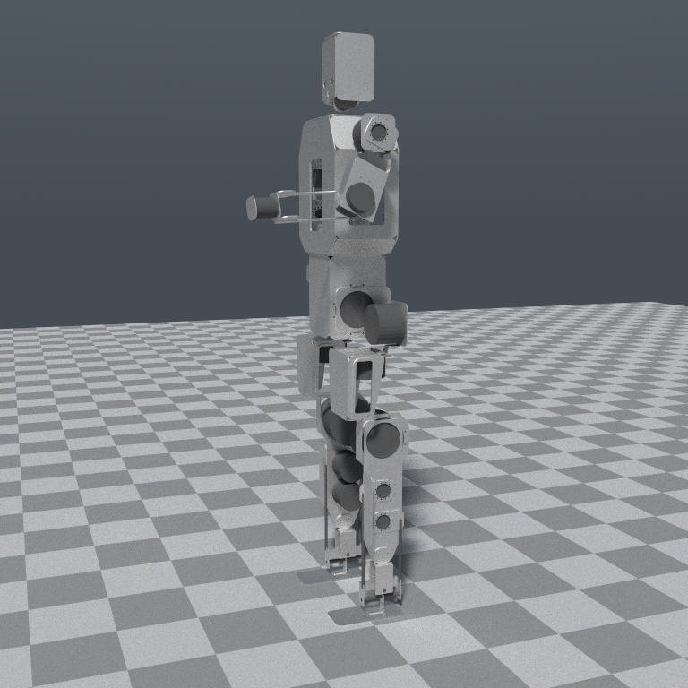
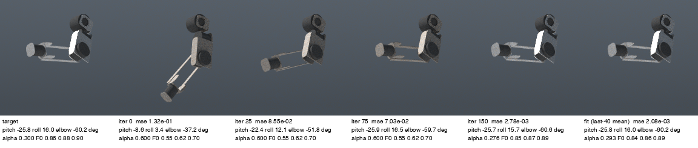
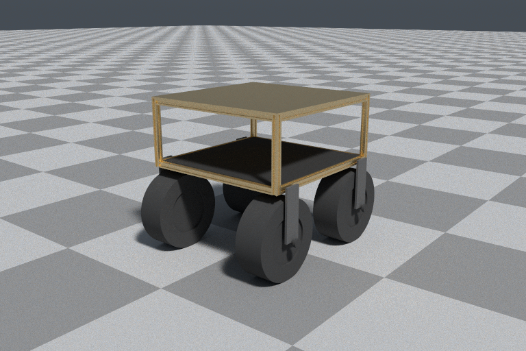

# irys

irys is a differentiable spectral path tracer written in Rust. It renders on
the CPU and on the GPU (wgpu 30), and it returns gradients of an image loss
with respect to materials, instance poses and mesh vertices.

irys owns no geometry. Clients implement the `Geometry` trait (bounds and
ray intersection per primitive) and irys does the light. It is the renderer
for vcad, kosm, ipse, phyz and muni.

What works today:

- A spectral CPU path tracer over any `Geometry`: BVH and TLAS, analytic
  primitives, triangle meshes, heightfields, Gaussian splats, caustics.
- A GPU tier with a WGSL integrator, temporal history and denoisers.
- Inverse rendering in `irys-diff`: path replay backprop on the CPU and on
  a GPU wavefront, for a GGX conductor's roughness and spectral F0, every
  diffuse surface's spectral albedo, and each Gaussian splat's colour and
  opacity, under the sky, a sun and area emitters; and edge-sampled
  visibility gradients for instance pose and per-vertex position.
- An OpenPBR scene kernel with volumes, skin and hair, and an importer for
  scenes exported from Blender.
- Research built on top: a 3D Gaussian splat trainer, and image-to-CAD
  recovery of a vcad program from renders or a photo with an AprilTag.

Everything is version 0.1.1 and the API is not stable. See
[Status and limits](#status-and-limits).

## Crates

| Crate | What |
|---|---|
| `irys-core` | the `Geometry` trait, rays, `TriMesh`, BVH/SAH, TLAS, the blue-noise sampler |
| `irys-prims` | stock `Geometry` implementations: analytic primitives, heightfields |
| `irys-light` | spectra, optics, environments, the CPU path tracer, caustics, splats |
| `irys-gpu` | the wgpu 30 compute tier: device, buffers, WGSL integrator, history, denoisers |
| `irys` | facade over the four crates above, published as `irys-render`; the GPU tier is behind the `gpu` feature |
| `kosm-render` | 0.2.1 compatibility shim that re-exports `irys` under kosm-render's old paths |
| `irys-diff` | BSDFs as tang IR graphs, path replay backprop on CPU and GPU, visibility gradients, the OpenPBR look. Features: `gpu`, `assets` |
| `irys-bench` | binary: the equal-time benchmark harness against Blender Cycles |
| `irys-recon` | image to CAD: recover a vcad program and its dimensions from irys renders or a photo; tag36h11 detection |
| `irys-recon-net` | image to CAD with a learned scene proposer (a tang tensor-IR graph) seeding the search |
| `irys-splat` | a 3D Gaussian splat trainer on the GPU tier: tile rasteriser forward and adjoint, Adam, densification |
| `irys-ffi` | a C ABI that renders into an IOSurface-backed Metal texture (Apple only, a spike) |

`irys-diff`, `irys-tags`, `irys-recon` and `irys-splat` are on crates.io
with the renderer crates; `irys-bench`, `irys-recon-net`, `irys-ffi` and
`irys-wasm` are built from this repository only. Every tang dependency comes
from crates.io, so a project that links irys needs no `[patch]`.

## Quickstart

Every crate below is on crates.io:

```sh
cargo add irys-render                 # CPU; code still writes `use irys::...`
cargo add irys-render --features gpu  # with the wgpu tier
cargo add irys-diff                   # differentiable rendering
cargo add irys-diff --features gpu    # with the GPU wavefront
```

The examples below run from a clone. They need Rust 1.95 or newer and a C
compiler on your PATH: irys-diff's CPU tier, the f64 reference the GPU is
checked against, compiles its BSDF kernels to C at run time. The GPU tier
runs the same kernels as WGSL.
The first build of any `irys-diff` example is slow, because its
dev-dependencies include vcad.

```sh
git clone https://github.com/muni-works/irys
cd irys

# CPU only. Fits a ball's roughness and colour to one target image by path
# replay backprop and writes target.ppm, iter_NNN.ppm and loss.csv.
# Needs a C compiler on PATH (irys-diff compiles its kernels to C).
cargo run --release -p irys-diff --example fit -- out/fit

# The same fit on the GPU wavefront, then in a scene with a mesh floor and splats.
cargo run --release -p irys-diff --features gpu --example fit_gpu -- out/fit_gpu
cargo run --release -p irys-diff --features gpu --example fit_scene -- out/fit_scene

# A rover built from vcad parts: render it, then recover its body material.
cargo run --release -p irys-diff --features gpu --example rover -- out/rover

# Tests. GPU tests skip when there is no adapter.
cargo test -p irys
cargo test -p irys-diff --features gpu
```

Other entry points:

```sh
# Detect tag36h11 tags in a photo.
cargo run --release -p irys-recon --example tag_probe -- photo.jpg

# Recover a part from one or more photos taken beside a tag.
cargo run --release -p irys-recon --example recon_photo -- photo.jpg

# The image-to-CAD v0 gate: 20 random parts recovered from irys renders.
# Slow: the recorded runs took about 270 to 340 s per part.
cargo run --release -p irys-recon --example recon_v0

# Train a splat map from posed photos.
cargo run --release -p irys-splat --example splat_train -- \
    --images DIR --poses poses.jsonl --camera camera_info.json --out map.ply
```

`scripts/bench.sh` runs the benchmark against Cycles and needs Blender.

The `rose`, `rose_check` and `rose_fit` examples in `irys-diff` read CAD from
the [rose](https://github.com/muni-works/rose) repository's older full-size
model (`full/cad/rose-full.loon`), which is no longer on rose's `main`: clone rose,
check out the tag `pre-restructure`, and point `$ROSE` at it (the default is
`~/Developer/rose`). Their results are in the
figures below and in [docs/design.md](docs/design.md).

## Status and limits

[docs/design.md](docs/design.md) is the design and a dated build log, one
section per phase, each with its measurements and its deviations. New
sections are appended at the end. [docs/image-to-cad.md](docs/image-to-cad.md)
covers recovery of CAD from images, [docs/belief-codec.md](docs/belief-codec.md)
is a specification of which irys has built only the M1 prerequisites, and
[docs/papers.md](docs/papers.md) lists the papers irys implements.

- The core crates (`irys-core`, `irys-prims`, `irys-light`, `irys-gpu`,
  `irys`) are the split of kosm-render 0.2 and are the most settled part.
  They are on crates.io at 0.1.1. The facade is published as `irys-render`
  because the `irys` name there belongs to an unrelated project; its library
  is still called `irys`.
- `irys-diff`, `irys-recon`, `irys-recon-net`, `irys-splat` and `irys-ffi`
  are research code. Expect interfaces to change.
- The design lists `irys-raster`, `irys-line` and `irys-view` crates. None of
  them exists.
- ReSTIR PT/GRIS and a neural radiance cache were not built. ReSTIR DI and
  path guiding are GPU only, and ReSTIR DI measured as a net loss once the
  Sobol sampler was on.
- Against Cycles at equal time, irys has 1.5 to 5.6 times lower error at
  every budget on its three benchmark scenes (pair, room, cornell), with the
  opt-in sun sampling share (design.md, speed round 3). On Blender's demo
  files with full materials Cycles wins: irys's error is 0.89 to 2.75 times
  Cycles' on the classroom and 14 to 17 times on the clamped pavilion, and
  Cycles is 2 to 3 times faster per sample (design.md, phase 5, round 4).
- Against Mitsuba 3 on the same M4 Max and scenes, irys's material gradient
  reaches equal variance 7 to 26 times sooner; both match their own central
  differences. Mitsuba's pose gradient converged to a biased value on the
  arm scene, so there is no pose comparison (`bench/mitsuba`, design.md).
- The GPU wavefront in `irys-diff` uses wgpu's experimental ray queries
  where the device has them. Development and all recorded timings are on
  Apple silicon with Metal. The `irys-diff` test suite also passes on an
  NVIDIA RTX 3090 through Vulkan (2026-11-10).
- Replay is bit-exact per device and driver: another GPU rounds f32
  differently and agrees with the f64 reference to f32 precision.
- Image to CAD: on synthetic renders the v0 gate passes 17 of 20 parts
  (topology right and every dimension within 0.5 mm). From one synthetic
  phone photo with a tag, v1 passes 2 of 20 at 0.5 mm and 6 of 20 at 1 mm.
  The neural proposer (v2, v3) works on synthetic scenes and mostly does not
  recover the real desk photo.
- The pose fit on the rose arm recovers three joint angles to within 0.07
  degrees from a start about 13 to 23 degrees away, on a synthetic target
  (design.md, phase 2d).







## Research

Papers about irys and its companion work are published at
[muni.works/research](https://muni.works/research).

The companion paper for vcad is
[Exact Gradients Through a BRep Kernel](https://muni.works/research/vcad).
The two share one benchmark: irys renders vcad's frozen-plan mesh of a
robot-arm shoulder plate, takes the gradient of an image loss on every mesh
node by edge sampling, and vcad pulls that back to a CAD parameter (the
bearing bore diameter). The benchmark is the `rose_brep` example in
`irys-diff`. It reads the plate from
[rose](https://github.com/muni-works/rose) at commit `832192f`.

## License

Apache-2.0, see [LICENSE](LICENSE).
