# irys — design

One renderer for the stack. vcad, kosm, ipse, rose and muni each draw pixels
today, in five different ways. irys is where the light lives; every repo above
it is a client that hands over geometry and a camera and gets a frame back.

Status: proposal, 2026-10-17. Phase 0 (seed + split) has landed; see below.

## Why now

The survey (2026-10-17) found:

| Where | What | Problem |
|---|---|---|
| `kosm/crates/kosm-render` (41k LOC) | spectral path tracer, BVH/TLAS, caustics, splats, heightfield, blue noise, GPU tier (wgpu 30) | already geometry-agnostic — but lives in a game's repo and is versioned with it |
| `kosm/crates/kosm-view` (10k) | winit viewer, temporal history, à-trous, raster live tier | duplicates `kosm-render::gpu::{history,budget}` |
| `vcad/crates/vcad-kernel-raytrace` (16k) | direct BRep ray tracing, its own `Bvh`/`Tlas`/`Instance`/`pathtrace`, wgpu 23 | second copy of the same acceleration stack, same type names |
| `vcad/crates/vcad-kernel-gpu` (4k) | wgpu context, wavefront | third GPU context layer |
| `vcad/crates/vcad-render` (13k) | hidden-line SVG/PNG, `photoreal`, `materials`, `envmap` | second material/env model; rose's only renderer |
| `phyz/crates/phyz-camera` (3k) | wgpu 23 rasterizer for sim cameras | fourth GPU context, own mesh/scene types |
| `muni/depot/splat-worker`, ipse `scripts/splat_*` | Python gsplat on CUDA | splats rendered by a stack irys can't call |
| `muni/depot/console`, `vcad/packages/app` | three.js | out of scope for v1 (see below) |

`kosm-view` building vcad-raytrace with `gpu` means one binary links wgpu 23
*and* 30. That alone is worth fixing.

## Principles

1. **irys owns no geometry.** It never depends on vcad, phyz, kosm or ipse.
   Clients implement `Geometry`; irys bounds it, traverses it and shades it.
   This is the rule `kosm-render` already follows — keep it.
2. **A substance is not a look.** irys takes optical constants (spectral
   albedo, IOR/Sellmeier, roughness, emission). kosm's `material` library
   stays in kosm and derives them; irys never carries a second brass.
3. **CPU is the reference, GPU is a tier.** Every GPU result has a CPU path
   it is tested against. Headless and CI build with no device.
4. **One wgpu.** The whole graph agrees on one major version, bumped in irys
   first.
5. **Pure frame.** `render(scene, camera, budget) -> Frame` is a function.
   Temporal state (history, reprojection) is an explicit value the caller
   threads, not hidden in a viewer — so kosm's "same id, same bytes" holds.
6. **Differentiable where it is cheap.** Scalars are `tang::Scalar` so duals
   flow through optics and the frame (kosm's marble already depends on this).

## Crate split

```
irys/
  crates/
    irys-core     math, Ray/Hit, Aabb, Geometry trait, Bvh/Sah, Tlas/Instance,
                  Camera, Frame (rgba + depth + normal + id AOVs). no deps but tang.
    irys-light    spectrum (CIE, Sellmeier), optics (Fresnel), BSDFs, env/HDR,
                  sampler (blue noise), CPU pathtrace, caustics/photon map.
    irys-prims    stock Geometry impls: TriMesh, Analytic, HeightField, Splats.
    irys-gpu      one wgpu context, buffers, resident scene, WGSL integrator,
                  history/budget/à-trous/firefly cap, neural denoiser. feature-
                  gated; the only crate that names wgpu.
    irys-raster   fast live tier: forward pass, shadow map, SH probes (from
                  kosm-view/raster) + a sim-camera mode (absorbs phyz-camera).
    irys-line     hidden-line / flat-shaded SVG+PNG (from vcad-render's core).
    irys-view     winit window over irys-gpu/raster. optional, never in CI.
    irys          facade: `use irys::prelude::*;`, re-exports by feature.
```

Rule of thumb for a boundary: a crate exists if some client wants it without
the rest. rose wants `irys-line` only. phyz wants `irys-raster` only. A
headless kosm test wants `irys-core + irys-light` only.

## The Geometry trait

Keep `kosm-render`'s trait as is — it has survived BRep, meshes, splats and
heightfields:

```rust
pub trait Geometry {
    fn len(&self) -> usize;
    fn is_empty(&self) -> bool { self.len() == 0 }
    fn bounds(&self, i: usize) -> Aabb;
    fn intersect(&self, ray: &Ray, i: usize, t_min: f64, t_max: f64) -> Option<Hit>;
    fn intersect_all(&self, ray: &Ray, i: usize, out: &mut Vec<Hit>) { /* convex default */ }
    fn occludes(&self, ray: &Ray, i: usize, t_min: f64, t_max: f64) -> bool { /* via intersect */ }
}
```

Additions, each optional with a default so no existing impl breaks:

- `fn material(&self, i: usize) -> MaterialId` — today materials ride in
  `Hit`; making it a trait method lets the GPU tier upload it once.
- `fn gpu(&self) -> Option<GpuGeometry<'_>>` — how a primitive set
  describes itself to `irys-gpu` (triangle soup, analytic prim table, splat
  buffer, heightfield texture). `None` means CPU-only, and the GPU tier
  falls back or refuses loudly, never silently drops it.
- `fn tessellate(&self) -> Option<TriMesh>` — for `irys-raster` and
  `irys-line`, which need triangles. BRep impls in vcad return the
  tessellator's mesh; analytic prims tessellate themselves.

What stays out: transforms (that's `Tlas`/`Instance`), animation, and any
notion of a document or scene graph. A client's scene graph builds a `Tlas`.

**vcad's BRep** becomes `impl Geometry for BrepFaces` in vcad (in
`vcad-kernel-raytrace`, shrunk to the surface intersectors + trimming).
Its `Bvh`, `Tlas`, `pathtrace` and `gpu/` are deleted in favour of irys's.

## Clients after the move

| Client | Depends on | Keeps locally |
|---|---|---|
| kosm | `irys` (light, gpu, view) | `Camera` as a `Lens`, materials → optics constants, `brep::Scene` adapter |
| vcad | `irys-core`, `irys-light`, `irys-line`, `irys-gpu` (wasm) | BRep `Geometry` impl, `.vcad` → scene, CLI flags |
| rose | `vcad-render` → `irys-line` | nothing new; `render.sh` unchanged |
| phyz | `irys-raster` | `phyz-camera` becomes a thin adapter |
| ipse | `irys-prims::Splats` + `irys-gpu` | map → splat buffer adapter |
| muni | see below | |

## muni

muni is the reason this has to be a library and not a kosm crate. What it
needs, in order:

1. **sim-world depth/RGB from 3DGS** (`docs/sim-service-plan.md`). Today that
   plan is Python gsplat in a container. With `irys-prims::Splats` +
   `irys-gpu`, sim-bridge renders depth from arbitrary poses in Rust, in
   process, no ZMQ hop, and the same renderer trains the world model and
   tests the policy. This is the first muni deliverable.
2. **Sim cameras for bvr's `sim` crate** — `irys-raster`'s sim-camera mode,
   batched like kosm's `step_batch`.
3. **Depot digital twin.** The console stays three.js for now. Later,
   `irys-gpu` on wasm/WebGPU can render the splat map behind the three.js
   overlays. Not v1.
4. **Splat training** stays Python (gsplat/CUDA). irys consumes the `.ply`;
   it does not train splats in v1.

Out of scope: teleop video (GStreamer), Rerun replay, the marketing site.

## Migration order

Each step lands green on its own; nothing is a flag day.

1. **Seed.** `git subtree split` `kosm/crates/kosm-render` into
   `irys/crates/irys-core` with history; republish nothing yet. kosm points at
   it by path via `.cargo/config.toml`, CI by git rev.
2. **Split** that crate into `irys-core`, `irys-light`, `irys-prims`,
   `irys-gpu` along the module lines above. Pure moves; `kosm-render` becomes
   a re-export shim so kosm and vcad 0.10 keep compiling.
3. **Hoist kosm-view's** history/budget/temporal into `irys-gpu` (dedupe with
   `kosm-render::gpu`), raster into `irys-raster`, window into `irys-view`.
4. **Publish** `irys-*` 0.1 to crates.io. kosm drops the shim and depends on
   irys directly.
5. **vcad onto wgpu 30 + irys.** `vcad-kernel-raytrace` keeps surface
   intersectors and implements `Geometry`; its BVH/TLAS/pathtrace/gpu go.
   `vcad-kernel-gpu`'s context is replaced by `irys-gpu`'s for rendering
   (its compute-only parts — narrowphase, router — stay in vcad).
   Snapshot every vcad render test before and after.
6. **vcad-render → irys-line + thin CLI.** rose is checked with its
   `render.sh` output diffed pixel-wise.
7. **phyz-camera → irys-raster** adapter.
8. **muni sim-bridge** renders splat depth through irys (muni #1 above).
9. **ipse** splat viewer/compare scripts move to a irys example.

Steps 1–4 are kosm-only and low risk. Step 5 is the big one: two BVHs with
the same names, a wgpu major bump, and wasm in the vcad app.

## Phase 0: the split as built (2026-10-17)

Pure moves (`git mv`), no behaviour change. What landed differs from the
sketch above in three places, all because a module-line split would have
made a cycle:

- **Splats live in `irys-light`, not `irys-prims`.** `splats.rs` shades
  through `pathtrace`'s surface model and the CPU integrator composites
  splats itself (`Scene::splats`), so prims → light → prims. `irys-prims` is
  `analytic` + `heightfield`.
- **TriMesh stays in `irys-core`.** It is defined in `geometry.rs` beside
  the trait, and the integrator, the GPU tier and the tests all name it.
- **The sampler (blue-noise mask, Sobol) is in `irys-core`**, because both
  tiers read it; `spectrum`/`optics` call each other and go to `irys-light`
  together with `tables`, `env`, `caustics`, the CPU tier (`cpu/`,
  `pathtrace`) and the CPU half of the neural denoiser (`neural`). There is
  no `irys-neural`: the device half is `irys-gpu::neural`.

```
irys-core   (tang)                       math ray geometry bvh sah tlas sampler
irys-prims  -> core                      analytic heightfield
irys-light  -> core   (rayon native)     spectrum optics tables env cpu pathtrace
                                         caustics splats neural
irys-gpu    -> core, light (wgpu 30)     the old gpu/ module + shaders
irys        -> core, light, prims, gpu?  facade, kosm-render 0.2's public paths;
                                         `gpu` feature pulls irys-gpu
kosm-render -> irys                      0.2.1 shim, `pub use irys::*`
```

Each moved module keeps its `crate::x` paths through a private
`use irys_core::{..}` at its new crate root. The integration tests live in
the facade (`crates/irys/tests`) since they span tiers.

## Phase 1 spike: the contract on CPU (2026-10-17)

`crates/irys-diff`, its own crate because tang-compile is a git dependency
(`bfc8003`, kosm's rev) and irys-light has to stay publishable. The
workspace `[patch.crates-io]` sends `tang`/`tang-expr` to that rev so the
graph holds one tang; it folds into irys-light when the IR publishes.

- `ggx.rs` — a rough conductor (GGX, height-correlated Smith, Schlick with a
  three-hat spectral F0), `θ = (α, F0₀, F0₁, F0₂)`, written once as one
  `TensorGraph` batched over a wavefront: inputs are `[n]` columns of vertex
  cosines and hero-wavelength hat weights. Lowered to eval (`f`, `pdf`) and
  adjoint (`backward` of `Σ δf·f`, so the batch sum is the reduction).
  Sampling (VNDF) is f64 CPU code and detached.
- `prb.rs` — forward pass keeps `L` per path; replay reseeds, re-walks, and
  adds `δL (L − L_j) ∂f_j/f_j`. The derivation is the module doc.
- `ir.rs` — compiled C (f32) or interpreter (f64), `IRYS_IR=interp` forces
  the latter.

Scene: GGX ball on a grey Lambertian disc under a smooth sky + soft sun,
`irys_core::Bvh` over `irys_prims::Analytic`, one hero wavelength per path
through `irys_light::spectrum`. Results (debug build, M-series):

| Gate | Result |
|---|---|
| gradient vs CRN central differences, sampler frozen, L2, f64 | rel error 1.6e-10 … 1.9e-9 on all four θ |
| same, sampler at current α (paths move), mean pixel, 64 seeds | α: −5.84e-2 ± 0.40e-2 vs −5.79e-2 ± 1.2e-2 (0.0σ); F0 bands rel ≤ 1e-6 |
| compiled C f32 vs interpreter f64 | f 1.6e-6, pdf 1.7e-6, δθ 9.4e-7 worst rel; interpreter = hand f64 to 1e-12 |
| replay vs forward | bit-identical L on 512/512 paths, both backends |
| memory | 30.1 f64 words per path at depth 2 and 8, nothing per vertex |
| inverse: α 0.6 → 0.25, 32×32×4, Adam | within 0.02 at iteration ~20; last-10 mean 0.265 |
| timing | gradient (render + forward + replay) 4096 paths ≈ 35 ms native, ≈ 1.3 s interpreted; 512 paths interpreted 0.17 s |

What the spike says the design got wrong or left out:

1. **The replay weight has a `1/f`.** It is `δL (L − L_j) ∂θ log f_j`; the
   contract's "`(L − L_so_far) · ∂f/∂θ`" is off by `f_j`.
2. **A nonlinear loss needs two seeds.** With one, the L2 gradient
   `2 (I − T) ∂I` correlates the noise in both factors and descent also
   minimises variance: the first inverse run walked α from 0.6 to 1.0.
   `prb::gradient` takes `(primal, adjoint)` seeds; same seed only for the
   CRN check.
3. **Memory is paths × 1, not pixels × 1**, once forward and replay are
   separate wavefront passes (`L` per path between them). Pixels × 1 needs
   the replay fused into the forward kernel per path, or a third pass.
4. **The pdf the integrator divides by is the sampler's**, not the eval
   graph's: the two agree (tested to 1e-9), but the one that drew the
   direction is the one that counts (frozen sampling makes that explicit).
   The graph's pdf is for MIS.
5. **Replay bit-exactness needs one program for `f`.** The eval and adjoint
   lowerings fuse differently and may round differently in f32, so replay
   re-evaluates `f` with the eval program and runs the adjoint only for `δθ`.
   The C is built with `-ffp-contract=off` for the same reason.
6. **tang-gpu is out.** Its `CpuProgram` links wgpu 25 (principle 4); `ir.rs`
   carries the forty-line loader instead.
7. Not done: PRB inside `irys-light`'s integrator (the spike has its own
   200-line wavefront), the floor's BSDF as a graph, NEE/MIS, Russian roulette, visibility (reparam) gradients.

### Hero wavelengths ×4 (2026-10-17)

Each path now carries four stratified wavelengths, the hero and three
rotated by `k/4` of the band (Wilkie+ 2014). The hero alone draws the
direction; the graph runs per *lane* (path × wavelength, so the wavefront is
4× wider) and the image splats each lane at `hero_weight(λ_k) / (4 spp)`.
GGX's sampler is λ-free, so all four share the hero's pdf and the MIS weight
is a flat ¼. Each lane is its own PRB path (`L`, `L_j`, `δL`).

| | |
|---|---|
| per-pixel variance, 24×24×2, 16 seeds, 1 λ → 4 λ | total 7.4× lower, chroma (channel − grey) 28.7× lower |
| frozen-sampler gradient vs CRN central differences | rel ≤ 6.1e-10, unchanged gate |
| live sampler, 64 seeds | α 0.4σ, F0 bands rel ≤ 1e-6 |
| replay vs forward | bit-identical on every lane, both backends; 63.1 words/path at depth 2 and 8 |
| inverse α 0.6 → 0.25 | within 0.02 at iteration 13; last-10 mean 0.234 |
| `examples/fit`, 96×96×8, 60 its | θ = [0.188, 0.334, 0.783, 0.997] vs truth [0.2, 0.34, 0.78, 1.0] |

No tolerance changed.

## Phase 2a: the PRB wavefront on the GPU (2026-10-17)

`irys-diff::gpu` behind a `gpu` feature, on `irys-gpu`'s wgpu 30 context.
The phase-2 risk was replay bit-exactness on a device; it held first time.

**The IR does emit WGSL.** tang-compile at `bfc8003` has
`TensorGraph::to_wgsl` (one kernel per materialised comp, views as index
arithmetic, `split` schedules for reductions). So nothing is hand-lowered:
the GGX eval lowering (`f`, `pdf`) and adjoint lowering (`δθ`) are the IR's
own kernels, dispatched as wavefront stages. Only the path logic is hand
WGSL (`src/gpu/wavefront.wgsl`): `gen`, `bounce` (intersect the two
analytic prims, VNDF-sample at the hero, write the seven graph columns per
lane), `update` (`T *= f cos/p`, and in replay `δf = δL (L − L_j)/f`),
`finish` (`L` per lane), `accumulate`. A bounce is bounce → eval IR →
update [→ adjoint IR → accumulate], one compute pass per frame.

**Bit-exactness, by construction.** Forward and replay dispatch the same
`ComputePipeline`s over the same bind groups — one shader module per
kernel, built once — so `f` and everything feeding a path is the same
machine code on the same inputs. The replay differs only in a uniform that
gates the `δf` store. The adjoint program recomputes `f` internally; that
copy never touches throughput (note 5 above). RNG: `prb::Rng` ported
exactly (SplitMix64 on `u32` pairs, 64-bit add/mul by 16-bit limbs); a
uniform keeps the top 24 of the CPU's 53 bits, so CPU and GPU walk the same
paths up to f32 rounding. Nothing broke; the only f32 accommodation is the
surface offset, 1e-4 (t_min 1e-5) instead of the CPU's 1e-6.

**The reduction: no atomics.** WGSL has no float atomics and a CAS loop on
`atomic<u32>` makes the sum order (so the gradient's low bits) depend on
scheduling. Instead the adjoint's `Σ_lanes` stays the IR's own monoid
reduction, scheduled `split = 256` (one workgroup per parameter, threads
stride the lanes, tree combine); `accumulate` adds the four results per
bounce in bounce order. The gradient is bit-deterministic run to run
(tested).

| Gate (debug build, M-series, Metal) | Result |
|---|---|
| replay `L` vs forward `L`, 64×64×4 × 4 λ | 65536/65536 lanes bit-identical, depth 2 and 8; `δθ` identical twice |
| GPU f32 vs CPU f64 interpreter, frozen sampler, 32×32×4, one seed | `L` median rel 1.2e-7, p99 1.5e-4 (14/16384 lanes > 1e-3: silhouette rays); loss rel 5.8e-7; `δθ` rel 8.3e-5, 7.0e-6, 1.9e-5, 3.5e-4 |
| GPU PRB vs GPU central differences (h = 1e-3, CRN) | rel 1.1e-6, 9.9e-6, 6.9e-6, 1.9e-3 (θ₃, the smallest gradient, is f32 FD noise) |
| throughput, 96×96×8 (73 728 paths × 4 λ, depth 4) | forward 1.1 ms incl. readback (≈ 66 Mpaths/s); replay 20.6 ms; gradient with host scoring 166 ms |
| CPU compiled-C path, same frame, same profile | forward 453 ms (0.16 Mpaths/s), gradient 1543 ms: GPU 9× end to end, ~400× on the forward pass |
| `examples/fit_gpu`, same seeds and Adam as `fit` | θ = [0.188, 0.334, 0.783, 0.997] vs truth [0.2, 0.34, 0.78, 1.0] — the CPU run's numbers to three places; 60 iterations + previews in 14 s vs ≈ 2 min |

 (`phase2a-loss.csv` is its loss and θ.)

Remaining risks and follow-ups:

1. **Host scoring dominates.** ~140 ms of the 166 ms gradient is the host
   building the image, the loss and `δL` per lane from `L` (debug Rust).
   Image, loss and `lane_adjoint` belong on the device; then the host reads
   back four floats. *Done in phase 2b, piece 1.*
2. **Replay cost is the adjoint.** Four split reductions per bounce, each
   recomputing `f` and its derivative per lane: 20 ms vs 1 ms forward. A
   fused one-pass reduction over all four parameters (one kernel, width-4
   accumulator) is an IR schedule, not a design change.
3. **The scene is hand-written in WGSL.** Two analytic prims, no BVH. Phase
   2 proper needs `irys-gpu`'s scene traversal inside `bounce`; bit-exactness
   then also depends on traversal order being deterministic (it is, for a
   stackful BVH walk, but test it). *Done in phase 2b, piece 2; tested.*
4. **Lane layout.** Graph inputs are seven separate `[lanes]` columns because
   that is how `to_wgsl` binds inputs; that is 9 storage bindings in `bounce`.
   A struct-of-columns input or a `[lanes, 7]` view would cut it.
5. **Cross-vendor.** Bit-exactness is per device and driver: the same
   pipeline on the same GPU. Replaying on another adapter is not promised,
   and nothing needs it.
6. f32 everywhere on the device; long paths and big scenes will want the
   offset scaled to the hit distance. *Done in phase 2c, piece 2.*

## Phase 2b: the real scene on the GPU wavefront (2026-10-17)

Two pieces, both in `irys-diff::gpu`.

**Piece 1 — scoring on the device** (phase 2a risk 1). Three more wavefront
kernels: `score` (one thread per pixel sums its `spp × 4` contiguous lanes
in lane order through a WGSL port of `spectrum::hero_weight`, then writes
the residual's `∂loss/∂image` and squared error), `loss_sum` (one workgroup:
a fixed per-thread stride, then a fixed tree), `lane_adjoint` (δL per lane
from the adjoint frame's own wavelengths). No float atomics anywhere; the
host writes uniforms and reads back five floats, `loss` and `δθ`
(`GpuPrb::gradient_l2`). The host-scored `gpu::gradient` stays as the
reference and for non-L2 losses.

| Gate | Result |
|---|---|
| device image / δL vs host f64 scoring of the same `L` | max err / max 1.0e-6 / 1.6e-6; loss rel 5.3e-8; `δθ` rel ≤ 5.3e-5 |
| device-scored gradient, two seeds, run twice | bit-identical loss and `δθ` |
| gradient, 96×96×8, debug | 170–178 ms host-scored → **11.6–12.8 ms** device-scored; CPU compiled C 1583 ms (124×) |
| same, `--release` | 27–42 ms → **7.0–7.8 ms**; CPU 116–129 ms (17×) |
| `fit_gpu` | same θ to three places, 60 iterations 14 s → 5 s |

**Piece 2 — irys's BVH on the wavefront.** `irys-gpu` has no traversal of
its own (its geometry seam leaves `trace_scene` to the client), so the
wavefront ports `irys-core`'s flat BVH: `Bvh::flatten` of two trees packed
into one node array (opaque tree at 0, splat tree after it), one
leaf-index array, one `vec4` record array — three bindings. `prb::Scene`
is now that: `Bvh<Opaque>` (a `TriMesh` and an `Analytic` behind one
`Geometry`, combined indices, a `Surface` per prim) plus an optional
`Bvh<Splats>`; the CPU reference traces the same trees. `Scene::new` is the
phase 1/2a scene, now traced through the BVH on the device too (its tests
are unchanged and pass); `Scene::garden` is the ball on a 512-triangle
checkered floor in front of a 900-splat procedural bush.

- **Walk order.** A 64-entry stack, near child first by slab entry (left on
  a tie), the far child pushed under it; nodes are culled against the
  current closest `t`. The walk is a function of the ray, so replay
  retraces it; tested bitwise across runs and across two wavefronts.
- **Splats, 3DGRT-style.** The 3σ boxes are the proxies in the splat tree.
  A segment (up to the opaque hit, or ∞) composites in rounds: each round
  walks the tree and keeps a sorted K = 16 buffer of the nearest hits
  strictly after the last one composited, ordered by `(t, index)` — a total
  order, so the result does not depend on which nodes the walk visits
  first — and culls boxes past the buffer's last entry once full.
  `C += T α c; T *= 1 − α`, out at `T ≤ 1e-4`, exactly
  `irys_light::splats::composite`'s model (emissive and absorbing, baked
  lighting, no shading, no secondary rays). Spectral radiance is the sRGB
  colour lifted onto the conductor's three hats (`prb::splat_radiance`).
- **Differentiable in θ only.** Splats are θ-free factors on the path
  (`L` gains `T_path · C`, the throughput gains `T`), so the PRB estimator
  is unchanged. Splat parameters (means, covariances, opacity, colour) are
  the follow-up: 3DGRT's backward is a second ordered walk per segment.

| Gate (debug, M-series, Metal) | Result |
|---|---|
| replay vs forward, garden 64×64×4 × 4 λ | 65536/65536 lanes bit-identical at depth 2 and 6; `δθ` identical twice |
| walk-order determinism | two wavefronts × two runs: `L`, image, loss, `δθ` bitwise identical |
| GPU f32 vs CPU f64 (same trees, CPU `splats::composite`), frozen sampler, 32×32×4 | `L` median rel 1.2e-7, p99 2.5e-4, 31/16384 lanes > 1e-3; loss rel 5.2e-6; `δθ` rel 4.6e-5, 1.2e-5, 2.1e-5, 2.4e-4 |
| GPU PRB vs GPU central differences (h = 4e-3, CRN, device loss) | rel 2.0e-4, 3.3e-5, 4.8e-5, 3.8e-3 (θ₃ again the f32 floor) |
| the bush is composited | 277/2304 pixels change with the splats removed |
| throughput, garden 96×96×8 | forward 5.6 ms (13 Mpaths/s), gradient 19.6 ms; release 4.6 / 18.4 ms; CPU compiled forward 665 ms debug, 56 ms release |
| `examples/fit_scene`, 96×96×8, 60 its, same seeds and Adam | θ = [0.208, 0.339, 0.788, 0.998] vs truth [0.2, 0.34, 0.78, 1.0], 60 iterations in 1.3 s |
| beauty, 384×384, 256 spp (64 × 4 spp), depth 6, fitted θ | 1.3 s |

 (`phase2b-loss.csv` is its loss and θ.)


Deviations:

1. **No reuse of irys-gpu traversal**, because there is none: irys-gpu's
   integrator takes `trace_scene` from the client. The port is ~150 lines of
   WGSL in `wavefront.wgsl`. Once a second client needs it, it belongs in
   irys-gpu as the stock `GeometryModule` for `Bvh` + `TriMesh` + `Analytic`.
2. **One BVH per kind, not a TLAS.** Two trees in one node buffer; no
   instance transforms. `Tlas` is generic over one geometry type, and mixing
   kinds needs either an enum geometry (what `Opaque` is) or per-instance
   kinds in the WGSL. The traversal is the same code either way. *A TLAS over
   instances in phase 2c, piece 1 (one `Opaque` kind per tree).*
3. **GPU analytic prims are spheres and discs**, and splat colour is
   degree 0; `pack` panics on anything else rather than dropping it.
4. **Splats are not differentiated**, and they cast no shadows (there are
   no shadow rays: no NEE yet). The CPU and GPU agree on that model.
5. Splat proxies use the CPU's 3σ box; the peak `t` is reported in f32, and
   a peak computed a hair outside its own box can be culled by the K-buffer
   — deterministic, so it never breaks replay, but CPU and GPU may differ on
   such a splat.

Risks and next:

1. **Splat cost.** The garden's forward is 4.6× the two-prim scene's,
   nearly all of it the compositing rounds (every round re-walks the splat
   tree). Real captures are 10⁵–10⁶ splats: K = 16 with a re-walk per round
   will not hold; 3DGRT's answer is hardware any-hit with a k-buffer, ours
   is probably a larger K in workgroup memory and a per-ray resume point.
2. **Replay cost is still the adjoint** (phase 2a risk 2): the fused
   four-parameter reduction is unchanged work.
3. **The IR's grid limit.** `to_wgsl` dispatches one-dimensional grids, so a
   frame is capped at 65535 × 64 lanes (the beauty frame renders 4 spp at a
   time). A 2D grid split, or chunking lanes, lifts it. *Done in phase 2c,
   piece 2 (chunks).*
4. **f32 offsets** (phase 2a risk 6) bite sooner in a mesh: the fixed
   1e-4 offset is fine at unit scale; a CAD-scale scene needs it scaled to
   the hit distance. *Done in phase 2c, piece 2.*
5. **Splat gradients** need the backward walk per segment and per-splat
   parameter accumulation, which brings back the reduction problem at
   10⁵ parameters: per-splat accumulators can't be one workgroup each.

## Phase 2c: instances, NEE, robustness, the rover (2026-10-17)

Three pieces, all in `irys-diff`; splats are untouched (they work as in 2b,
and refuse NEE).

**Piece 1 — TLAS + instances, NEE and MIS.** `prb::Scene` is now
bottom-level trees (`Bvh<Opaque>`, shared by `Arc`) placed by
`irys_core::Tlas` (`Placement`: tree, object → world, diffuse tint); the
CPU reference traces the `Tlas` itself. The wavefront flattens the top
level into the node array (root 0), every bottom-level tree after it, and
one four-`vec4` record per instance (world → local rows, root, first prim,
tint). The walk is the 2b walk twice: top-level leaves in leaf order, each
instance through its own tree with the ray mapped into local space and
*not* renormalised, so a local `t` is the world ray's and hits compare
across instances with no rescale; the normal comes back by the transpose
of world → local (the inverse transpose of the placement). Shading is
two-sided on both tiers.

NEE: at every surface vertex, three uniforms (always drawn, before the
BSDF's two) pick a light direction from `Env::sample` — `SUN_PICK = ½` the
sun lobe, which is a von Mises–Fisher density up to scale and so sampled
exactly, the rest uniform over the sphere for the gradient — and a shadow
ray (any-hit through the same walk) decides visibility. The power heuristic
weighs it against BSDF sampling; an escape after a BSDF bounce carries
`w_B = p_B² / (p_B² + p_L²)` with `p_B` kept in the path state, and the
camera ray's escape has no rival (`w = 1`). `Env::default()` is 2b's sky to
the bit, so with `Scene::nee = false` every earlier estimator and test is
unchanged.

The replay (derived in full on `prb::trace`). Every term of `L` is a
product of BSDF values: the BSDF-sampled `f_i` of each earlier vertex and,
for a light term `C_j = T_j f_j(ω_L) cos Le V w_L / p_L`, the light-sampled
`f_j(ω_L)` once. Regrouping `∂θ log` by `f`,

```text
∂L/∂θ = Σ_j [ ∂θ log f_j(ω_B,j) · (L − L_j⁺)  +  ∂θ log f_j(ω_L,j) · C_j ]
```

with `L_j⁺` the radiance collected *including* `C_j`. So at a conductor
vertex the replay adds `C_j` to its running `L_j` first, then seeds two
lanes: `δf_L = δL · T_j · s · Le` (`s = cos w_L / p_L`; no division, `f_L`
may be 0) and `δf_B = δL (L − L_j⁺) / f_B`. The light lanes are a second
half of the same graph batch (`Scene::graph_width` = 2 × lanes), so one
eval and one adjoint reduction take both; MIS weights are functions of the
detached pdfs and are constants to `∂θ` like `p` (they sum to one for every
`ω`, so this stays unbiased with a live sampler too). Diffuse vertices are
θ-free: their `C_j` lands in `L_j` and nothing else.

**Piece 2 — robustness.** Origins leave a surface along the normal by
`ε = max(2⁻¹⁵ |x|∞, 2⁻¹⁷ (|o|∞ + t))` on both tiers (`prb::offset`,
`offset_ray`), and hits need only `t > 0`. The first term is Wächter &
Binder's 256 ulps of the position; their per-coordinate integer form
assumes a hit point interpolated from vertices, and ours is `o + t d`,
whose rounding grows with `|o| + t` — a floor at `z = 0` seen from 5 m has a
`z` error of `ulp(5 m)`, not `ulp(0)`; the integer form alone still left
the ×1000 floor speckled — hence the second term. The CPU uses the same
constants in f64, so both tiers offset by the same relative amount.

Frames of any size are one call: `GpuPrb` traces a frame in chunks of as
many paths as one 1-D dispatch of the IR's kernels holds (65535 × 64 graph
lanes; with NEE, 524 280 paths at 4 λ), one submit per chunk after that
chunk's uniforms, and scores the whole frame after with 2-D grids (`flat`).
`L`, `δL` and the image are frame-wide; path state, columns and `δf` are
the chunk's, and a short last chunk's tail is dead paths with harmless
lanes. Scoring rebuilds each path's wavelengths from its generator rather
than reading the (chunk-local) path state. The gradient adds chunk by chunk
in order, so it is still deterministic.

**Piece 3 — the rover.** `examples/rover.rs`: muni's BVR1 (`bvr/cad`) —
the 2020-extrusion frame of `BVR1Frame::generate` (T-slots and bore cut by
vcad's booleans), four `UUMotor::kn6104` hub motors, dropout plates, base
tray and a lid — authored on vcad 0.10's `Part` and tessellated by vcad's
kernel, in millimetres. Each repeated part is one tree: a 500 mm rail
placed 8 times, a 20 mm corner block 8, a 200 mm post 4, the wheel 4, the
plate 4 (31 instances, 18 966 triangles stored, 84 808 placed). The frame
and lid are the anodised-gold GGX conductor (θ), wheels and plates tinted
diffuse, the ground a checkered mesh, sun (κ = 900, ≈ 2° across) and sky
with NEE. The fit starts at θ = (0.6, 0.6, 0.6, 0.6) and recovers the
body's roughness and F0 from a 256-spp target render with 8-spp gradients.

| Gate (debug, M-series, Metal; scene `Scene::pair` unless named) | Result |
|---|---|
| instances | one mesh ball (16 × 32 UV sphere) placed twice — uniform scale, and squashed + turned — on a mesh floor of a second tree |
| replay vs forward, NEE, 64×64×4 × 4 λ | 65536/65536 lanes bit-identical at depth 2 and 6; `δθ` identical twice |
| determinism | two wavefronts × two runs: `L`, image, loss, `δθ` bitwise identical |
| CPU f64 PRB vs CPU central differences (h = 1e-5, CRN, frozen sampler, 16×16×2) | rel 3.1e-9, 7.0e-11, 1.8e-10, 6.0e-12 — the NEE replay formula, light lanes and `L_j⁺` included |
| GPU f32 vs CPU f64, frozen, 32×32×4 | `L` median rel 1.1e-7, p99 4.1e-6, 0/16384 lanes > 1e-3; loss rel 1.8e-7; `δθ` rel 3.6e-6, 7.4e-7, 2.7e-7, 4.3e-7 |
| GPU PRB vs GPU central differences (h = 4e-3, device loss) | rel 9.3e-4, 4.0e-6, 1.2e-5, 1.8e-5 |
| **NEE + MIS vs BSDF only, equal spp** (64×64×4, 48 frames) | per-pixel variance **4.5× lower**; image means agree to 2.4e-3, worst 8×8 block 2.7 σ |
| throughput 96×96×8, NEE off / on | debug: forward 1.75 / 2.08 ms, gradient 11.7 / 18.4 ms; release: 0.87 / 1.21 ms, 7.5 / 14.9 ms |
| ×1000 and ×1e5 scene vs unit (images normalised by their mean) | mean \|Δ\| / mean 2.1e-7 and 1.8e-7, 0/9216 pixels > 20 % darker; the fixed 1e-4 offset at ×1000: 0.21 and 1825/9216 (20 %) |
| chunked (10 chunks, last short) vs one dispatch | `L`, image, loss bitwise identical; `δθ` rel ≤ 1.2e-7; chunked replay bit-exact |
| 1024×1024 × 4 spp, NEE, one call | 9 chunks; image 106 ms (release 85 ms), replay 1.0 s, 16 777 216/16 777 216 lanes bit-identical; mean within 5e-4 of 128² × 64 spp |
| rover: vcad tessellation | 7 parts in 109 s debug, 8 s release |
| **rover fit**, 192×128×8, NEE, depth 5, 80 its, same Adam as 2b | **θ = [0.182, 0.417, 0.768, 0.987]** (mean of the last 20 iterates) vs truth [0.18, 0.42, 0.78, 0.98]; image MSE 2.70e-3, the same as the truth re-rendered (the noise floor); ≈ 62 ms per gradient, debug and release alike (GPU-bound) |
| rover beauty, 768×512, 256 spp (16 calls × 16 spp, 13 chunks each), depth 6 | 2.7 s debug, 2.6 s release |


 (`phase2c-loss.csv` is every iteration's
8-spp loss and θ.)

Deviations:

1. **The rover CAD is ported, not imported.** `bvr/cad` is a crate on a
   path dependency of a private checkout, so it cannot be a dependency here;
   `examples/rover.rs` repeats its calls (same dimensions, same booleans) on
   crates.io vcad 0.10, a dev-dependency only (no irys crate depends on
   vcad). The vcad graph is wgpu-free (vcad-kernel-raytrace's `gpu` feature
   is off) but brings crates.io kosm-render 0.2.0 as a second copy beside
   the workspace shim, dev-only. Simplified against the full assembly: plates
   for the dropout mounts, a box lid for the shell, no electronics.
2. **The sun is the environment's lobe**, sampled exactly, not a separate
   area emitter; there are no mesh emitters yet.
3. **The phase-2 gate is half met**: the rover is in a scene and its
   material is fitted from a *render*. A photo needs a camera pose and the
   lighting, and pose needs visibility gradients (below).
4. Wächter & Binder's per-coordinate integer offset is replaced by a scalar
   ε with a distance term (piece 2 above, and why).
5. Chunking is the wavefront's; the IR's grid is still one-dimensional
   (tang unchanged).
6. NEE with splats is refused: shadow rays would have to composite them.

Risks and next:

1. **Visibility gradients.** θ moves no geometry, so the estimator has no
   boundary term. Fitting pose or shape from a photo (the actual gate)
   needs the reparameterisation kernel (warped area, Bangaru+ 2020), and
   then edges of 85 k triangles are the expensive part.
2. **NEE doubles the graph batch**: release gradient 7.5 → 14.9 ms. The
   fused four-parameter reduction (2a risk 2) matters twice as much now.
3. **One submit per chunk**, uniforms by queue writes; at hundreds of chunks
   a dynamic-offset uniform array would put a frame in one submit.
4. **Fixed traversal stacks** (32 top, 64 bottom): `pack` refuses deeper
   trees rather than overflowing; a TLAS of 10⁵ instances will want more.
5. Light sampling knows only the environment; emissive meshes (and the
   rover's LEDs) need a light tree.
6. f32 holds at ×1e5 about the origin; a kilometre scene with millimetre
   parts wants camera-relative positions.

## Phase 2d: visibility gradients, rose's arm (2026-10-17)

The hero subject is now rose full's left arm (the rover stays as an
example). Three pieces: pose gradients through primary visibility, the arm
from rose's own CAD, and a fit that recovers three joint angles and the
finish together. Splats are untouched.

**The choice: edge sampling, not a reparameterisation.** The brief named
warped-area sampling (Bangaru, Li & Durand 2020) or Loubet et al. 2019's
reparameterisation. Both were weighed against what the wavefront is:

- *Warped area* needs a warp field `V` that is continuous across every
  discontinuity and equals its velocity there. With a box pixel filter the
  pixel borders are discontinuities of the integrand too (velocity 0), so
  `V` must also vanish on them — which contradicts matching a silhouette
  crossing a pixel border; the paper gets out of this with a smooth
  reconstruction filter spanning pixels. So: a new image formation (tent or
  Gaussian splatting) on both tiers, auxiliary rays per primary ray, and the
  harmonic boundary-test weights — and its estimate of `V` is a ratio of
  sums, consistent rather than unbiased at finite auxiliary counts.
- *Loubet* is cheaper (one rotation per ray, picked from auxiliary rays)
  but biased by construction wherever more than one discontinuity is in the
  kernel — on an arm of 550 k triangles, everywhere near the silhouette.

The parameters here are rigid instance placements and the camera is fixed,
so the discontinuity set is known exactly: the projected edges of the moving
triangles. Reynolds' transport over that set — the boundary integral both
methods above are ways of *not* evaluating — is directly samplable: Li et
al. 2018's edge sampling restricted to primary rays. It is exact, needs no
change to image formation or to the path kernel (the two sides of an edge
are two ordinary camera paths), and is tested against central differences
to the noise. `vis.rs` derives it in full:

```text
∂I_p/∂φ ⊇ ∫_{E ∩ p} (f(s − εn) − f(s + εn)) · v_n(s) dℓ(s),   v_n = n · ∂π(X(s))/∂φ
```

- **Candidates.** Every triangle edge of every moving instance, projected
  and clipped to the frame. `Edges` welds each tree once (positions to
  1e-7 of the diagonal) to find each edge's neighbour: shared with a
  coplanar triangle → never a candidate; otherwise an importance —
  silhouette (one face front, one back) and boundary 1, a crease between
  front faces `clamp(4 (1 − cos), 0.02, 1)` (a cylinder facet ≈ 0.08, a
  right angle 1), back-only 0.02 (winding is a hint: nothing gets weight 0,
  so it stays unbiased). `n` samples per call, stratified over
  `Σ ℓ w`, each weighted `Σℓw / (w_e n)`.
- **The two sides** are two full paths through `s ∓ εn`, `ε = 10⁻³ px`,
  traced by the existing wavefront in a new *point mode*
  (`Scene::set_points`, WGSL binding 26): path `i` leaves through a given
  camera-plane point and is keyed `i / 2`, so a pair shares wavelengths and
  every uniform after the camera — the difference is common random numbers.
- **Ownership.** Each triangle owns its edges: the inner ray must hit that
  triangle, *or a coplanar one of the same face* — CAD tessellations are
  full of slivers thinner than ε, and without this the vcad plate's
  edge term came out 60 % high; a test now holds it. Where the outer ray
  lands on the same instance within 10⁻⁴ of the distance (a crease, which
  the neighbour samples from its side), each side takes half. A silhouette's
  back face sees its inner ray hit the front face (not coplanar) and is 0.
- **Velocity.** `X(s)` is the edge line's closest approach to the camera ray
  through `s`, carried back to object space; `v = J_π · ∂X/∂φ`, with
  `∂X/∂φ` from central differences (h = 1e-6) of the rig's closed-form
  placement — a derivative of the rig, exact to ~1e-10, not of the image.
- **What is left out.** The interior derivative of `f` at fixed `x` (shading
  at the hit turning with the link) and every secondary discontinuity
  (shadows, reflections). Against the sky at depth 1 the edge term is the
  whole derivative; shaded, it is not (below), and the fit converges anyway
  because the target is a fixed point of any gradient linear in `δI`.

GPU: the edge term is host bookkeeping (sampling, ownership tests on the CPU
TLAS, weights) around one point-mode forward pass on the device;
`GpuPrb::update_geometry` re-uploads the top-level tree and instance records
after `Scene::place` (buffers carry room for the tree to change shape) and
is tested bitwise against a rebuild.

**The arm, from the assembly.** `examples/rose/arm.rs` reads rose's
canonical assembly, `full/cad/rose-full.loon` (generated by
`full/rose_full_loon.py`): its `[use links.X [..]]` / `[use actuators [..]]`
forms name the modules and its 160 `[root NAME material]` forms are the
parts, each already in the robot's frame at zero joint angles — the
assembly carries no transforms, so placing a root is reading it. Each root
resolves to its module's `[let NAME EXPR]` and is evaluated onto
`vcad_kernel::Solid` (0.10, a dev-dependency like `vcad`; the chest panels
are `extrude`/`sketch` forms only the kernel exposes) over the vocabulary of
vcad's `hardware/rose-full/plates.loon`, ported call for call because
vcad-loon is not on crates.io, plus `translate` and `rotate`. The joints come
from the same files: each arm joint is its actuator envelope in
`actuators.loon` (`[act-AX d lo hi cu cv]` — axis `AX` through `(cu, cv)`:
shoulder pitch `y` through (·, 462), roll `x` through (255, 362), elbow `y`
through (·, 235.2), wrist `z` through (0, 255)); what rides each joint is
`rose_full_links.py`'s role table (shoA is the pitch output and roll stator,
shoB the roll output and elbow stator, elbA the elbow output and wrist
stator, the hand the wrist output), so each actuator rides the link its
stator bolts to. The robot is lifted 1029 mm so its soles are on the ground.
Trees: the left arm's four links (shoA 223 304 triangles, shoB 145 818, elbA
175 934, hand 5 104) and four actuators, then the rest of the body one tree
per link module and side (31 trees; one 1.8 M-triangle body tree was 63
levels deep, past the WGSL traversal stack): 2.4 M triangles. A cold cache is
199 s release on every core (vcad's booleans on bored plates, up to 200 s for
one plate), then 50 ms. Sheet is clear-anodised aluminium (GGX
`θ = (0.30, 0.86, 0.88, 0.90)`), actuators at `actuators.loon`'s 0.10 grey.

*What the first version got wrong.* It read the same four link modules and
the right pivots, but hand-assembled them into a scene of its own: the arm
moved to `y = 0` on an invented post, no torso, and a target pose rolling
the arm 16° *inward* — through where the chest is — with the forearm
pitched 86° forward and seen end-on from the camera. Without the body
nothing said "arm", and the forearm's two 3 mm fork plates read as bars
sticking out sideways. (Nothing came from `mini/` or `mega/`: mini's arm is
`uarm`/`farm` cylinders at x = ±132 and mega has no plate vocabulary at
all.) `examples/rose_check.rs` now holds the reading to rose's own render:
an exact orthographic raster from vcad-render's `--view iso` axis and
framing (`--fill 0.92 --auto-aspect`, 1400 px) comes out 437 × 1400 like
`full/render/rose-full-iso.png`, its silhouette has IoU 0.980 with that
image's alpha (bounding boxes within 1 px), and every one of the arm's
26 970 pixels lands inside rose's silhouette; irys's own render from a
pinhole 40 m out on the same axis overlays it. The target pose now rolls
the arm 16° *out*.

| Gate (M-series, Metal) | Result |
|---|---|
| box vs sky, depth 1, 40×30, edge 24 × 8192 samples vs CD over 48² fixed points per pixel (h 0.05) | rel 6.7e-2, 1.1e-1, 4.1e-3 — within 3.3, 0.8, 1.3 σ of the edge estimate (the CD reference is good to ~1 %) |
| vcad rounded plate (5 110 triangles) vs sky, same | rel 6.7e-2, 9.2e-4, 2.4e-3 (z 0.7, 0.05, 0.9) |
| edge term on the device (f32) vs CPU f64, same samples, depth 3 | rel 1.8e-6, 7.3e-7, 2.6e-7 |
| point-mode replay | 65536/65536 lanes bit-identical; every 2a–2c replay/determinism test unchanged |
| `update_geometry` vs rebuilding the wavefront | image bitwise identical |
| **arm mask** (whole robot, beauty camera, depth 1, 96², 64 × 16384 samples vs CD over 32² points, h 0.01) | edge (−6.89 ± 0.97, −9.26 ± 0.22, +4.46 ± 0.49) vs CD (−5.72, −8.83, +4.87): within 1.2, 2.0, 0.85 σ |
| arm shaded (depth 5, NEE) | edge (+48.8, +7.4, +3.5) vs CD (+91.7, +24.4, −40.5): the interior and shadow terms dominate — measured, not hidden |
| arm GPU vs CPU edge term, mask | \|Δ\|/\|g\| 5.3e-8, 8.2e-8 |
| rose beauty, the whole robot, 768² × 256 spp, depth 6 | 4.1 s release (19 chunks per call) |
| **rose fit** (the arm alone, 192², 8 spp, depth 5, 16 384 edge pairs, 300 its, pose alone for 100) | φ = (−25.76, +15.97, −60.23)° vs truth (−25.78, +16.04, −60.16)° from (−8.6, +3.4, −37.2)°: error ≤ 0.07°; θ = (0.293, 0.844, 0.864, 0.885) vs (0.30, 0.86, 0.88, 0.90); image MSE 2.081e-3 vs truth re-rendered 2.062e-3; 87 ms θ gradient + 75 ms edge term per iteration, 54 s total |


 (`phase2d-loss.csv`: every iteration's
8-spp loss, the three angles, θ.)

Deviations:

1. **Edge sampling instead of warped area or Loubet**, for the reasons
   above. Primary visibility only, rigid instance parameters only.
2. **The interior pose derivative is not computed.** Shading at a hit
   point turning with its link, and shadows/reflections moving, are absent
   from `∂/∂φ`; the shaded arm's gradient is wrong by O(1) in magnitude and
   sign on two of three angles. The fit still lands on the truth — the
   silhouette term is zero there and points the right way near it — but a
   fit that needs shading cues for pose (a low-contrast silhouette) would
   not.
3. **The loon is read, the plates vocabulary ported** (vcad-loon is not
   published). The fit stages pose before finish (100 pose-only
   iterations). On the beauty camera, with both live from the first step,
   `F0` saturated at 1 to brighten a misplaced arm; whether the staging is
   still needed on the fit's camera was not separately tested.
4. **The fit is the arm alone, not the robot.** It runs on the left arm's
   eight trees, placed exactly as in the assembly, over a plain floor, from
   front-left and a little below so the forearm reads against the sky (11°
   half-angle). With the body in frame, or the forearm against the checker,
   the 3 mm fork plates give the silhouette term too little to pull on and
   the elbow stalled 27–68° short (the missing interior term, deviation 2,
   is what would have to carry it); pitch and roll converged either way.

5. **"From a photo" not done.** The obvious non-irys target is
   `vcad-render`'s output from `rose/render.sh`, but it is an auto-framed
   (`--fill --auto-aspect`) orthographic flat/line render with its own
   lights: matching it needs an orthographic camera in irys, a camera-pose
   parameter, and a lighting model — none of which this phase has. Not
   attempted rather than shown badly.

Risks and next:

1. **Variance.** 76 % of the arm's edge samples are hidden (inner ray
   blocked); per-run rel σ is 0.8–2.4 on the mask. A visibility-aware
   importance (a cheap ID-buffer pass to keep only edges that border a
   different instance or the sky) is the obvious next 10×.
2. **The interior term.** Differentiating the hit's shading frame with the
   link's motion (the GGX graph takes the cosines as columns: `∂cos/∂φ`
   feeds the adjoint as extra lanes) — then shadows need edge sampling of
   *secondary* rays, which is where warped-area's per-ray machinery starts
   to pay.
3. **Host-side cost.** The 87 ms edge term is mostly host work —
   projecting 227 k candidate edges and two CPU ownership rays per sample,
   around one small device pass (the split is not measured). It belongs on
   the device, where a TLAS walk already exists.
4. **Camera pose** is the next parameter (the camera is a moving "instance"
   for every edge), and then a real photo with a measured camera.
5. vcad tessellation density (550 k triangles for three sheet-metal links)
   costs traversal and edge count; a coarser tolerance for rendering would
   cut both.

## Phase 2e: the interior term, cheaper edges, the camera (2026-10-17)

Continues 2d's pose gradients. Scenes are the tests' own (`tests/phase2e.rs`):
an arm of boxes — a static post, a conductor upper link, a diffuse forearm,
each pre-rolled so no face is axis-aligned, gaps at both joints — at depth 4
with NEE, rigged by shoulder pitch, shoulder yaw and elbow.

### 1. The interior term (`interior.rs`)

`∂I/∂φ` at fixed random numbers, where the integrand is smooth: the hit
point moving on a moving triangle, its normal turning, the next direction
(drawn in the hit's frame) turning with it, and every cosine, GGX value,
pdf, MIS weight and sky lookup downstream. **Hand-derived forward mode**: a
dual number (`D`, ≤ 8 tangents) re-traces the frame with the primal trace's
control flow — Möller–Trumbore against the triangle the primal hit, corners
as duals; GGX visible-normal sampling and eval in duals; NEE and the
environment in duals. Not the IR: the GGX graph differentiates to `θ` with
the columns as data; making it take `∂cos/∂φ` lanes would need a second
graph for one factor of many, and the duals cover all of them. The dual
trace's values equal the forward pass's `L` to 9e-15.

*Attached frames.* The renderer's `basis(n)` flips where `n_z` crosses 0 — a
discontinuity in `φ` no edge sees. The derivative taken is that of the
estimator whose frame on a moving instance is `R(φ)R(φ₀)ᵀ basis(n(φ₀))`:
equal to the rendered one at `φ₀`, a valid estimator of the same `I(φ)` for
every `φ`, so its derivative is unbiased from the very same paths. Rigid
placements assumed (the frame's angular velocity is the skew part of
`L̇L⁻¹`).

*A 2d bug, found by this gate.* 2d sampled a crease between two front faces
from both sides and halved where the outer ray landed next to the edge
point. When the grazing side's ownership test failed (its inner ray at
10⁻³ px onto a nearly edge-on face) half the jump was lost. A mask has no
jump at creases, so every 2d gate passed; shaded, the edge term on the arm
was +15.7 against a true total of −3.0 (z ≈ 25), and this — not the missing
interior term — is what 2d's "shaded arm disagrees in sign" was. Now a
crease has one owner, the face meeting the eye more squarely, at full
weight, and the outer ray's `f` is whatever it lands on.

| Gate (CPU f64; CD over 16² fixed points per pixel, h 0.01, 4 seeds) | Result |
|---|---|
| dual values vs `prb::forward` (interpreter), 3456 lanes | worst rel 9.3e-15 |
| per-lane tangent vs CD at one seed, translations (frames fixed), depth 4 | 92/92, 20/20 moving lanes agree to 1e-4 |
| per-lane, rotations, depth 1 + NEE | 44/44, 44/44, 12/12 |
| **arm vs sky, depth 4, NEE**, 48×36, edge 24 × 8192 pairs + interior 24 × 4 spp | sum (−3.17 ± 0.67, −3.65 ± 0.28, −0.06 ± 0.18) vs CD (−5.41 ± 1.35, −2.83 ± 0.94, −0.26 ± 0.54): z 1.5, 0.8, 0.4. Edge alone z 2.5, 0.2, 2.0; interior (−1.49, −1.02, +1.31) |
| same arm over a floor it shadows (ignored test, measured) | sum (−31.1, +8.5, −6.3) vs CD (−36.9 ± 1.4, +11.7 ± 2.1, −8.7 ± 1.3): z 3.6, 1.5, 1.9 — the floor shadow moving is ~15 % of φ0 and neither term sees it |
| a conductor slab filling the frame (scratch, not kept) | edge + interior (523, 90, 11.3) vs CD (519 ± 12, 94 ± 8, 9.0 ± 2.7) |

Deviations: CPU only (the device has no dual trace); triangles only on the
path (analytic prims refused), no splats; the checker's edges ignored.
Interpenetrating instances are a discontinuity (their intersection curve)
that is no triangle's edge — the first arm, with links sunk into each other
and into the post, disagreed by 10σ before the gaps; rose's links bolt
plate-to-plate, so this matters there.

### 2. Visibility-aware edge importance (`vis::Visibility`)

An ID + depth buffer (one ray per pixel centre, 0.5 ms at 48×36) and two
changes to the candidates' importance, both unbiased (nothing gets weight
0): a silhouette is sampled from its **front face only** — 2d gave the back
face's side weight 1, and its inner ray always lands on the front face and
scores 0, so half of every silhouette sample was wasted — and each
candidate, probed every pixel along its screen length, keeps
`HIDDEN_WEIGHT = 0.01` of its importance over runs where it is deeper than
the farthest surface in the surrounding 3 × 3 pixels. Visible creases keep
their crease weight: the brief said to drop front-front edges, but shaded
they carry real jumps (piece 1's bug is exactly that term), so dropping
them would bias every shaded gradient.

| Plate arm (links are three parallel plates in one tree, the post in front), 48×36, 24 × 4096 pairs | 2d importance | 2e | variance ratio |
|---|---|---|---|
| depth 1, visible samples | 35 % | 57 % | φ 2.2, 1.4, 2.3 (geo-mean **1.9**) |
| depth 2 + NEE | 35 % | 57 % | 1.8, 1.2, 2.1 (geo-mean **1.7**) |

Means agree to |z| < 1.6. **Not the 10× 2d expected.** Removing waste
caps the gain at `1 / visible fraction`; what is left invisible (43 %) is
mostly edges that coincide with a nearer edge to within a pixel (stacked
plates share their outline), which no pixel-resolution buffer can tell
apart, and the remaining variance is per-sample: `v_n · Σℓw / w_e` swings
with crease weight and edge speed, and shaded the two paths' difference is
itself noisy. A velocity-aware importance (`∝ |v_n|`, per parameter) is the
next lever. The rose arm itself was not re-measured (its files are off
limits here).

### 3. The edge term's host work on the device (`gpu/edges.wgsl`, `GpuEdges`)

`edges.wgsl` is appended to the wavefront's source and walks its tree.
`edge_cand` (a thread per moving triangle edge: project, facing, crease
owner, importance, clip, `len × w`), a fixed-order prefix sum (`scan_block`
sums 1024 slots sequentially per thread, `scan_tops` the block totals in
one thread, `scan_fill` writes the inclusive sums — no atomics, so the same
weights give the same bits), and `edge_sample` (a thread per sample:
stratified `u`, binary search, edge point, closest-approach material point,
the ownership ray through the device's TLAS with the coplanar-sliver rule,
the pinhole Jacobian, `v_n` per parameter from the rig's derivative
matrices). The samples land straight in the wavefront's point buffer; the
host keeps the rig (placements at `φ ± RIG_H`, a few matrices) and the
final `O(n)` weighted sum. The host now draws each sample's `u` from its
own generator (`Rng(seed ^ "edge", i)`), as the device does, so the two
draw the same samples.

| Gate (M-series, Metal) | Result |
|---|---|
| device vs host samples, plate arm, 16 384, both importances | 98.9–99.6 % of points within 1e-5 (the rest: f32 cumulative sums moving a `u` across a segment end); weights 16384/16384 within 2e-3; visible counts equal |
| edge term from device samples vs host samples, both traced on the device | rel ≤ 2.1e-3 |
| two device draws | bit-identical points and weights |
| **split, 522 k triangles, 16 384 pairs, 192², depth 5 (release)** | before: host sampling **102.5 ms**, device pairs 2.7 ms, host sum 0.45 ms. After: host 0.04 ms, device sampling **3.0 ms**, device pairs 3.9 ms, host sum 0.43 ms — 105 → 7.4 ms |

Deviations: the ID-buffer demotion (piece 2) is host-only; the device does
2d's importance or 2e's front-only silhouettes. Velocities still come from
central differences of the rig's closed form on the host (exact to 1e-10;
f32 on the device).

### 4. The camera as a parameter (`vis::CameraRig`, `Tangents::camera`)

`c = (t, ω, δ)`: eye translated by `t` (world), the frame turned about the
eye by `R_z R_y R_x(ω)` (world axes), the half field of view widened by `δ`
— seven parameters about a base pinhole (`Scene::set_camera` is new). Edge
term: every instance's edges are candidates (front-only silhouettes), and a
fixed world point's screen velocity is the pinhole's derivative (central
differences of the closed form). Interior: the eye, axes and `tan` of the
half-angle are duals; the primary ray and everything downstream follow.
Edges with a corner behind the eye are now kept on both tiers (the
triangle's side is read from a point just inside it next to the edge); 2d
dropped every triangle with a corner behind the eye, which a camera near a
floor makes common. Edge ends behind the eye are still dropped (no near
clip).

| Gate | Result |
|---|---|
| per-lane, all 7 parameters, arm on floor, depth 4, NEE, one seed | rotations and fov: 376/376, 376/376, 44/44, 376/376 moving lanes agree to 1e-4; translations move no lane (flat faces, directional light, no second object on the path) |
| **two boxes, conductor + diffuse, apart, depth 3 + NEE**, 48×36, 24 × (8192 pairs + 4 spp) vs CD (16² points, h 0.05 / 0.004 rad / 0.01 rad, 4 seeds) | z −0.54, +1.01, −2.34, −0.40, −0.59, +0.96, −1.57; e.g. fov: edge 55.5 + interior 89.9 = 145.4 ± 1.3 vs 150.1 ± 2.7 |
| arm mask, depth 1 | z −0.52, +1.69, +1.72, +1.25, −2.74, −0.28, +0.80. The reference itself moves by a few per cent with the rotation step (c4: 6.5, 5.3, 4.3 at h = 0.01, 0.004, 0.025 rad) |
| shaded arm, depth 4 + NEE (ignored test, measured) | translations and the roll disagree by 5–14σ (c0: 5.16 ± 0.25 vs 0.57 ± 0.21) — the arm's shadows on itself and the post are image discontinuities that are no triangle's edge, and every one of them moves when the camera does |

### 5. Shadow edges: deferred

Not built. What the gates measured it is worth: ~15 % of the shoulder
pitch on the arm over a floor (−31.1 vs −36.9 ± 1.4), and for the camera on
the shaded arm it dominates the translations (c0: 5.2 vs 0.6). Why not now:

- The light is an environment (a vMF sun lobe plus the sky), so a shadow
  edge is not a curve on a light source but the occluders' silhouettes as
  seen from each shading point, over the whole sphere. Li et al. 2018's
  secondary edge sampling needs, per shading point, a sample of a point on
  an occluder silhouette edge with a density over all edges of the scene —
  a per-vertex edge hierarchy (their 3D edge tree with cone bounds), not
  the per-frame screen-space list pieces 2–3 built.
- Each sample needs its own pair of shadow rays (`ω ± ε`), a weight with
  the edge's motion projected onto the unit sphere around the shading
  point, and the path's throughput up to it — so the replay's per-vertex
  state, or a third pass. On the device that is a new kernel per bounce.
- With a smooth environment the visibility integral is smooth in `x`; its
  per-sample discontinuity is an artefact of point-sampling the light.
  Warped-area reparameterisation of the shadow ray alone (Bangaru et al.
  2020, restricted to NEE) is the cheaper candidate here, because a shadow
  ray has one discontinuity family and no image-formation change.

The camera and the floor arm stay as measured (ignored) tests, so the term
has its gates waiting.

### Phase 2e risks and next

1. **Shadow edges** (above): the largest error left on any shaded scene
   with contact or cast shadows, and for every camera parameter.
2. **Interpenetration.** Intersection curves of overlapping instances are
   discontinuities no edge list contains. Rose's links bolt plate to plate;
   if they overlap in the tessellation, the edge term is biased there. A
   check (instances' meshes intersecting) belongs in `Edges::new`.
3. **Variance.** Piece 2 gave 1.7–1.9×, not 10×: per-sample variance now
   dominates. Importance ∝ `|v_n|` per parameter, and fewer, fatter crease
   samples, are next.
4. **The interior term is CPU f64 only** (~0.25 s for 48×36×4 spp × depth 4
   in debug); the fit on the device would need a dual (or adjoint) trace in
   WGSL, or the IR graph extended to take the shading frame's tangents.
5. **The CD references** are good to a few per cent at best (the rotation
   step moves them by that much); gates at 3σ of combined error are as
   tight as they can be made without a much costlier reference.
6. The rose arm itself was not re-run (its files belonged to another
   agent); the crease bug fixed in piece 1 changes 2d's shaded rose
   numbers (`edge (+650, +479, +167)`), which should be re-measured.

### Phase 2e: rose in context (2026-10-17)

The question: with 2e's pose gradient (edge term on the device,
`GpuEdges` with front-only silhouettes, plus the interior term on the CPU),
does the rose arm fit converge with the body behind the forearm? **No.**
`examples/rose_fit.rs` now runs the whole robot from rose-full.loon on the
checker floor by default, from 2d's fit camera so the only change from 2d is
what is behind the forearm (the torso); `--control` is 2d's arm-alone
scene, `--edge-only` 2d's gradient. Same start, truth, θ, and schedule (300
iterations, pose alone for 100); interior at 1 spp per iteration.

| Run (192², 8 spp, depth 5 + NEE) | φ (last-40 mean) vs (−25.78, +16.04, −60.16)° | θ vs (0.30, 0.86, 0.88, 0.90) |
|---|---|---|
| control, 2e gradient | (−25.78, +16.02, −60.16) | (0.293, 0.845, 0.864, 0.886) |
| control, edge only (2d) | (−25.78, +16.00, −60.17) | (0.293, 0.845, 0.865, 0.886) |
| **context, 2e gradient** | (−2.66, −40.74, +0.49): diverges | (0.432, 0.678, 0.679, 0.681) |
| context, edge only | (−9.19, +60.34, +13.37) | (0.289, 0.818, 0.834, 0.846) |
| context, camera looking down on the checker | (+4.09, +36.43, +12.78) | (0.318, 0.833, 0.847, 0.862) |
| context, no sun (sky only) | (−25.81, +16.21, **−20.12**) | (0.262, 0.804, 0.823, 0.842) |
| context, depth 1 + NEE | (−20.31, −15.91, −79.08) | (0.346, 0.702, 0.713, 0.723) |
| context, 16 px box-blurred pose loss for the first 100 (schedule change) | (−9.09, +57.00, +17.07) | (0.287, 0.816, 0.832, 0.843) |

Per iteration, context (release, M-series): θ gradient 122 ms, edge term
93 ms (including re-uploading the whole robot's top-level tree to the pairs'
wavefront and tracing 16 384 pairs at depth 5; `GpuEdges`'s own draw is
the 3 ms of piece 3), interior 15 ms (36 864 paths, 1 spp, depth 5, 16
threads; 4 spp is 67 ms and changes nothing), 94 s for 300. Control: 87 /
21 / 7 ms. The interior term was not too slow at full resolution.

Why, measured with `--check` (the pose gradient at the start pose, θ at
truth, against central differences of the 256-spp MSE, h = 0.01):

1. **Discontinuities seen through a bounce.** Context with the sun, 256
   seeds: edge + interior (−0.099 ± 0.010, −0.024 ± 0.004, −0.052 ± 0.006)
   vs CD (+0.017 ± 0.002, −0.004 ± 0.001, +0.010 ± 0.002): z −11, −5, −9,
   the wrong sign on pitch and elbow. With no sun it agrees (z 1, 1, 2); at
   depth 1 with NEE (so primary cast shadows are in the image) it agrees (z
   −1, 2, −1); at depth 2 with NEE it is already off (z −3, −3, −2). So the
   missing term is not primary visibility and not the shadows the arm casts
   on what the camera sees directly: it is the arm moving *in reflection* in
   the polished torso (and the torso in the arm), and shadow boundaries
   seen through that reflection. Neither 2e term samples those. The control
   has the same bias in kind (z 6, 6, 6) but there the target is still the
   fixed point and the reflections are of sky; in context the bias is 6× the
   true gradient. The per-sample distribution is heavy-tailed on top of that
   (median −0.098, p90 +0.020, max +0.66 on pitch).
2. **The loss itself.** Even where the gradient is right, the image L2 along
   the elbow (pitch, roll at truth) has a basin only ±5° wide around −60°:
   with the sky only, a local minimum at −20° (MSE 2.81e-4 vs 3.01e-4 at
   −40°), which is exactly where the no-sun fit stopped with pitch and roll
   exact; at depth 1, one near −40°. Aluminium forearm over aluminium torso
   gives the edge term little contrast to pull on away from the target
   silhouette. A 16 px blur makes the sun-lit elbow scan monotone from −10° to
   −60°, but with the biased gradient the blurred fit diverges anyway.
3. Not interpenetration: the arm's mask gradient (depth 1, sky only,
   control) is 27 % low on pitch (z −7) — a sign of 2e's interpenetration
   risk or of stacked plates — but it is the same in both scenes and the
   control converges.

Fixed on the way: `edges.wgsl`'s sampler could land past the last
cumulative sum (f32) on a trailing zero-importance slot and return `x / 0`;
one such sample in a few thousand iterations NaN'd every fit. It now scores
0. Next: secondary edges (reflection and shadow) for the conductor, or
warped-area reparameterisation of the secondary rays (5. above), then the
basin, by a pyramid or a silhouette/feature loss.

 (`phase2e-rose-loss.csv`:
every run, every iteration, both pose terms and the time split.)

## Phase 2f: secondary visibility, rose in context (2026-10-17)

The question 2e left: does the rose arm fit converge with the whole robot,
the checker floor and the forearm in front of the polished torso? **Yes,
with 600 iterations**: φ = (−25.73, +16.07, −60.23)° vs truth (−25.78,
+16.04, −60.16)°, θ = (0.303, 0.855, 0.876, 0.895) vs (0.30, 0.86, 0.88,
0.90), image MSE 8.57e-4 against the truth re-rendered at 8.60e-4. Same
start, truth, θ, learning rates and schedule as 2e; the difference is the
pose gradient. Four pieces, each a commit.

### 1. Secondary edge sampling (`secondary.rs`, `interior::interior_with`)

A path vertex `x` sees discontinuities of its own: an occluder's outline
across the shadow ray, the arm's outline in the torso's reflection, a crease
seen through a bounce. The forward pass estimates the vertex's direction
integral twice — a light sample `ω_L` (fixed in the world at fixed random
numbers) and a BSDF sample `ω_B` (drawn in the vertex's attached frame from
`wo`) — with integrands `F_L = g Le V w_L` and `F_B = g C [w_B on escape]`.
Both jump across every edge `x` sees, and Reynolds gives each a boundary
term with the edge's angular speed *relative to its sampler's map*:

```text
∂/∂φ ⊇ ∮ ΔF_L · n·V + ΔF_B · n·(V − ω̇_B) dℓ_ω,    V = (I − ωωᵀ)(Ẋ_p − ẋ)/r
```

`ω̇_B` is the velocity of the direction the BSDF sampler draws at the `u`
that draws the edge point: the GGX visible-normal sampler (and the cosine
one) is inverted for that `u` and re-drawn in duals (round trip to 1e-7,
unit test). One edge point per vertex from `Secondary` — one edge BVH per
bottom-level tree in object space (built once: 1.34 M candidate edges for
the whole robot in 0.65 s), nodes weighed `Σℓ / max(d², r²)`, leaves by 2e's
owner rules seen from `x` — by one-sample MIS over three importances
(geometry; the sun lobe over each node's cone of directions; at a
conductor, its mirror lobe), exact density, the point along the edge
piecewise-constant in 16 pieces. The two sides are continuation paths from
`x` with common random numbers; the inner one must land on the owner (2e's
coplanar-sliver rule). Candidates are the moving instances, and every
instance when `x` or its `wo` moves. CPU f64, from the interior term's own
paths; `IRYS_SEC_N` edge samples per vertex (4 in the fits).

**The choice, measured** (`secondary_estimators_compared`, ignored): on 2e's
arm over a floor, the light sample's share of the boundary term by edge
sampling and by warped-area reparameterisation of the shadow ray (Bangaru
et al. 2020: `K` auxiliary rays from a vMF around it, harmonic weights
`1/(D² + B²)` with `B` the hit's angular distance to its triangle's
candidate edges, the warp's divergence by central differences), 400 seeds
of the same paths:

| estimator | φ0 | φ1 | φ2 | time / estimate |
|---|---|---|---|---|
| edge sampling, light share | −5.68 ± 0.47 | +3.51 ± 0.56 | −0.33 ± 0.16 | 2.5 ms |
| warp K=4, κ=400 | +3.3 ± 4.3 | +7.8 ± 6.4 | +7.1 ± 4.9 | 2.4 ms |
| warp K=8, κ=400 | +0.9 ± 2.7 | +5.2 ± 3.7 | +3.8 ± 2.4 | 2.8 ms |
| warp K=8, κ=100 | +17.6 ± 13 | +22 ± 16 | +18 ± 16 | 3.8 ms |
| warp K=8, κ=1600 | −6.7 ± 1.8 | +8.8 ± 2.5 | −0.1 ± 0.7 | 4.1 ms |
| warp K=32, κ=400 | −4.1 ± 1.9 | +8.0 ± 2.4 | +1.2 ± 0.9 | 8.3 ms |

The warp's best setting has 14–19× edge sampling's variance at 1.6× its
cost, heavy tails (an auxiliary ray crossing an edge jumps its weight) and
a bias that moves with `κ`; edge sampling is unbiased by construction.
Edge sampling, and on the CPU: the device has no dual trace (2e risk 4),
and at 53 ms per iteration (below) the CPU is not the bottleneck.

| Gate (`tests/phase2f.rs`, release; CD over 16² points per pixel, now Cranley–Patterson shifted per seed, 8 seeds) | Result |
|---|---|
| arm over a floor it shadows (2e's ignored gate), depth 4 + NEE, 24 seeds | edge −29.5, interior −1.5, secondary −4.2 ± 1.8: sum (−35.3, +12.6, −8.3) vs CD (−37.1 ± 1.4, +15.1 ± 1.5, −8.4 ± 0.6): **z +0.77, −1.07, +0.06** (2e alone +3.8, −3.9, +3.4) |
| the same arm against the sky (2e's gated scene) | z +0.61, −1.12, +0.81 |
| shaded arm under camera motion (2e's ignored gate), 7 parameters | **z +0.10, −1.07, −2.64, −2.16, −0.03, −0.38, −1.09** (2e alone +16, +2.3, −0.6, −0.3, −4.8, −9.2, −9.9) |
| **rose in context, sun, `--check` at the start pose** (256-spp MSE, h 0.01), 64 seeds | edge −0.087 ± 0.009, interior +0.0046, secondary +0.149 ± 0.065, curves +0.0005: sum (+0.067 ± 0.067, −0.001 ± 0.030, +0.010 ± 0.034) vs CD (+0.0167, −0.0037, +0.0098): **z 1, 0, 0** (2e: −11, −5, −9) |
| same, 256 seeds | secondary +0.014 ± 0.030: z −3, −2, −4 |
| rose, loss only on pixels ≥ 3 px from the arm (`MASK=3`: what is left is the arm's shadows and reflections), 64 seeds | secondary (−3.8 ± 6.8, −17.7 ± 4.1, −5.6 ± 1.6)e-4 vs CD (−5.9 ± 1.2, −9.7 ± 0.8, −5.7 ± 0.5)e-4: z 0, −2, 0 |

The rose gate is met at 64 seeds and missed at 256: the secondary term on
rose is heavy-tailed (per-seed σ ≈ 30× the gradient at 4 spp), so its
stderr is not a reliable error bar and neither number is a clean pass. What
is solid: off the arm (`MASK`) it matches; on the arm the biggest samples
are vertices on one aluminium plate a few millimetres from another link's
edge (`IRYS_SEC_DUMP`: r ≈ 4 mm, |V| ≈ 100, pdf ≈ 5e-6 per mm) — joints and
bolted plates in contact, where `m·V ∝ 1/r²` and the node bound caps at the
node's size.

*Two 2e residuals found on the way.* (a) **`GpuEdges` is biased low on
rose**: on the control mask (depth 1, sky only) it gives 1.84e-3 on pitch
where host samples under every importance (2d, front-only, ID buffer;
traced on the device or in f64 on the host) give 2.43–2.57e-3 and central
differences 2.62e-3 (h 0.003) to 2.82e-3 (h 0.01). The device refused real
coplanar slivers (f32 tolerances; fixed, 5616 → 5869 of the host's 6068
visible samples) and still weighs ~8 % of samples 5–20 % differently;
not found. 2f's rose runs use host samples (`--vis`). (b) The CD reference
on rose moves by ~7 % with the step (2.62 vs 2.82e-3); the box gates' did
with its fixed grid points (now shifted per seed).

### 2. Interpenetration (`secondary::pierces`, `vis::curves`, `EdgeSamples::for_curves`)

Rose's arm does interpenetrate: at the start pose 6 instance pairs (shoA↔shoB,
shoB↔elbA, shoA into two body trees), a few dozen edge crossings, 5 713
triangle-pair intersection segments, 143 px of curve on screen. The
intersection curves are now sampled like edges (two rays either side, each
on one of the two instances at the curve's depth; normal speed from
re-intersecting the two planes at φ ± h). On a box arm sunk 6 cm at both
joints the curves carry −2.89 of φ0's −3.55 and the total gates (z +1.2,
+0.5, −1.9). **On rose they are 0.1–1 % of the gradient** (mask: +2.9e-6 of
2.8e-3 on pitch; in context +5e-4 of 0.017) — not 2e's 27 % mask deficit,
which was (a) above. They are in `--check`, not in the fit. Not done: the
curves as seen through a bounce (secondary rays), where a curve point near
`x` is a `1/r²` singularity.

### 3. Basin width (`--pyramid`, `SCAN`)

MSE along the elbow (pitch and roll at truth, 4 × 32 spp), per level of a
block-average pyramid and per box blur:

| elbow | −80 | −70 | −65 | **−60** | −55 | −50 | −45 | −40 | −30 | −20 | −10 |
|---|---|---|---|---|---|---|---|---|---|---|---|
| full | 3.85e-3 | 4.22e-3 | 2.95e-3 | **9.3e-4** | 2.52e-3 | 2.81e-3 | 2.70e-3 | 2.85e-3 | 3.38e-3 | 3.45e-3 | 3.93e-3 |
| pyr2 | 2.38e-3 | 2.32e-3 | 1.38e-3 | **2.5e-4** | 1.23e-3 | 1.68e-3 | 1.57e-3 | 1.70e-3 | 2.20e-3 | 2.25e-3 | 2.45e-3 |
| pyr4 | 1.63e-3 | 1.43e-3 | 8.42e-4 | **6.0e-5** | 7.23e-4 | 1.14e-3 | 1.07e-3 | 1.17e-3 | 1.64e-3 | 1.64e-3 | 1.74e-3 |
| pyr8 | 8.73e-4 | 7.13e-4 | 3.04e-4 | **1.5e-5** | 3.00e-4 | 6.70e-4 | 5.77e-4 | 6.91e-4 | 1.01e-3 | 9.86e-4 | 1.04e-3 |
| blur16 | 6.67e-5 | 2.82e-5 | 1.16e-5 | **1.1e-6** | 1.21e-5 | 3.16e-5 | 6.10e-5 | 9.20e-5 | 1.09e-4 | 1.40e-4 | 1.53e-4 |

(`docs/phase2f-scan.txt` has every 5°.) Downsampling sharpens the minimum
relative to its surroundings but does not widen it: every pyramid level
keeps the local minimum at −45° and the −80/−70 shoulder; only the 16-px
blur is monotone from −10° to −60° (2e's finding). The pyramid schedule
(pose-only phase on 8×, 4×, 2×, a third each) **diverged** (elbow +25°,
pitch −2°). Not on by default; the fit converged without it because the
start (−37°) is inside the region where the corrected gradient points the
right way, not because the basin is wide.

### 4. The fit

`rose_fit --vis` with `IRYS_SEC_N=4` (192², 8 spp, depth 5 + NEE, host edge
samples with the ID buffer, interior + secondary at 1 spp), Adam as 2e:

| Run | φ (last-40 mean) vs (−25.78, +16.04, −60.16)° | θ vs (0.30, 0.86, 0.88, 0.90) | MSE (truth 8.60e-4) |
|---|---|---|---|
| **context, 2f, 600 iterations** | **(−25.73, +16.07, −60.23)** | (0.303, 0.855, 0.876, 0.895) | 8.57e-4 |
| context, 2f, 300 | (−25.06, +16.12, −57.50) | (0.311, 0.841, 0.857, 0.873) | 2.57e-3 |
| context, host edges + interior, no secondary, 300 | (−25.56, +8.04, +55.68): diverges | (0.336, 0.783, 0.791, 0.801) | 4.19e-3 |
| context, 2f + pyramid, 300 | (−2.34, +19.05, +25.40): diverges | (0.364, 0.701, 0.702, 0.705) | 6.64e-3 |
| control, 2f, 300 | (−25.74, +15.91, −60.34) | (0.257, 0.769, 0.788, 0.806) | 2.24e-3 (2.06e-3) |

Per iteration, context, 600-iteration run (release, M-series, nothing else
running): θ gradient 111.6 ms (GPU), edge term 166.8 ms (host sampling with
the ID buffer + 16 384 pairs on the device), interior + secondary 66.2 ms
(36 864 paths at 1 spp, 4 edge samples per vertex; interior alone is 13 ms,
so the secondary term costs ~53 ms), 244 s in all. Control: 88 / 98 / 22 ms.

 (`phase2f-rose-loss.csv`: every
run above, every iteration, the three pose terms and the time split.)

Deviations:

1. Edge sampling, not warped area, for the measured reason above; CPU only.
2. The fit uses host edge samples (`--vis`), not `GpuEdges` (2e's default),
   because the device's are biased on rose (piece 1 (a)). That alone does
   not converge (table: no secondary).
3. 600 iterations, not 300: at 300 the elbow is still 2.7° short (the
   schedule's learning rate decays, so the extra 300 are small steps).
4. One run per configuration: the fit's convergence is not measured over
   seeds.
5. The intersection-curve term is in `--check`, not the fit (it is ≤ 1 %).

### Phase 2f risks and next

1. **Variance of the secondary term on rose.** Heavy-tailed, from vertices
   millimetres from another link's edge; the 256-seed check misses at z −3
   to −4 while 64 seeds pass. An edge tree whose node bound does not cap at
   the node's size near `x`, or a near-field strategy (edges within a few
   `r` of `x`, by an exact local search), is the next lever; then fewer
   iterations would do.
2. **`GpuEdges`' remaining bias** on rose (weights on ~8 % of samples).
3. The basin is still ±5° on the elbow; a fit started outside it fails.
   The blur is the only lever measured monotone, and needs the corrected
   gradient (2e's blurred fit had the biased one) — not re-tried here.
4. Secondary intersection curves and the checker's albedo edges are not
   sampled; the camera gate's c2/c3 sit at z −2.6/−2.2.
5. The secondary term is CPU f64; at 4 samples per vertex it is a quarter
   of an iteration. A device port needs the dual trace first.

## Phase 3: sampling (2026-10-17)

The gate: equal-time error ≤ Cycles on standard scenes. **Not met.** At
equal *samples* irys now matches or beats Cycles on all three benchmark
scenes (relMSE at 1024 spp: pair 4.2e-5 vs 4.0e-5, room 4.8e-4 vs 9.5e-4,
cornell 1.8e-4 vs 3.2e-4); at equal *time* it is 1.5–3.4× behind (below
Cycles only on cornell's smallest budget), and the whole remaining gap is
throughput — Cycles takes a sample 2.4–3.6× faster on this GPU. Before
phase 3 the equal-time gap was 2.2–26×. Seven commits before this note:

| piece | commit | what |
|---|---|---|
| 0 | `irys-bench` | the harness: matched scenes in Cycles, references, equal-time relMSE |
| 1 | emitters, tail, ReSTIR DI | mesh lights + NEE, `Scene::complete`, ReSTIR DI on the wavefront |
| 2 | path guiding | grid × histogram guiding at diffuse vertices, trained online |
| 3 | Sobol + spectral IS | Burley's scrambled Sobol, wavelengths by the film's response |
| 3′ | Sobol constant | direction numbers as a WGSL constant (sampler overhead halved) |
| — | Russian roulette | detached, θ-free; measured, off (below) |
| — | bench timing | fastest-of-repeats and interleaved re-timing on a shared GPU |

### 0. The benchmark (`crates/irys-bench`, `scripts/`)

**Cycles is here**: Blender 4.4.3 at `/Applications/Blender.app` (not on
`PATH`), Cycles on Metal, the M4 Max's 40-core GPU — the same device irys
uses. **Classroom and bistro are not**: nothing was downloaded, and irys
cannot read a `.blend` (phase 5), so the scenes are irys's own, rebuilt
in Cycles from exported triangles:

- **pair** — phase 2c's outdoor scene: two GGX gold balls (one squashed and
  turned) on a checker floor, sky and a soft sun (κ = 40). Direct light.
- **room** — the classroom stand-in: a closed 6 × 5 × 3 m room lit only
  through one window by a sharp sun (κ = 400) and the sky; a gold ball and a
  box inside. Almost all indirect, most light samples occluded.
- **cornell** — a grey Cornell box under one emissive quad (phase 3's mesh
  emitter), a tall box and a gold ball. Grey because irys's diffuse albedo
  is a scalar.

`irys-bench export` writes world-space triangles per placement, materials,
the pinhole and the sky; `scripts/cycles_bench.py` builds them in Cycles.
Matched: geometry, camera (vertical FOV, box filter one pixel wide), the
sky (irys's `Env::radiance` as shader nodes, the gradient's spectral tint
projected to sRGB; Cycles importance-samples a 2048² map of it), Lambert
diffuse and irys's checker as nodes, the conductor as Principled metallic
with single-scatter GGX, roughness √α and base colour = irys's spectral F0
projected to sRGB (exact for Schlick, which is linear in F0), one-sided
emitters, depth `d` = Cycles `max_bounces = d − 1` (irys's
`Scene::complete`, piece 1). No clamping, denoising, or adaptive sampling;
Cycles' light tree and default (Sobol–Burley/blue-noise) sampling stay on.
Not matched: Cycles is RGB and irys spectral; Cycles' metallic Fresnel is
F82-tint, irys's Schlick; Cycles uses Russian roulette, irys a fixed depth.

**The metric.** Each renderer is scored against **its own** 32768-spp
reference — relMSE = mean (x − r)² / (r² + 10⁻²) over pixels and channels —
because the models differ slightly; the references agree anyway (channel
means equal to four digits on all three scenes, cross relMSE ≤ 1e-4), so
neither renderer is scored on an easier picture. 400 × 300, sweeps of
1 … 1024 spp. **Time** is wall time of the render calls on a built, warm
scene: irys's `GpuPrb` calls (calls of 16 spp, or 4 with ReSTIR/guiding);
Cycles' `render()` with persistent data after a warm-up, so its ~45–90 ms
per-render overhead is in. Equal-time error is log–log interpolation of each
curve at Cycles' own times for 64, 256 and 1024 spp. **The GPU was shared**
with other sessions' work for most of the runs, and single sweeps scattered
by up to 2×, so every time reported is the fastest observation of that
level across all sweeps (2–5 per level, `--reps 2` each, plus interleaved
`irys-bench retime` rounds), for Cycles per level and for irys as the
fastest seconds-per-spp at ≥ 64 spp (its time is linear in spp). Both
renderers get their best case; relMSE does not depend on any of it.

### Results

Equal-time relMSE (each renderer against its own reference) at Cycles'
own times for 64, 256 and 1024 spp; *ratio* is irys / Cycles, < 1 is the
gate. "phase 2" is the estimator this phase started from (NEE + MIS,
random numbers, uniform wavelengths); "best" is the best phase 3
configuration on that scene — Sobol + spectral IS on pair and cornell,
plus guiding on room:

| scene | budget | Cycles | irys phase 2 | ratio | irys best | ratio |
|---|---|---|---|---|---|---|
| pair | 0.089 s | 8.8e-4 | 8.6e-3 | 9.8 | 1.4e-3 | 1.6 |
| pair | 0.220 s | 1.7e-4 | 3.5e-3 | 20.6 | 5.0e-4 | 3.0 |
| pair | 0.744 s | 4.0e-5 | 1.0e-3 | 25.9 | 1.4e-4 | 3.4 |
| room | 0.168 s | 1.6e-2 | 4.1e-2 | 2.6 | 2.6e-2 | 1.6 |
| room | 0.559 s | 3.8e-3 | 1.2e-2 | 3.3 | 6.3e-3 | 1.7 |
| room | 2.307 s | 9.5e-4 | 3.1e-3 | 3.2 | 1.4e-3 | 1.5 |
| cornell | 0.165 s | 5.7e-3 | 1.2e-2 | 2.2 | 5.2e-3 | **0.9** |
| cornell | 0.453 s | 1.3e-3 | 4.6e-3 | 3.5 | 2.0e-3 | 1.5 |
| cornell | 1.766 s | 3.2e-4 | 1.2e-3 | 3.7 | 4.7e-4 | 1.5 |

Each piece alone and together, as the equal-time ratio at Cycles' 256-spp
time:

| scene | phase 2 | ReSTIR DI | guiding | Sobol | spectral IS | Sobol + spectral | + guiding |
|---|---|---|---|---|---|---|---|
| pair | 20.6 | 15.0 | 19.9 | 4.2 | 13.6 | **3.0** | 3.7 |
| room | 3.3 | 3.6 | 1.9 | 2.8 | 3.0 | 2.6 | **1.7** |
| cornell | 3.5 | 4.0 | 3.2 | 1.9 | 3.0 | **1.5** | 1.8 |

Time per spp at 400 × 300 (fastest observed): irys 2.6 / 5.7 / 3.9 ms
(phase 2) and 2.6 / 6.5 / 4.1 ms (best) on pair / room / cornell; Cycles
0.73 / 2.25 / 1.72 ms at 1024 spp, overhead included. irys is 2.4–3.6×
slower per sample, which is the whole gap: at **equal spp** the best
configuration is level with Cycles on pair and twice as good on room and
cornell (relMSE × spp at 1024 spp, lower is better):

| scene | Cycles | phase 2 | ReSTIR DI | guiding | Sobol | spectral IS | Sobol + spectral | + guiding |
|---|---|---|---|---|---|---|---|---|
| pair | 0.041 | 0.299 | 0.210 | 0.314 | 0.058 | 0.214 | **0.043** | 0.048 |
| room | 0.973 | 1.240 | 1.250 | 0.698 | 0.933 | 1.127 | 0.834 | **0.494** |
| cornell | 0.331 | 0.538 | 0.534 | 0.451 | 0.237 | 0.444 | 0.202 | **0.184** |


(Each image: Cycles at its 64-spp time; irys's phase 2 estimator and
Sobol + spectral IS + guiding at their levels nearest that time; both
references. Every panel is labelled with spp, seconds and relMSE.
`scripts/bench.sh` and `irys-bench report` regenerate them.)

### 1. Mesh emitters, the tail, ReSTIR DI

**Emitters.** `Surface::Emitter` is a black one-sided area light of
`Scene::emission`. NEE picks the environment or an emitter triangle
(`Scene::lights`, a CDF by area — with one emission, area is power and a
light tree would pick the same triangles) and MIS weighs it against BSDF
hits on both tiers. The PRB replay is unchanged in form: emission is θ-free.
**The tail** (`Scene::complete`): the last vertex's BSDF ray is traced for
emission only, so a path of `d` vertices collects exactly the light of ≤ `d`
scatterings by both strategies. Without it the last vertex had only its
NEE share, ~3 % dark on the box — which is how this was found: NEE and
BSDF-only images disagreed.

**ReSTIR DI** (`gpu/restir.wgsl`), at the first vertex: M0 = 8 candidates
from the base light sampler, temporal reuse of the same slot's previous
reservoir (its own G-buffer: a different sub-pixel point), k = 3 spatial
neighbours within 16 px, all in generalized RIS (Lin et al. 2022) with
pairwise MIS and unshadowed targets — **unbiased** (tested block by block
against plain NEE). A sample is an environment direction or an emitter
point, so reuse is the identity shift. The reservoir estimates the light
strategy's *share* of the NEE/BSDF MIS pair (`w_L` is in its integrand), so
BSDF escapes keep their `w_B` and the rest of the estimator is untouched;
`W` is a detached number and PRB's light lane takes `cos · w_L · W · G` in
place of `cos · w_L / p_L`. Replay is exact because the reservoirs are a
function of the seed and the *previous* frame's buffers, which only
`GpuPrb::advance` changes.

It buys 1.4× at equal spp on pair (direct light) and nothing on room and
cornell (indirect-bound), for 5–16 % more time — **net loss everywhere
once the sampler is in** (Sobol already stratifies the direct light, and
ReSTIR's candidates use their own random stream). Unshadowed targets are
why it cannot help the room: the sun wins every reservoir, also where it is
occluded.

### 2. Path guiding (`gpu/guide.wgsl`)

**Choice.** A fixed-resolution cousin of practical path guiding (Müller et
al. 2017), not online neural guiding (NASG, 2303.08064): the question was
how much guiding buys on these scenes, and a grid of histograms answers it
without a second network in the bounce loop; it also kept the invariants
for free (integer atomics make training deterministic; the guide is a
constant between builds, so replay is exact). A neural guide is the next
step if the grid's resolution turns out to be the limit (it was not: 10, 16
and 24 cells per side measured within 6 %).

A uniform grid (16 cells on the scene's longest side) × 6 normal classes,
each a 16 × 16 equal-area histogram of incident radiance. Diffuse vertices
sample a one-sample MIS mixture `q = c g + (1 − c) cos⁺/π`, c = 0.5 once a
cell has 64 samples; `q` is the BSDF strategy's pdf for every MIS weight.
The cosine half keeps it unbiased whatever the histogram holds. Training
runs in forward passes only: each diffuse vertex records `Li / q` with
`Li = (L − L⁺) / T`; `guide_build` normalises, mixes 10 % uniform and
prefix-sums. In the bench the first half of a render's calls train
(rebuilding after each) and every call counts towards the image. Learning
NEE's share as well (Müller's choice) was measured worse: 2.3e-3 against
1.7e-3 on the box at 256 spp.

Room: 1.8× lower error at equal spp, 1.7× at equal time. Cornell: 1.2×.
Pair: nothing (direct light). Conductors are not guided.

### 3. The sampler (`qmc.rs`)

**Choice over ReSTIR PT and NRC**, by the benchmark: at equal spp Cycles'
error on pair was 7× lower than irys's, and the gap was where the samples
go — independent random numbers against Cycles' Sobol–Burley, and a film
whose four stratified hero wavelengths leave a *white* pixel with a
relative variance of 0.152 per path (pair's whole error at 1 spp was 0.29).
Path reuse addresses neither; NRC would add bias for an indirect-bound gap
the guide already halves.

**Sobol, shuffled and Owen-scrambled** (Burley, JCGT 2020; Cycles'
Sobol–Burley). A path's draws come in tuples of up to four dimensions —
camera `(λ, x, y)`, then a light tuple and a BSDF tuple per vertex
(`PathRng::align`) — and each draw is a pure integer function of (pixel,
sample, dimension): `owen(sobol_d(owen(i, seed)), hash(seed, d + 1))`.
Owen-scrambling the index maps each aligned power-of-two block of indices
onto another, so every tuple's first 2^k samples are still a (0, k, 2)-net
(unit test, every elementary interval) while tuples are decorrelated.
The device and the CPU compute the same integers (GPU vs CPU f64 per lane:
median rel 1.9e-7, no lane off by 1e-3); replay is exact by construction.
The frame seed's low word is the frame's place in the sequence.

**Wavelengths by importance**: the hero uniform through the inverse CDF of
`p(λ) ∝ |r̄| + |ḡ| + |b̄|` (256 bins), the other three rotated by `k/4` *in
CDF space* so each lane is marginally `p` and the set stays stratified; the
film divides by `p`. White's per-path variance 0.152 → 0.054.

Together: pair 7× lower error at equal spp, cornell 2.7×, room 1.5×, for
0–12 % more time (after the direction numbers became a WGSL constant;
+12–20 % before).

### Russian roulette (measured, off)

`Scene::roulette`: from vertex 3, continue with `q = clamp(proxy, 0.1, 1)`
and divide by `q`, the proxy being the diffuse albedos over the earlier
survivals' `q` — θ-free, so the decision is detached and CRN differences
see the same paths (CPU and device; tested like the rest). On the room it
saves 28 % of the time and costs 43 % more error per sample, neutral alone
and a loss with the guide (it cuts the guided paths that carry the light).
With lane compaction (risk 1) a dead lane would also stop costing an IR
evaluation, and the trade changes.

### Phase 3 deviations

1. **Scenes**: no classroom or bistro (no download without asking, and no
   `.blend` import before phase 5). The stand-ins test the same things —
   indirect light through a small opening, a small area light, direct sun —
   but are smaller and simpler than the real ones.
2. **The Cornell box is grey** (scalar diffuse albedo); emitters are
   spectrally flat.
3. **ReSTIR DI and guiding are GPU-only**; the CPU reference refuses a
   scene that asks for them, and their tests are GPU against GPU (plain NEE
   or cosine sampling for unbiasedness, central differences for PRB). The
   sampler is on both tiers.
4. **ReSTIR needs the frame in one chunk** (≤ 524 280 paths: 4 spp at
   400 × 300), and its candidates draw from the random stream even under
   Sobol.
5. **No light tree**: one emission means area is power. It belongs with
   the first scene whose emitters differ.
6. **Timing on a shared GPU**: other sessions used the device during most
   runs; the reported times are best observations for both renderers (see
   the metric). An idle machine would give tighter numbers, not different
   conclusions: the per-sample errors carry the argument.

### Phase 3 risks and next

1. **Throughput is the gate now.** Cycles traces 2.5–4× more paths per
   second here. irys walks its BVH in WGSL (≈ 60 % of a frame), Cycles uses
   Metal's ray-tracing hardware; irys also evaluates the IR's BSDF over
   every lane every bounce, dead or diffuse (≈ 25 %, bandwidth-bound), and
   has no Russian roulette (fixed depth). Hardware ray queries (wgpu's ray
   tracing on Metal), lane compaction before the IR eval, and roulette are
   the levers, roughly in that order.
2. **ReSTIR DI is a net loss** with the sampler on. Visibility-aware reuse
   (shadow rays in the pairwise MIS weights) is what helps interiors; it
   costs O(k) shadow rays per pixel and was not tried.
3. **Bind groups must list exactly the bindings each entry point uses**
   (wgpu's derived layouts): a kernel edit that stops using a buffer fails
   validation at `GpuPrb::new`. Explicit layouts would make it robust.
4. **The guide's grid is uniform**: fine for these rooms, wasteful for a
   street; an adaptive tree (SD-tree) or a neural guide when scenes grow.
5. ReSTIR PT/GRIS and NRC were not built.

## Speed: hardware ray queries, lane compaction (2026-10-17)

Phase 3 left the gate on throughput: irys took a sample 2.4–3.6× slower
than Cycles on the same M4 Max. Two commits on `claude/speed`:

| piece | commit | what |
|---|---|---|
| 1 | hardware ray queries | BLAS per tree, TLAS of the placements, `rayQuery` for closest and shadow rays |
| 2 | lane compaction | stage → deterministic scan → scatter → eval IR over the compact lanes only |

### 1. Hardware ray tracing (`gpu/rt.rs`, `gpu/rt.wgsl`)

**What wgpu 30 offers on Metal** (read in the registry source, then
probed on the device): `wgpu-hal-30.0.1/src/metal/adapter.rs` sets
`Features::EXPERIMENTAL_RAY_QUERY` from `supportsRaytracing` and
`supportsRaytracingFromRender` on macOS ≥ 15; `metal/command.rs` builds
BLASes and TLASes through `MTLAccelerationStructureCommandEncoder` (triangle
and bounding-box geometry, indirect instance descriptors whose transform
is the instance's row-major 3 × 4); `naga-30.0.1/src/back/msl/ray.rs`
lowers WGSL `rayQuery*` to Metal's `intersection_query`, procedural AABB
candidates and `rayQueryGenerateIntersection` included. The M4 Max reports
the feature. A Metal-native backend (objc2-metal intersector, behind a
feature) and a faster software walk (CWBVH) were therefore not needed:
the hardware is reachable from WGSL, behind the one experimental-features
token, and the shader stays one module.

**Build.** Per bottom-level tree, up to two BLASes: its triangles (opaque,
in mesh order, so `primitive_index` is the prim record's offset) and its
analytic prims as AABBs (padded by a relative margin), intersected in the
candidate loop by the software walk's own `hit_prim` in the instance space
`to_local` gives. One TLAS instance per (placement, BLAS), its transform
the placement's object → world, `rt_inst` mapping it back to (instance
record, first prim record) — so a hardware hit is exactly the `Hit` the
WGSL walk returns. `update_geometry` rebuilds the TLAS. Splats keep the
software K-buffer (they are parked); the edge sampler keeps the WGSL walk
(one eye ray per edge point).

**Two device facts found the hard way.** The first frames after a build
were missing a whole BLAS, a different one run to run, until the BLAS
builds were waited on before the TLAS build and first use: Metal does not
order an acceleration-structure build against the work that reads it
here. The builds also go one per submit (wgpu's Metal
`place_acceleration_structure_barrier` is empty). And naga rejects
`rayQueryGenerateIntersection(&q, expr)` with an inline expression ("used
before it was introduced"); a `let` first works.

**Determinism.** Ray queries are a function of (structure, ray) on this
device: replay is bit-exact and two wavefronts agree bit for bit under the
hardware walk (`tests/speed.rs`, four scenes: instanced meshes, the
emitter box, analytic prims alone, triangles + a sphere behind splats).
Ties in t between two triangles are the hardware's to break, not prim
order as in the WGSL walk; nothing in these scenes has coplanar
overlapping triangles, and a tie would be resolved the same way every
trace, which is what replay needs. The hardware triangle test is
watertight where Möller–Trumbore leaves cracks: on 120 000 primary rays
pair and cornell differ from the WGSL walk on one ray each (an edge, the
hardware hitting what the software missed). Images agree to 1e-3 in mean
and relMSE; on the bench the relMSE at every level is the software walk's
to four digits. `IRYS_RT=sw` (or `GpuPrb::set_hardware_rt(false)`) keeps
the WGSL walk as fallback and reference.

Incoherent rays (8 bounces from the primary hits, a microbenchmark): the
hardware walk traces 3.4 G rays/s in the room against 0.57 G for the WGSL
walk (6×), 3.6 G against 0.68 G in the box, 2.4 G against 1.6 G on pair;
shadow (terminate-on-first-hit) rays 4.5 G against 0.62 G.

### 2. Lane compaction (`gpu/compact.wgsl`)

`bounce` used to write seven graph columns for every lane of every path
every bounce (harmless ones for diffuse and dead vertices), and the eval IR
read them all: ~800 bytes per path per bounce, bandwidth-bound. Now a
conductor vertex stages its two lane groups (BSDF sample, light sample) as
two `vec4`s per path and sets lane bits; a fixed-shape integer scan
(Hillis–Steele per 256 paths, then one workgroup over the block totals —
no atomics) gives each path its compact slot; `scatter` writes the columns
there; the eval IR (pointwise over lanes) runs by **indirect dispatch** over
the compact lanes alone, and `update` reads `f` there and skips paths with
no lanes without loading them. The GGX conductor is the only IR BSDF, so
this is also the material bin: diffuse vertices never reach the graph.
Replay compacts identically (same kernels, same bits) and additionally
zeroes `δf` past the compact lanes, so the adjoint's full-width reduction
sees no stale adjoint; columns start harmless so never-written lanes stay
finite. Chunked and whole-frame renders are bit-identical.

**Russian roulette, remeasured** (it was off because a dead lane still
cost an IR evaluation, which compaction removes): room −25 % time, +56 %
error per sample; cornell −18 %, +62 %. Error × time is worse on both, with
and without the guide. It stays off.

### Results

Same protocol and references as phase 3 (each renderer against its own
32768-spp reference; equal-time error by log–log interpolation at Cycles'
own 64/256/1024-spp times; fastest observation per level). Cycles' times
are the fastest of the phase 3 sweeps and three sweeps run here,
interleaved with irys's; irys's are the fastest per level of five sweeps
× 2 repetitions. **Raw** times are used, not phase 3's "fastest s/spp
extrapolated linearly": on the closed scenes irys's per-sample time grows
with the render's length (cornell 2.14 ms/spp at 64 spp, 2.88 at 1024;
room 2.55 → 2.85), reproducibly and with the software walk too, so the GPU
sustains less than its first second — linear extrapolation would credit
irys with a speed it does not keep. The machine was shared (load average
10–45 from other sessions' builds and tests during the runs).

Time per sample, 400 × 300, ms (irys: fastest at ≥ 64 spp / at 1024 spp):

| scene | Cycles | irys phase 3 best | irys now: Sobol + spectral | irys now: + guiding |
|---|---|---|---|---|
| pair | 0.71 | 2.6 | **0.88** / 0.89 | 1.03 / 1.03 |
| room | 2.14 | 6.5 | 2.55 / 2.85 | **2.92** / 3.53 |
| cornell | 1.44 | 4.1 | **2.14** / 2.88 | 2.77 / 3.55 |

Equal-time relMSE, irys / Cycles (< 1 is the gate), the best
configuration per scene in bold as in phase 3:

| scene | budget | Cycles | Sobol + spectral | ratio | + guiding | ratio | phase 3 best ratio |
|---|---|---|---|---|---|---|---|
| pair | 0.089 s | 8.8e-4 | 4.1e-4 | **0.47** | 5.8e-4 | 0.66 | 1.6 |
| pair | 0.220 s | 1.7e-4 | 1.6e-4 | **0.93** | 2.2e-4 | 1.29 | 3.0 |
| pair | 0.729 s | 4.0e-5 | 5.1e-5 | **1.27** | 6.5e-5 | 1.64 | 3.4 |
| room | 0.167 s | 1.6e-2 | 1.3e-2 | 0.83 | 9.8e-3 | **0.62** | 1.6 |
| room | 0.534 s | 3.8e-3 | 4.1e-3 | 1.09 | 3.0e-3 | **0.79** | 1.7 |
| room | 2.190 s | 9.5e-4 | 1.1e-3 | 1.12 | 7.8e-4 | **0.82** | 1.5 |
| cornell | 0.144 s | 5.7e-3 | 3.4e-3 | **0.60** | 4.6e-3 | 0.81 | 0.9 |
| cornell | 0.419 s | 1.3e-3 | 1.3e-3 | **0.98** | 1.5e-3 | 1.17 | 1.5 |
| cornell | 1.474 s | 3.2e-4 | 4.0e-4 | **1.23** | 4.7e-4 | 1.45 | 1.5 |

With phase 3's linear-time protocol the room ratios are 0.62 / 0.73 / 0.69
and cornell's 0.60 / 0.81 / **0.90**; pair is unchanged (its time per
sample does not drift).


(Cycles at its 64-spp time, both irys configurations at their nearest
level, both references. `irys-bench report --prefix speed` regenerates
them; `irys-bench speed` prints ms/spp per variant.)

**Gate verdict: met on room at every budget; not met overall.** irys is
ahead of Cycles at every small budget (0.47–0.62) and on the room
throughout, level at the middle budgets of pair and cornell (0.93, 0.98),
and behind at the largest budget on pair (1.27) and cornell (1.23 raw,
0.90 by phase 3's protocol). The time per sample came down 2.9× on pair,
2.2× on room and 1.9× on cornell; irys is still 1.25× (pair), 1.2–1.65×
(room, depending on configuration and length) and 1.5–2.0× (cornell)
slower per sample than Cycles, and the largest-budget gap is that, against
an error per sample that is level (pair) or 1.6–2× better (room, cornell).

### Where a frame goes now, and the next lever

Measured by removing kernels from the trace at 64 spp (room, ms/spp, the
frame is 2.36): the pipeline floor (gen, finish, scoring, readback, the
per-call submit) 0.21; `bounce` ≈ 2.0; scan + scatter + eval + update
≈ 0.2. Inside `bounce`, the hardware trace of ~2 M rays/spp at the
microbenchmark's 3.4–4.5 G rays/s is ≈ 0.5–0.6. The rest of `bounce` —
≈ 1.4 ms/spp, more than half the frame — is shading and state, and the
largest named part of it is the **sampler**: Sobol + spectral IS against
plain random numbers costs 0.16 / 0.55 / 0.48 ms/spp on pair / room /
cornell (18–23 % of the frame; phase 3 measured 0–12 % of a frame 2–3×
longer). Each draw hashes six times, Owen-scrambles twice and walks up to
32 Sobol columns for the scrambled index's set bits. **Next lever**: hoist
the per-path and per-tuple hashes (four of a tuple's draws share the
scrambled index), and replace the 32-step column walk by four byte-table
lookups per dimension (3 × 4 × 256 words, XOR is exact, so device and CPU
still agree bit for bit). Expected: most of the 0.5 ms/spp on the
interiors, which is the remaining gap on cornell and pair at the largest
budget. Then the per-call floor (0.21 ms/spp, a quarter of pair's frame):
the bench reads the image back after every 16-spp call; accumulating on
the device would remove most of it. Neither was started.

### Round 2: sampler, readback, replay compaction (2026-10-18)

Three commits on `claude/speed2`, then the re-bench:

| piece | commit | what |
|---|---|---|
| 1 | byte-table Sobol | four 256-entry tables per dimension (Burley 2020) instead of the 32-column walk; a tuple's pixel key, seed and scrambled index computed once for all its draws (`pdraws`); one hash per value scramble (`QKEY`) |
| 2 | device accumulation | `GpuPrb::accumulate` / `accumulated`: a render's frames summed on the device, read back once; calls without ReSTIR or guiding go from 16 to 64 spp |
| 3 | compacted replay | `ggx::LaneAdjoint` (θ read as θ + z, z ≡ 0, backward w.r.t. z: the adjoint per lane, pointwise) over the compact lanes by indirect dispatch, summed by fixed trees in `compact.wgsl` |

**Sampler** (sobol+spectral minus base, 256 spp, fastest of 4 × 2
interleaved runs, ms/spp): pair 0.17 → 0.05, room 0.54 → 0.10, cornell
0.47 → 0.13. Images are bit-identical to before on all three scenes; the
tables are tested against the walk (200 k indices) and the device gets
the same array as a module constant.

**Readback floor.** Per-call fixed cost (1-spp calls minus 64-spp calls,
sobol+spectral): pair 0.69 → 0.20 ms, room 2.2 → 0.38, cornell 1.8 → 0.37.
At the old 16-spp calls that was 0.09 / 0.13 / 0.23 ms/spp; with 64-spp
calls it is under 0.01. The guided variant keeps 4-spp calls (it learns
between them) and gained 0.12–0.14 ms/spp from the readback alone. The
device sum is `image()`'s frames summed in f32 in frame order, bit for
bit, rerun and chunked (`tests/speed.rs`).

**Gradient pass** (`irys-bench grad`, `gradient_l2` wall time, fastest of
5, sobol+spectral, 400 × 300): the old replay's δθ was the IR's own
reduction — four workgroups, one per parameter, each striding every lane
of the wavefront — and it dominated everything.

| scene | 4 spp before → after | 16 spp before → after |
|---|---|---|
| pair | 142 → 8.0 ms (18×) | 624 → 31 ms (20×) |
| room | 195 → 17 ms (11×) | 861 → 69 ms (12×) |
| cornell | 194 → 16 ms (12×) | 852 → 64 ms (13×) |

rose_fit's θ gradient per iteration: 78.9 → 20.3 ms (3.9×; the edge and
interior terms, 83 and 33 ms, are untouched and now dominate). δθ agrees
with the old reduction to ~1e-7 relative; replay and rerun stay bit-exact
and the gradient tests against central differences pass.

**Results.** Same protocol as above: raw times, fastest per level; irys
four sweeps × 2 reps; Cycles the fastest per level of every earlier sweep
and two more run here, interleaved with irys's. Time per sample, ms
(irys at 64 / 1024 spp):

| scene | Cycles | sobol+spectral: round 1 → 2 | + guiding: round 1 → 2 |
|---|---|---|---|
| pair | 0.71 | 0.88 / 0.89 → **0.75 / 0.75** | 1.03 / 1.03 → 0.81 / 0.81 |
| room | 2.05 | 2.55 / 2.85 → **1.93 / 1.92** | 2.92 / 3.53 → 2.07 / 2.10 |
| cornell | 1.44 | 2.14 / 2.88 → **1.68 / 1.67** | 2.77 / 3.55 → 1.98 / 1.99 |

The drift with render length on the closed scenes is gone (it went with
the per-call readbacks). irys now takes a sample faster than Cycles in the
room, 5 % slower on pair, 16 % slower on cornell.

Equal-time relMSE, irys / Cycles:

| scene | budget | Cycles | sobol+spectral | ratio | + guiding | ratio | round 1 best |
|---|---|---|---|---|---|---|---|
| pair | 0.089 s | 8.8e-4 | 3.4e-4 | **0.39** | 4.4e-4 | 0.50 | 0.47 |
| pair | 0.219 s | 1.7e-4 | 1.3e-4 | **0.78** | 1.7e-4 | 1.01 | 0.93 |
| pair | 0.729 s | 4.0e-5 | 4.4e-5 | **1.09** | 5.2e-5 | 1.32 | 1.27 |
| room | 0.167 s | 1.6e-2 | 9.8e-3 | 0.62 | 6.8e-3 | **0.43** | 0.62 |
| room | 0.534 s | 3.8e-3 | 3.0e-3 | 0.78 | 2.0e-3 | **0.52** | 0.79 |
| room | 2.095 s | 9.5e-4 | 7.6e-4 | 0.80 | 5.0e-4 | **0.52** | 0.82 |
| cornell | 0.144 s | 5.7e-3 | 2.6e-3 | **0.46** | 3.1e-3 | 0.55 | 0.60 |
| cornell | 0.415 s | 1.3e-3 | 8.2e-4 | **0.63** | 9.7e-4 | 0.74 | 0.98 |
| cornell | 1.474 s | 3.2e-4 | 2.3e-4 | **0.71** | 2.5e-4 | 0.78 | 1.23 |

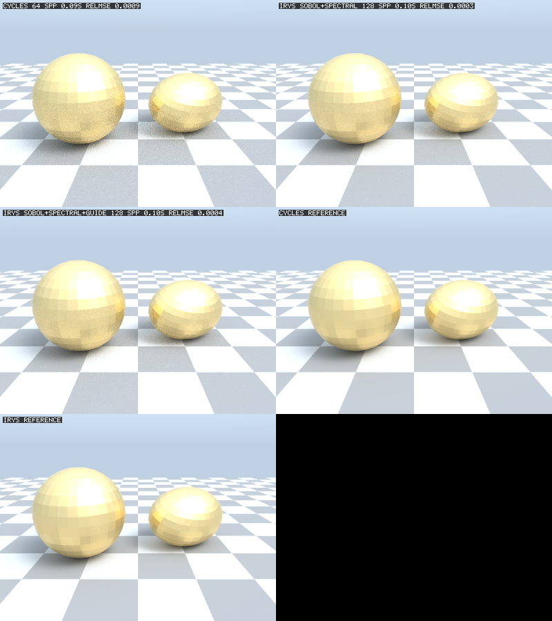
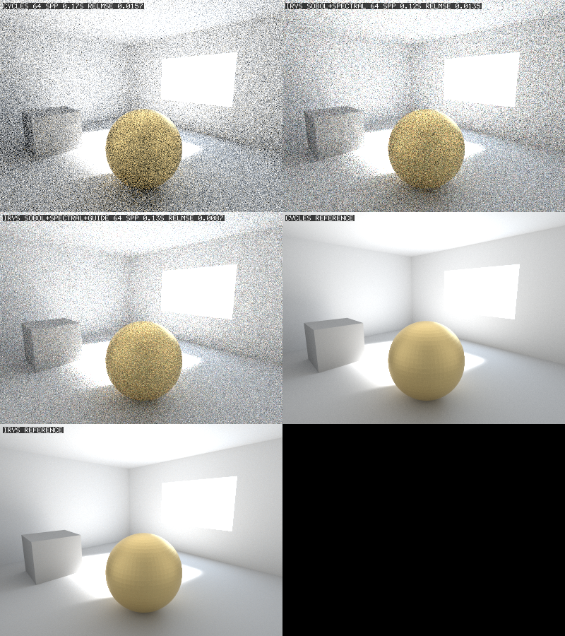
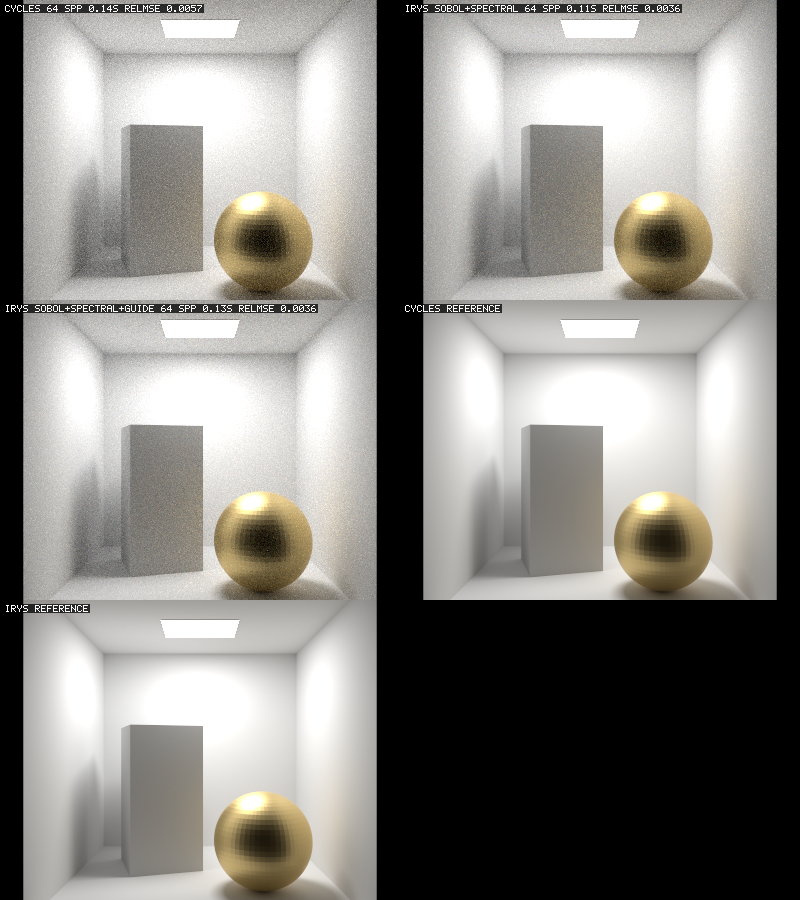

(`irys-bench report --prefix speed2 --variants sobol+spectral,sobol+spectral+guide`.)

**Gate verdict: met on room and cornell at every budget; missed on pair
at the largest budget (1.09).** Eight of nine budgets are below 1, cornell
by 0.71 at its largest; pair is ahead at 0.39 and 0.78 and 9 % behind at
0.73 s.

**Next lever (not started): pair's time per sample and its error per
sample.** At 1024 spp pair's relMSE is 4.2e-5 against Cycles' 4.0e-5 (level
per sample), and irys takes 0.75 ms against 0.71; the 1.09 is those two
5 % gaps multiplied. What is left of pair's frame is `bounce`: the sampler
is now 0.05 ms/spp and the per-call floor under 0.01, so the ~0.7 ms is
the trace (≈ 0.2 at the microbenchmark's 2.4 G rays/s on pair) and
shading and path state — every kernel loads and stores the 128-byte
`Path` per bounce, and scoring rebuilds each path's wavelengths
(`path_lambdas`: a Sobol draw and four 8-step CDF searches per path per
call). Slimming `Path` (the state that is dead past a diffuse vertex) and
keeping the wavelengths from `gen` for scoring are the two named
candidates; on the error side, pair is the one scene where guiding hurts
(1.32), so a cheaper guided variant is not the answer there.

### Round 3: slim `Path`, stored wavelengths, the sun share (2026-10-18)

Three commits on `claude/speed3`, then the re-bench:

| piece | commit | what |
|---|---|---|
| 1 | slim `Path` | `smp.xyz`, `ldir`, `lkind` (read only by `update`, only for a path with lane bits) move to a cold buffer of two `vec4`s per path that `bounce` writes at a conductor vertex; the MIS pdf keeps a scalar field. 128 → 96 bytes |
| 2 | stored wavelengths | `gen` writes each path's four wavelengths to a frame-sized buffer; `bounce`, `update`, `scatter`, `score` and `lane_adjoint` read them there. `Path` drops `lam`: 96 → **80 bytes**; scoring no longer redraws a Sobol point and runs four CDF searches per path |
| 3 | the sun share | `Env::pick` (default ½, as before) and `Env::pick_by_peak`: NEE's share of the sun lobe by peak radiance, sun against the gradient's peak (pair 0.94, room 0.999). The bench's `sun` feature |

**Path and bounce** (frame ms/spp at 256 spp, fastest of 4 × 3
interleaved; the frame is `bounce` but for ≈ 0.03 ms of scoring and
floor): pair 0.744 → 0.694 (piece 1) → 0.695 (piece 2), room 2.01 → 1.94
→ 1.82, cornell 1.74 → 1.68 → 1.67. Piece 1 is not bit-identical to
round 2: pixels differ by ≤ 6e-7 relative (the Metal compiler contracts
`update`'s arithmetic differently once the loads change), and replay,
rerun, chunking and CPU agreement are unchanged. Piece 2 is bit-identical
to piece 1 on every sweep image of all three scenes and three variants.
Packing `tp` into f16 or octahedral directions was not tried: the 48
bytes left are throughput, radiance and the ray, which the CPU-agreement
tolerances and replay would feel.

**Scoring** (`irys-bench score`: image, loss and δL per lane over a
64-spp frame, fastest of 5 × 20): 0.052 / 0.054 / 0.060 → **0.023**
ms/spp (pair / room / cornell). The bench's renders call `score` + `accum`
only, so they gain about half that.

**Error per sample on pair.** The image is sun-lit, and half of NEE's
samples went to the uniform sphere for a sky gradient that a BSDF sample
finds anyway. relMSE at 512 spp, two to four seeds (spread < 1 %), against
the round 2 reference (0.7–0.99 measured with the upper-hemisphere sky
sampler below, ≈ 3 % under the uniform sphere at those shares):

| sun share | 0.5 | 0.7 | 0.8 | 0.9 | 0.99 | 1.0 |
|---|---|---|---|---|---|---|
| pair | 7.6e-5 | 5.6e-5 | 5.1e-5 | 4.7e-5 | 4.3e-5 | 4.2e-5 |

Room (guided, 256 spp): 1.9e-3 at ½, 9.9e-4 at 0.9, 8.7e-4 at 1. At 1024
spp the peak share takes pair from 4.2e-5 to **2.6e-5** (Cycles 4.0e-5)
and the room from 8.2e-4 to 3.4e-4 (guided: 4.8e-4 → 2.3e-4); cornell has
no environment and is unchanged. It is unbiased: the 4096-spp means agree
with the 32768-spp reference to 1e-5, and `tests/speed.rs` checks the
mean, CPU against device, and the gradient against central differences
under it. The peak ratio rather than 1 keeps sky NEE alive where there is
no sun (`sun_radiance = 0` gives 0). Two other candidates: an
upper-hemisphere sky sampler (pdf ∝ 0.15 + 0.25 z, exact) cut 9 % at a
½ share and ~3 % at 0.8, but its pdf jumps at the horizon, which the
interior term does not differentiate (the camera gate's c4 failed), so it
was dropped; and a luminance-importance map with alias tables, Cycles'
way, was not needed — this environment is analytic, and its lobe is
already sampled exactly. MIS stays the power heuristic.

`pick_by_peak` was **not the default** here (it is since phase 5a): as the default it trips two phase
2e gates measured at ½ — the camera gate's c4 (z −3.1; its
central-difference reference itself moves 7.4 → 11.6 → 14.1 across
rotation steps 0.0025 / 0.01 / 0.004 while the estimate stays at 11.0) and
the ID-buffer variance ratio at depth 2 (1.28 against its 1.3 floor, from
1.87: less NEE noise leaves the edge term less to win). Neither is a
bias; re-baselining them is Cam's call.

**Results.** Same protocol as round 2: raw times, fastest per level;
irys four sweeps × 2 reps; Cycles the fastest per level of every earlier
sweep and four more run here, interleaved with irys's (load average 7–15
from other sessions; pair's and room's Cycles 1024-spp time improved
slightly, room's budget is 2.005 s now). Time per sample, ms (64 / 1024
spp):

| scene | Cycles | sobol+spectral: round 2 → 3 | + sun | + guide + sun |
|---|---|---|---|---|
| pair | 0.71 | 0.75 / 0.75 → **0.69 / 0.68** | 0.69 / 0.68 | 0.76 / 0.75 |
| room | 1.96 | 1.93 / 1.92 → 1.78 / 1.78 | **1.76 / 1.75** | 1.94 / 1.94 |
| cornell | 1.44 | 1.68 / 1.67 → **1.62 / 1.61** | 1.61 / 1.61 | 1.92 / 1.90 |

irys now takes a sample faster than Cycles on pair (4 %) and the room
(11 %), 12 % slower on cornell.

Equal-time relMSE, irys / Cycles:

| scene | budget | Cycles | sobol+spectral | ratio | + sun | ratio | + guide + sun | ratio | round 2 best |
|---|---|---|---|---|---|---|---|---|---|
| pair | 0.089 s | 8.8e-4 | 3.1e-4 | 0.35 | 1.9e-4 | **0.21** | 2.8e-4 | 0.31 | 0.39 |
| pair | 0.219 s | 1.7e-4 | 1.2e-4 | 0.72 | 7.1e-5 | **0.42** | 1.0e-4 | 0.61 | 0.78 |
| pair | 0.729 s | 4.0e-5 | 4.0e-5 | 1.01 | 2.6e-5 | **0.64** | 3.2e-5 | 0.82 | 1.09 |
| room | 0.164 s | 1.6e-2 | 9.2e-3 | 0.58 | 3.7e-3 | 0.24 | 2.8e-3 | **0.18** | 0.43 |
| room | 0.534 s | 3.8e-3 | 2.7e-3 | 0.72 | 1.1e-3 | 0.28 | 8.1e-4 | **0.21** | 0.52 |
| room | 2.005 s | 9.5e-4 | 7.4e-4 | 0.78 | 3.0e-4 | 0.31 | 2.2e-4 | **0.24** | 0.52 |
| cornell | 0.141 s | 5.7e-3 | 2.5e-3 | **0.45** | 2.5e-3 | 0.45 | 3.1e-3 | 0.55 | 0.46 |
| cornell | 0.415 s | 1.3e-3 | 7.9e-4 | **0.60** | 8.1e-4 | 0.61 | 9.3e-4 | 0.71 | 0.63 |
| cornell | 1.474 s | 3.2e-4 | 2.2e-4 | **0.68** | 2.2e-4 | 0.68 | 2.4e-4 | 0.74 | 0.71 |

(+ sun is the same images as sobol+spectral on cornell; the 0.60 / 0.61
is timing.)


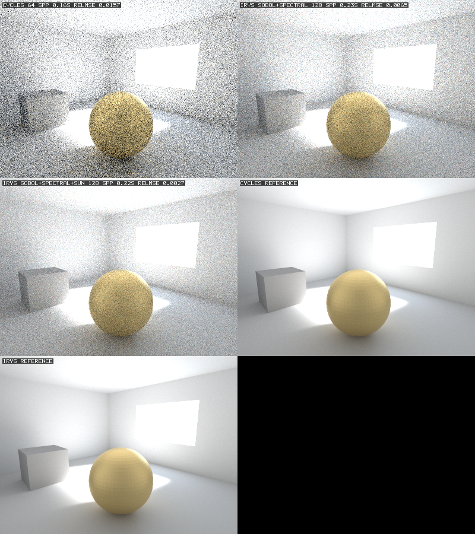


(`irys-bench report --prefix speed3 --variants sobol+spectral,sobol+spectral+sun,sobol+spectral+guide+sun --image-variants sobol+spectral,sobol+spectral+sun`.)

**Gate verdict: met at every budget on every scene** with the sun share
(worst 0.68, cornell at 1.47 s), and with the room guided. Without it,
speed alone brings pair's largest budget from 1.09 to 1.01 — level, not
below. The gate therefore rests on `sun`, which is opt-in until the two
phase 2e gates are re-baselined.

**Next lever (not started).** Make `pick_by_peak` the default once
those two gates are re-measured at it (more central-difference seeds for
c4; the variance-ratio floor). On speed, cornell is the slowest per
sample (1.61 against 1.44 ms): its `bounce` is the trace and diffuse
shading of eight bounces in a closed box, where `Path` traffic (80 bytes
× 2 per bounce) is no longer the named cost; a split diffuse/conductor
kernel (the conductor's stage, scan and scatter skipped for the paths
that cannot need them) is the next thing to measure there.

### Speed risks

1. **`EXPERIMENTAL_RAY_QUERY` is experimental** in wgpu 30 and needs the
   `ExperimentalFeatures` token in `irys-gpu`'s device request; the
   build/use ordering had to be enforced by hand (a wait after the BLAS
   builds). A wgpu upgrade should rerun `tests/speed.rs` first.
2. **Ties** between triangles at equal t resolve in the hardware's order,
   not by prim index. Deterministic on this device and covered by the
   replay and rerun tests; coplanar overlapping geometry would show it.
3. **Sustained throughput** on the closed scenes is 10–35 % below the first
   second's, on both walks; the bench reports raw times for that reason.
   Whether it is power management under the other sessions' load or
   intrinsic is not separated.
4. **The replay is compacted** since round 2 (`ggx::LaneAdjoint`); its δθ
   is summed in a different order than the IR's old reduction (≈ 1e-7
   relative), deterministic run to run.
5. The edge sampler and splats still walk in WGSL.
6. **Round 3's `Path` is 80 bytes** with conductor lane state in a cold
   buffer and wavelengths in a frame buffer that `gen` fills; a kernel that
   reads the wavelengths must run after `gen` of the same seed (scoring
   does). `Env::pick` is part of the estimator: CPU, device and the interior
   term must read the same share.

## Phase 5a: real scenes, the sun share by default (2026-10-18)

### 1. The sun share is the default

`Env::pick` is now `Option<f64>`: `None`, the default, is speed round 3's
share by peak radiance, recomputed from the current radiances
(`Env::sun_pick`); `Env::with_pick(p)` fixes it (`SUN_PICK = 0.5` is what
every earlier phase rendered with; the bench's `half` feature). Round 3
left two phase 2e gates failing under it. Both are the test, not the
estimator:

**The camera gate's c4** (z −3.1). Its four central-difference seeds
shared one 16² grid of fixed points per pixel, so their spread measured
the path noise but not where that one grid cuts the moving edges — the
term that made the reference "move with the step" (7.4, 11.6, 14.1 at
0.0025, 0.01, 0.004 rad). `camera_gate_reference_study` (ignored test)
gives every CD seed its own Cranley–Patterson shift of the grid, 16
seeds, steps × ½, 1, 2, 4 and the Richardson extrapolation of each pair,
against the estimate over 96 seeds:

| c4 (two boxes, depth 3 + NEE) | estimate | CD h/2 | CD h | CD 2h | CD 4h | Richardson (2h, 4h) |
|---|---|---|---|---|---|---|
| by peak (0.94) | 10.55 ± 0.28 | 8.46 ± 2.41 | 9.00 ± 2.01 | 10.40 ± 1.09 | 10.54 ± 0.59 | 10.35 ± 1.33 |
| ½ | 10.11 ± 0.39 | 8.83 ± 2.82 | 8.41 ± 1.99 | 9.39 ± 1.27 | 10.11 ± 0.77 | 9.15 ± 1.50 |

Every c4 cell agrees to |z| ≤ 0.9: the gate's ± 0.87 was a quarter of
the reference's real error at h = 0.004. The one parameter that leans is
the fov, c6, and it leans **at both shares**: the estimate is 146.98 ±
0.63 (by peak) and 147.04 ± 0.84 (½), the shifted reference 148–151, a
≈ 2 % gap that 2e already showed (145.4 vs 150.1) and that the share
does not move. The gate now shifts each CD seed's grid, takes 8 seeds,
and steps rotations by 0.008 rad, where the shifted reference is half as
noisy and its Richardson value agrees with it: c4 z +0.90, c6 −1.63, all
seven |z| < 1.7 (arm mask: all < 1).

**The ID-buffer variance ratio at depth 2** (1.28 against a 1.3 floor). A
ratio of two variances from 24 seeds each is good to about ± 25 % as a
geometric mean of three parameters. Over 96 seeds
(`visibility_ratio_study`): depth 1 1.81 / 1.66, depth 2 **1.50** / 1.95
(by peak / ½), every mean within |z| < 1.5 of the other importance. The
shaded ratio is lower at the peak share (less NEE noise leaves the edge
term less to win), not below the floor, and the gate draws 64 seeds now:
2.01 and 1.37.

Neither is a bias, so `pick_by_peak` is the default; the full suite passes
under it.

### 2. Scene import through Blender (`scripts/blend_export.py`, `blend.rs`)

`blender -b -Y file.blend -P scripts/blend_export.py -- <dir>` writes
`scene.glb` and `irys.json`; `irys_diff::blend::load` (feature `assets`)
reads them. glTF 2.0 plus a sidecar, as planned, but the glTF is written by
the script from the render-time depsgraph rather than by Blender's
exporter: that one does not keep particle or geometry-node instances as
shared meshes (the pavilion's 20 000 pebbles), has no area lights, and only
reads Principled factors, while both demo files are built from
Diffuse / Anisotropic / Mix graphs. The glb is standard (Y-up, one
primitive per material, a node per instance, a perspective camera); what
glTF cannot say is in the sidecar.

| | kept | dropped / approximated |
|---|---|---|
| geometry | meshes, curves and text as meshes, render subdivision levels, particle / collection / geometry-node instances (one tree per mesh × material, a placement per instance) | hair curves; per-ray visibility flags (a camera- and shadow-invisible emitter, a *light portal*, is folded into the sky instead) |
| materials | grey diffuse with the material's albedo, one GGX conductor θ (the conductor covering most placed triangles), one-sided emitters (a Backfacing mix keeps the emitting side) | colour (irys's albedo is a scalar: luminance kept), textures (averaged — and where the camera sees the material, replaced by Cycles' own Diffuse/Glossy Color passes, which fixed 20 of the classroom's 55 visible materials by > 0.1 albedo, e.g. leather 0.79 → 0.03), glossy coats over diffuse, anisotropy, bump / normal / displacement, glass and water (left out: no dielectric), alpha cut-outs (the pavilion's leaves), SSS (flagged, rendered diffuse), all conductors but one |
| lights | sun → the env lobe (κ = 2/r², same irradiance), area quad/disc, point/spot → emitter spheres; light node trees' Emission strength / Light Falloff | spot cones, blackbody tints, every emitter's own radiance (one shared radiance; dimmer emitters shrunk by √(L/L_max): same power, same place) |
| world | baked by Cycles to an equirect and fitted to `sky · (0.15 + 0.25 z⁺)` | its colour and shape (pavilion fit rel. rms 0.43), anything > 20× the median |
| camera | pinhole, sensor fit, aspect | depth of field, lens shift |

Units were calibrated in Cycles rather than assumed: sun strength is
irradiance, an area light's radiance P/(πA), a point light's P/(4π²r²) on
its soft radius, Emission strength is radiance.

### 3. Real scenes

Two files from blender.org's demo page, stored outside the repo with
an `ATTRIBUTION.md`: **classroom** (Christophe Seux, CC0, 70 MB zip) and
the **Barcelona Pavilion** (eMirage, CC-BY, 25 MB zip), both via
mirror.blender.org (download.blender.org/demo/test answers 403). Bistro is
not a blender.org file (NVIDIA ORCA, FBX). Barbershop is only on svn, so it
was not used.

| scene | instances | triangles (unique / placed) | lights |
|---|---|---|---|
| classroom (`_mainScene`) | 893 | 433 k / 1.23 M | sun, 7 point, 2 area, 3 emissive materials, a portal |
| pavilion (`1- time: midday`) | 20 722 | 198 k / 54.9 M (25 M after glass and leaves) | sun, sky texture + HDRI |

480 × 270, depth 8, references **32 768 spp** for both renderers (Cycles
146 / 344 / 119 / 66 s, irys 158 / 146 / 109 / 100 s), sweeps to 1024 spp,
otherwise phase 3's protocol (fastest of two per level, budgets at Cycles'
64 / 256 / 1024-spp times, each renderer against its own reference).

- **grey** (`<scene>-grey`, the clean bench): irys's import with every
  non-emitter grey Lambertian 0.8, exported by `irys-bench export` and
  rebuilt in Cycles instanced (geometry-node Instance on Points: linked
  duplicates cost 7 s of sync per render on the pavilion), the sun a lamp
  of the same irradiance and solid angle. One scene: reference means agree
  to 0.1 % (classroom 1.6847 vs 1.6858, pavilion 0.7229 vs 0.7216), cross
  relMSE 1.4e-3 and 3e-4.
- **true**: Cycles renders the .blend itself (`scripts/cycles_blend.py`),
  irys its import. The mismatch is the model, not noise: reference means
  0.33 vs 0.56 (classroom) and 0.34 vs 0.56 (pavilion), cross relMSE 26
  and 8.7. irys is brighter in both: the glass that Cycles renders (and
  that shadows, refracts and tints) is left out, the classroom's warm
  wood and leather are luminance only, the coats' energy is dropped
  into nothing rather than reflected, and the pavilion loses its water.

Equal-time relMSE, irys / Cycles (by-peak sun share, the new default):

| scene | budget | Cycles | sobol+spectral | ratio | + guide | ratio |
|---|---|---|---|---|---|---|
| classroom-grey | 0.78 s | 0.234 | 0.108 | **0.46** | 0.113 | 0.48 |
| classroom-grey | 2.50 s | 0.057 | 0.031 | **0.54** | 0.035 | 0.62 |
| classroom-grey | 9.30 s | 0.0143 | 0.0084 | **0.58** | 0.0095 | 0.66 |
| pavilion-grey | 0.44 s | 2.9e-3 | 5e-4 | **0.16** | 8e-4 | 0.27 |
| pavilion-grey | 0.95 s | 7e-4 | 3e-4 | **0.36** | 4e-4 | 0.54 |
| pavilion-grey | 2.49 s | 2e-4 | 1e-4 | **0.59** | 1e-4 | 0.85 |
| classroom (true) | 0.60 s | 0.160 | 0.208 | 1.30 | 0.132 | **0.83** |
| classroom (true) | 1.80 s | 0.113 | 0.069 | 0.61 | 0.047 | **0.41** |
| classroom (true) | 5.58 s | 0.021 | 0.020 | 0.96 | 0.013 | **0.63** |
| pavilion (true) | 0.34–3.84 s | ∞ / 31 / 2013 | 9e-4 / 3e-4 / 1e-4 | — | — | — |

Time per sample at 1024 spp: classroom-grey irys 4.4 ms vs Cycles 9.1 ms;
pavilion-grey 2.8 vs 2.4 ms. **The gate is met on both real scenes at every
budget in the equal-material bench** (worst 0.59). The true-material rows
compare different pictures: on the classroom irys converges faster to its
own (wrong-coloured, brighter) image; on the pavilion Cycles' sweep is
dominated by caustic fireflies through the glass and water (pixels up to
3·10⁴ at 64 spp, 3·10³ at 1024, against a reference max of 167; no
clamping by protocol), scenes irys does not render at all, so that row is
not a speed result.

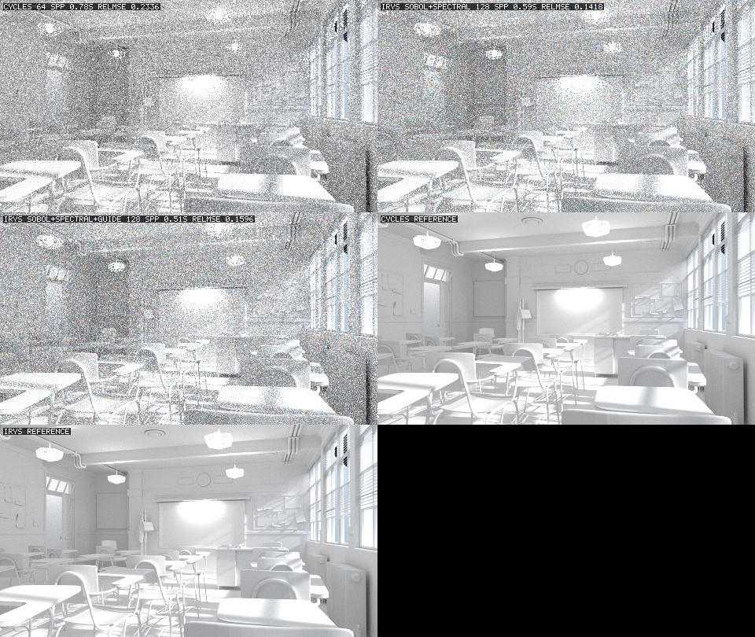
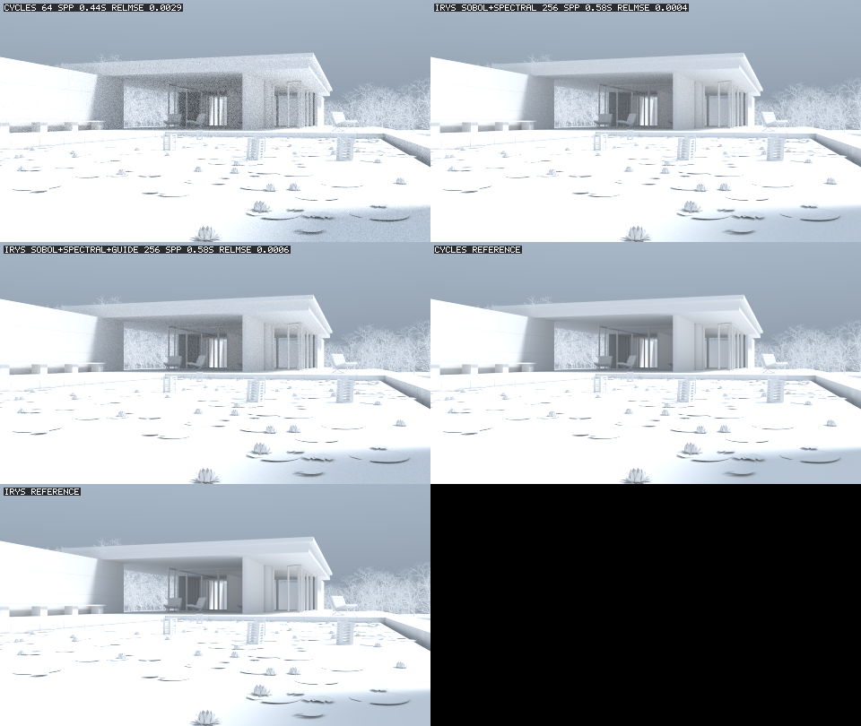
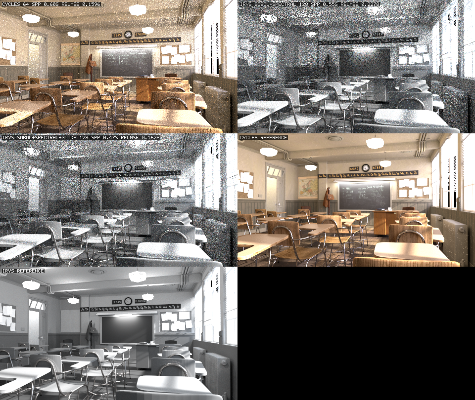
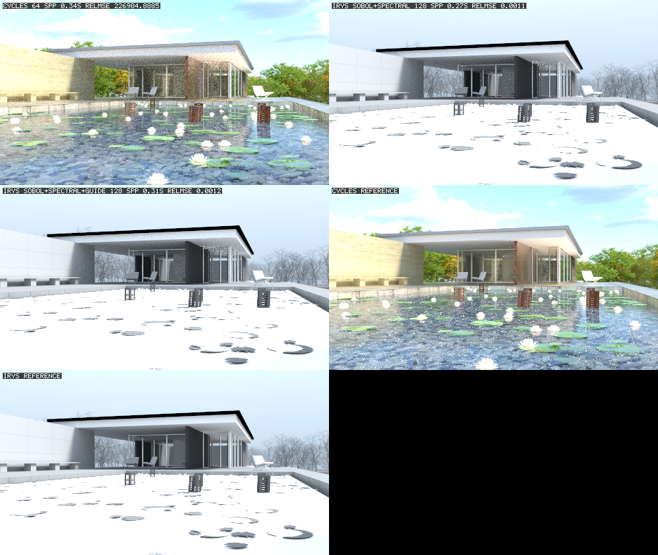

(`scripts/scenes_bench.sh classroom,pavilion`; each image Cycles at its
64-spp time, irys's two variants at their nearest levels, both
references, labelled.)

### Phase 5a risks and next

1. **The true-material gap is the look, not sampling**: glass/water
   (a dielectric), RGB albedo, coats and textures are phase 4's OpenPBR
   work (claude/look); until they land, the true bench measures different
   images and only the grey bench is a speed comparison.
2. **One emitter radiance, one conductor.** Shrinking emitters keeps power
   and position but sharpens their shadows and makes them harder to hit
   by BSDF sampling (the classroom's smallest is shrunk to 6 % of its
   size); per-emitter radiance and per-placement θ need device changes.
3. **Portals and visibility flags**: the classroom's daylight portal is
   folded into a sky of 8.3, which lights every opening, not only its
   window; per-ray visibility would be the faithful fix.
4. **The colour passes are view-dependent**: materials the camera does not
   see keep the reducer's estimate, which was off by > 0.1 for a third of
   the visible ones.
5. The pavilion's world fit is poor (rel. rms 0.43): irys's analytic sky
   cannot hold an HDRI; an environment map with alias-table sampling is
   needed for any real exterior.
6. Not verified: other demo files, mirrored instances' emitter sidedness,
   and timings were taken on a shared GPU (fastest of two per level).

## Phase 5b: the demo scenes with their own materials (2026-10-18)

Phase 5a rendered Blender's classroom and Barcelona Pavilion with irys's
phase-2 BSDFs (grey Lambertian, one conductor, one emitter radiance) and
so compared different pictures with Cycles. 5b renders them with OpenPBR
on the GPU, from each file's own camera, and redoes the true-material bench.

### 1. The exporter speaks OpenPBR (`scripts/blend_openpbr.py`)

`blend_export.py` (default `--look 1`) adds to each material record an
`openpbr` block, baked textures and what was approximated
(`dropped.openpbr` in the sidecar, with counts). Blender 4.4's Principled
BSDF maps 1:1 (base, metalness, roughness, specular IOR level and tint,
coat with tint/roughness/IOR and darkening 0 as Cycles has it, sheen →
fuzz, subsurface in Cycles mode, transmission, thin film, emission, alpha).
The older graphs the two files are built from map to the closest OpenPBR
material:

| Blender | OpenPBR |
|---|---|
| Diffuse(c) | base c, specular weight 0 (Blender's Diffuse has no specular) |
| Mix(k, Diffuse c, Glossy/Anisotropic g) | base c, metalness k, **metal colour g** |
| Mix(Fresnel / Layer Weight, D, G) | dielectric specular layer: colour g, IOR from the factor (Layer Weight blend b: 1/(1 − b)) |
| Glass / Refraction | transmission 1, colour, roughness, IOR |
| Add/Mix(Glossy, Transparent) | thin-walled glass: straight-through transmission, shadow rays pass |
| Mix(image alpha, Transparent, X) | a cut-out (alpha-tested at 0.5 by camera, bounce and shadow rays) |
| Translucent(c), Add(Diffuse, Translucent) | thin diffuse translucency; an Add keeps both albedos whole |
| Emission(c, s), Blackbody | emission colour × strength (radiance), blackbody RGB at luminance 1 (Cycles normalises the same way) |

Three things OpenPBR does not name are added: a **metal colour** (OpenPBR
ties the metal's F0 to the base colour; a Blender Diffuse+Glossy mix is
exactly OpenPBR's metalness mix with the two slabs' colours apart),
**translucency** (thin diffuse transmission), and the **cut-out**.

Colours are evaluated as fields over the UVs, not averaged: an image
through Mix (all blend modes), RGB Curves, Hue/Saturation/Value,
Bright/Contrast, Gamma, Invert, Color Ramp, Math and Mapping (scale,
location) is baked into a PNG (≤ 1024², sRGB) the kernel samples on the
mesh's UVs (glTF `baseColorTexture` + `KHR_texture_transform`; the metal
colour and the cut-out are named in the sidecar). Inputs that do not
depend on the UVs become constants: an object-random colour ramp its mean
over [0, 1], an Attribute 0.5, a Noise/Wave texture 0.5. Where such a
constant decided a camera-visible diffuse colour, Cycles' Diffuse Color
pass (5a's measurement) rescales it (factor clamped to [1/3, 3]).

Lights keep their colour (blackbody tints included) and their camera
visibility, spots their cone. Portals are kept as geometry that only
bounce rays see and shadow rays pass, emitting their own Sky Texture
(baked equirect, looked up at the reflected direction as Blender's
Texture Coordinate › Reflection does) through the material's RGB Curves
and HSV. The world is baked to a 1024 × 512 equirect. `--frames a:b` and
`--reel fps:a:b` write the file's camera per frame (the second resampled
with subframes).

One 5a bug surfaced: the exporter used the viewport depsgraph, which shows
a particle emitter whose render hides it. The pavilion's lotus emitter, a
plane over the whole pool with the lotus-leaf material, was exported (and
rendered by 5a's irys); `show_instancer_for_render` is now copied before
the depsgraph is built.

Coverage (counts of materials; the sidecar lists them):

| still dropped | classroom (79) | pavilion (21) |
|---|---|---|
| bump / normal maps | 37 | 4 |
| displacement | 7 | 2 |
| UV-free inputs as constants (Attribute, Object Info, Noise, Wave, group inputs) | 35 | 6 |
| roughness textures (their mean) | 9 | 0 |
| Layer Weight Facing read as Fresnel | 0 | 8 |
| volume outputs | 0 | 1 (lotus leaves) |
| ray visibility flags other than portals and lights | 13 objects | 0 |
| depth of field | 1 | 0 |

### 2. Full scenes on the GPU (`look::scene`, `look::scene_gpu`, `scene.wgsl`)

`look::scene::load` reads the export into plain data: a mesh per (glTF
mesh, primitive) with normals and UVs, instances, materials, 8-bit sRGB
textures, the world equirect, the sun, and every other light as emitter
geometry of its own material (quad, 48-gon disc, UV sphere, a spot's
cone). `look::scene_gpu::GpuLook` uploads it and `scene.wgsl` renders it:

- **Geometry**: one triangle BLAS per mesh, one TLAS instance per
  placement (the instance's custom data indexes its record: first
  triangle, material, first emitter). Instance masks are per-ray
  visibility: geometry `0x1`, portals `0x2` (bounce rays only), lights the
  camera does not see `0x4`, lights it does `0x8`; shadow rays see geometry
  only (Cycles' lights do not occlude). Cut-outs, thin glass and constant
  opacity are non-opaque triangles: the traversal alpha-tests a candidate
  against its texture, and a shadow ray multiplies thin glass's
  straight-through transmission and `1 − opacity` instead of stopping.
- **Materials**: one record of 20 vec4 per material (OpenPBR's parameters
  with colours on the hats, flags, texture ids, UV transform, portal sky,
  spot cone), the albedo tables (`E_d(μ, r, η)` 32×32×33, metal ×3, the
  sheen LTC) in one buffer, textures in another, sampled bilinearly with
  wrap. The material code is look::openpbr's `At::new` + `columns` +
  `graph::stack`, `lobe_weights`, `pdf` and `sample`, written out in WGSL
  with irys's three additions; subsurface is a Lambertian of the
  subsurface colour (no random walk in full scenes: neither file uses it).
- **Wavelengths**: four hero wavelengths per path. Lobes are picked by
  weights averaged over the four (the hero's alone gave a green leaf at a
  blue hero `f/p` without bound), and every contribution is divided by the
  mean of the four wavelengths' path densities (spectral MIS over whole
  paths, Wilkie+ 2014), so a dispersive near-delta refraction carries the
  hero ×4 and the rest ~0, unbiased. Where the index does not depend on
  the wavelength (no dispersion, no film: every material in both files)
  the four lanes share one evaluation with the colours as vec4.
- **Lights**: NEE picks the sun (uniform cone), the world (equirect
  importance sampling, marginal × conditional CDF), an emitter triangle
  (CDF by area × luminance, each with its own RGB radiance) or a portal
  triangle, by shares estimated from their irradiance at a reference
  distance (floor 5 %); MIS against the BSDF everywhere. A thin-glass or
  portal pass is not a vertex: the light sample through it was the
  previous vertex's.
- **Shading normals** that leave the viewer at a grazing angle are bent
  toward the geometric normal until it is ≥ 0.1 above them (Cycles'
  `ensure_valid_specular_reflection` has the same aim). Without it the
  pavilion's trees, whose normals are bent outward for foliage shading,
  made fireflies of 4·10³ through the leaves' Fresnel layer.
- **Determinism**: one dispatch per sample, chunks of 2¹⁶ pixels, each
  thread owning its pixel's accumulator; the frame's mean spectrum (40
  bins) is summed per workgroup in lane order into the workgroup's own
  slots, no float atomics. Two runs are bit-identical.

It is a megakernel like `skin.wgsl`, not the phase-2 PRB wavefront with
material binning: the kernel is forward only, there is no `θ` to replay,
and a wavefront would carry four 25-float material states per lane
through memory between stages. The conductor wavefront, its replay and
`gpu.rs` are untouched, and every existing test passes
(`cargo test --release -p irys-diff --features gpu,assets`). Volumes are
not on this path (the lotus leaves' volume output is dropped).

| Gate (`tests/look_scene.rs`) | Result |
|---|---|
| device material vs look::openpbr's f64 `At` (4000 lanes, 24 random materials: coat, fuzz, film, transmission, dispersion, inside/outside) | `f` 8.7e-5, pdf 8.7e-5 rel; lobe weights ≤ 2.7e-3 abs; 8 lanes over tolerance |
| white furnaces under a world of 1: diffuse, smooth white metal, smooth glass, dispersive glass (V 20), thin glass, half opacity, diffuse + separate metal colour, diffuse + translucency | 0.9985 … 1.0005 (± ≤ 0.0012) |
| four-lane path vs per-lane path, random materials | mean \|Δ\| / mean 4e-9 |
| a frame twice / another seed | bit-identical / different |

### 3. Beauty renders (`examples/blend_look`, `scripts/cycles_look.py`)

1920 × 1080 from each file's own camera, max_bounces 7, 4096 spp, **no
denoising** (irys has no denoiser on this path), Standard view. Cycles
renders the .blend itself with Metal, the export's camera and size, a box
filter, no adaptive sampling or clamping, once with OIDN off and once on.
Shared machine (another agent's GPU work alongside), single runs.

| scene | irys 4096 spp | Cycles 4096, OIDN off | Cycles 4096, OIDN on | frame mean irys / Cycles |
|---|---|---|---|---|
| classroom | 663 s (12.8 Mpaths/s) | 340 s | 379 s | 0.355 / 0.332 (+7 %) |
| pavilion | 834 s (10.2 Mpaths/s) | 266 s | 267 s | 0.334 / 0.346 (−3 %; OIDN 0.301) |

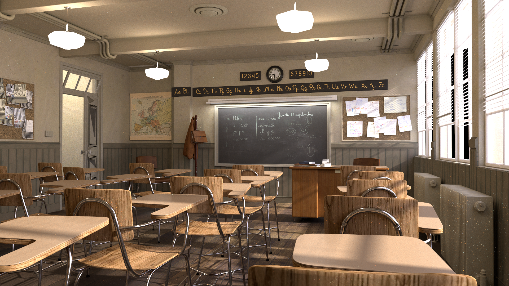
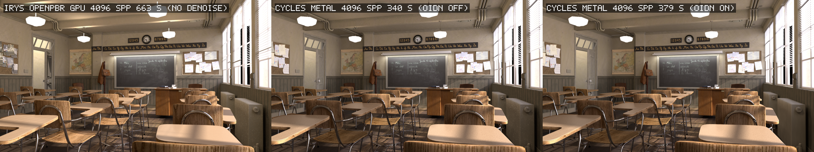
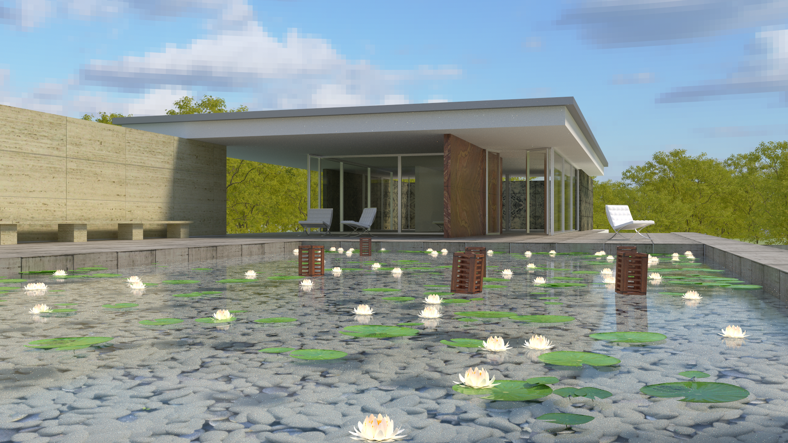
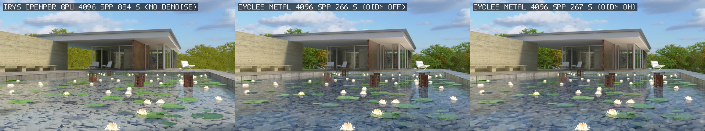

Cycles is 2–3× faster per sample here. What still differs, by eye: the
pool has no ripples and so no sky in it (the water's bump map is dropped;
Cycles' wavy normals put sky reflections across it), irys's pebbles are
lighter (their per-object random colour is a ramp mean), the trees are a
little yellower (the same), and the classroom's bump-mapped wood and paint
are flatter. The first pavilion render had one pixel of 3·10²³ (one path
through a vanishing f32 pdf); the kernel now drops any path whose radiance
exceeds 10⁹, and the frame above is the re-render.

### 4. True-material bench (`scripts/demos_bench.sh`, `examples/look_bench`)

Phase 3's protocol (480 × 270, max_bounces 7, 32768-spp references for
both, sweeps to 1024 spp, fastest of two, each against its own reference,
budgets at Cycles' 64/256/1024-spp times). First the sanity check, which
5a failed (cross relMSE 26 and 8.7):

| scene | reference mean RGB, Cycles | irys | cross relMSE (irys ref vs Cycles ref) |
|---|---|---|---|
| classroom | 0.401 0.322 0.276 | 0.441 0.343 0.282 | **0.70** (5a: 26) |
| pavilion | 0.300 0.352 0.381 | 0.290 0.346 0.366 | **0.28** (5a: 8.7) |
| pavilion, indirect clamp 10 | 0.240 0.299 0.342 | 0.248 0.309 0.342 | **0.066** |

The pictures now largely match: the means agree to 1–10 %, and the cross
relMSE fell 37× and 31×. They are not yet the same picture, so the
equal-time numbers below are still partly a model comparison. The
remaining causes: bump and normal maps (37 of the classroom's 79
materials, the pavilion's water), UV-free inputs as constants (35 in the
classroom; the Cycles colour-pass rescale fixes only the camera-visible
means), the red-heavy excess in the classroom (+10 % red: the wood and
leather textures after their colour chains and the blackbody lamps), and
the pavilion's water ripples. The unclamped pavilion's Cycles reference
and sweep are dominated by caustic fireflies through the water (Cycles
relMSE up to 2·10⁵ against its own reference), so only the clamped row is
a speed result there.

| scene | budget | Cycles relMSE | irys relMSE | ratio |
|---|---|---|---|---|
| classroom | 0.41 s | 0.160 | 0.358 | 2.24 |
| classroom | 1.24 s | 0.113 | 0.392 | 3.46 |
| classroom | 6.22 s | 0.021 | 0.036 | 1.71 |
| pavilion | 0.38 / 1.26 / 5.70 s | 2.3·10⁵ / 31 / 2013 | 1.65 / 0.63 / 0.31 | — (fireflies) |
| pavilion, clamp 10 | 0.37 s | 0.0104 | 0.207 | 20 |
| pavilion, clamp 10 | 1.10 s | 0.0025 | 0.077 | 30 |
| pavilion, clamp 10 | 4.32 s | 0.0006 | 0.019 | 31 |

**irys loses at equal time on true materials**, 1.7–3.5× on the classroom
and ~30× on the clamped pavilion. At 1024 spp irys takes 8.6 s / 17–19 s
where Cycles takes 6.2 s / 4.3–5.7 s, and per sample it is noisier: this
kernel has none of phase 3's machinery (Sobol, spectral importance,
ReSTIR, guiding), uniform random numbers, and a light pick by fixed group
shares rather than a light tree; the pavilion adds 54.9 M instanced
triangles and cut-out foliage, whose alpha test runs in the traversal for
every candidate. The grey bench of 5a (irys 0.16–0.59 of Cycles' error)
measured the phase-2 wavefront, which those samplers sit in; moving them
into the OpenPBR kernel is the next step.

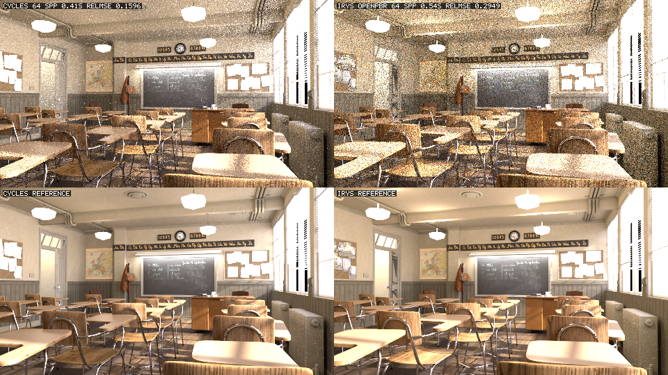


### 5. Reel sequences (`scripts/reel.sh`, `scripts/reel_cameras.py`, `examples/reel`)

1920 × 1080, 30 fps, JPEG q92, outside the repo in
`irys-assets/reel/frames/<sequence>/`, with `frames.json` per sequence and
`reel/manifest.json` (path, frames, fps, caption, credit, and per frame the
mean spectral radiance in 40 bins over 380–780 nm: for the OpenPBR scenes
the kernel's per-workgroup spectrum over every pixel and sample; for the
prb and skin sequences the device's per-lane `L` at the lanes' own
wavelengths, from a 240 × 135 pass of the same frame).

Planned: `classroom-keyframed` (the file's animated renderCam, frames
1–145 at 25 fps resampled to 174 frames at 30 fps), `pavilion-dolly` and
`pavilion-orbit` (the midday camera does not move: authored 5 s moves),
`fit` (phase 2b's trajectory), `rose` (phase 2f's 600-step run), `head`
(a 50° orbit with hair), `swatch` (five OpenPBR parameters swept under the
pavilion's sky). **Written: classroom-keyframed only** (174 frames, 64 spp,
8.4 s a frame, 347 MB). The run stopped itself before the next sequence:
the shared disk fell to 13 GB free, under the 15 GB floor. `scripts/reel.sh
pavilion-dolly,pavilion-orbit,fit,rose,head,swatch` resumes it.

### Phase 5b risks and next

1. Bump/normal maps are the largest remaining look gap; a height-field
   bake to a tangent-space normal map is the obvious next exporter piece.
2. The OpenPBR kernel needs the phase-3 samplers (Sobol + spectral IS) and a
   light tree before the true-material bench is a fair speed comparison.
3. The kernel is a megakernel; material binning was not built, so
   divergence costs are unmeasured.
4. SSS in full scenes is Lambertian; volumes are not on this path.
5. Timings are single runs on a GPU shared with another agent's work.

## Speed round 4: the OpenPBR kernel on true materials (2026-10-19)

Phase 5b left the full-scene kernel (`look/scene.wgsl`) losing at equal
time on true materials: classroom 2.24 / 3.46 / 1.71, clamped pavilion
20 / 30 / 31, and 2–3× slower per sample at 1080p. Five commits on
`claude/speed4`:

| piece | commit | what |
|---|---|---|
| 1 | profile | device counters and ablations behind `Opts::prof`, `examples/look_profile` |
| 2 | phase 3's samplers | Sobol 4-tuples, film-response wavelengths, the sun share by peak (`Opts::samp`) |
| 3 | light tree | `look::light_tree` over emitter clusters; two light fixes; path regeneration |
| 4 | megakernel kept | the numbers against a wavefront; alpha-only fetch; fewer waits |
| 5 | guiding | `gpu/guide.wgsl` in the kernel, a salted scramble, off under 256 spp |

**The machine was shared throughout** (another agent's `recon_v1` at
100–1000 % CPU and on the GPU, two vcad benches). Per-sample times moved
by up to 1.6× between runs of the same binary: the kernel that took 8.4
ms a sample at 480 × 270 when this round began took 12–14 ms during the
final bench. Every timing below is fastest-of-N and interleaved, and
irys was slowed more than Cycles (Cycles' times are within 15 % of 5b's).

### 1. Where the time went (480 × 270, 7 bounces, before any change)

| | classroom | pavilion |
|---|---|---|
| ms per sample | 8.4 | 14.7 |
| camera ray + its vertex (bounces 0) | 11 % | 14 % |
| per further bounce | ≈ 1.1 ms | ≈ 1.5 ms |
| NEE (all of it: pick, eval, shadow) | 29 % | 32 % |
| of it, shadow rays | 17 % | 23 % |
| material evaluation (Lambertian ablation) | 2.5 % | 19 % |
| alpha test in traversal | 1 % | 16 % |
| rays per path: continuation / shadow | 5.74 / 1.24 | 3.21 / 3.21 |
| non-opaque candidates per path: closest / shadow | 0.02 / 0 | 1.68 / 0.72 |
| SIMD occupancy by iteration 0, 1, 2, 3, 4, 5, 6 | 1.0 .97 .90 .85 .81 .77 .73 | 1.0 .97 .81 .72 .49 .41 .33 |
| distinct material classes per SIMD group (iterations 1–6) | 2.0–2.1 | 2.6–3.3 |
| vertices by class | diffuse 62 %, metal 38 % | diffuse 46, transmissive 25, fuzz/thin 13, both 10, metal 6 |

There was no one stage to fix. The classroom spent its time evenly per
bounce, a third of it in NEE, and its NEE was mostly wasted: 84682
emitter triangles picked by an area × luminance CDF gave a usable light
sample (facing, above the surface) at only 1.24 of 5.8 vertices. The
pavilion lost about a third of its SIMD lanes past bounce 3 to paths that
had ended, and paid 16 % for alpha-testing foliage and 19 % for its mix
of glass, water and leaves.

### 2. Phase 3's samplers

Burley's shuffled Owen-scrambled Sobol from `qmc::byte_tables` (camera:
wavelength + jitter; per vertex: NEE, then the light's fifth draw + the
BSDF's three), hero wavelengths by `qmc::Spectral`'s film-response CDF
with each lane over its density, and the sun/world NEE split by peak
radiance (round 3's share, capped to [0.1, 0.9]: uncapped, the world's
rare NEE samples made a heavy tail). Equal-spp relMSE against irys's own
references, one run each:

| | 64 spp | 1024 spp |
|---|---|---|
| classroom, hash + uniform λ | 0.379 | 0.0296 |
| classroom, Sobol + spectral | **0.109** | 0.0251 |
| pavilion clamp 10, before | 0.073 | 0.0046 |
| pavilion clamp 10, all three | 0.059 | 0.0037 |

No measurable time per sample (Sobol's draws are cheaper than the 64-bit
hash: 5 %). `samplers_are_unbiased`: frame means agree (|z| < 2).

### 3. The light tree, two light bugs, path regeneration

`look::light_tree`: a binary tree over clusters of ≤ 8 emitter triangles,
binned SAOH splits (Conty Estevez & Kulla 2018, Cycles' shape), each
child's centre, power, orientation cone and half-diagonal stored in its
parent so a step is one read, and a receiver-normal bound where only
reflection reaches the eye. Every triangle keeps its path as bits so a
BSDF hit's pick probability is evaluated for MIS. Below the first level
the traversal draws fresh bits from a hash chain: rescaling one u down
15+ levels left a few bits, and a branch whose probability was below that
resolution was picked far more often than its probability.

Checking the tree against the CDF found **two bugs in 5b's lights**, not
in the tree: sphere lights emitted from both sides, so NEE, whose shadow
rays lights never block, saw the far side's inner face through the near
one, twice what a BSDF ray (which stopped at the near side) saw; and
bounce rays stopped at any light's geometry while shadow rays passed it.
The MIS mix of the two strategies then depended on how lights are picked,
and the tree rendered the classroom 2 % brighter than the CDF. Lights now
emit outward, and every ray collects a light's emission and goes on
(Cycles: lights block nothing). The classroom's mean moved toward
Cycles' (red 0.441 → 0.431; Cycles 0.401) and its irys reference was
re-rendered. CDF and tree now agree to 2·10⁻⁴.

| classroom, equal spp | 16 | 64 | 256 | 1024 |
|---|---|---|---|---|
| CDF | 0.644 | 0.127 | 0.067 | 0.0265 |
| tree | 0.483 | 0.095 | 0.060 | 0.0252 |

The tree doubles the usable light samples (shadow rays per path 1.24 →
2.45) and costs 13 % (interleaved profile) to 28 % (sweeps) per sample:
a wash at equal time at small budgets, a small loss at large. It is on by
default (`samp::LIGHT_TREE`), since the classroom is the one scene with
many lights and the tree's advantage grows with their number.

**Path regeneration** (`Opts::regen`, default 16): each thread renders 16
of its pixel's samples back to back in one dispatch, a finished path
starting the next at once, so a SIMD group runs until its last path ends
rather than its longest per sample. The paths are the same (generator and
Sobol index per sample: `regeneration_is_a_schedule`), the frame
deterministic; the spectrum is summed in fixed point. Interleaved: pavilion
13.1 → 9.8 ms per sample (−25 %), classroom 12.1 → 11.1 (−8 %); at 1080p
no change (enough pixels already fill the device).

### 4. The megakernel stays

Material evaluation is 2.5 % of the classroom's time and 19 % of the
pavilion's; perfect binning of the pavilion's ~3 material classes per
SIMD group would save at most about two thirds of that, ~10 %, while a
wavefront would move ~35 floats of four-lane path state (throughput,
spectral MIS q, radiance, wavelengths, ray, MIS vertex and normal,
generator) through memory between stages, ~0.4 GB per sample at 480 × 270
— about what binning would save. The loss the profile did show, lanes
idle past bounce 3, regeneration recovers inside the megakernel. Also
here: the traversal's alpha test reads alpha alone (no colour, no sRGB
decode; its share of the pavilion 9–12 % → 6–8 %), and `render` waits on
the device every eighth dispatch group.

### 5. Guiding

Phase 3's `gpu/guide.wgsl` is included as is (`params.` → `P.`): a grid of
16 cells along the scene's longest side × 6 normal axes, a 16 × 16
equal-area histogram per cell of the BSDF strategy's radiance in 64-bit
fixed point, built into CDFs with 10 % uniform. At an opaque reflective
vertex on the four-lane path the kernel draws from the guide with
probability mix × the diffuse lobe's share, and the mixture density is the
BSDF strategy's pdf for every MIS weight. The frame's first quarter of
samples trains, the guide rebuilt after each sample group.

With one Sobol scramble across a pixel's samples a guided frame was
1·10⁻⁴ bright (z 4 over 40 seeds; z 0 with the hash generator): later
samples' points were correlated with the guide earlier samples trained.
The scramble is now salted per training group and for the rest of the
frame (`guiding_is_unbiased`). A guide trained on 16 samples made more
fireflies than it removed (classroom 64 spp, 4-seed mean relMSE 0.27 vs
0.23), so guiding acts only from 256 spp (`GUIDE_MIN_SPP`): 256 spp
−13 % (4 seeds), 1024 spp −27 %. The pavilion's bounds are mostly sky and
far trees, and it is not guided.

### 6. Re-bench: true materials, equal time

5b's protocol and Cycles references (480 × 270, 7 bounces, 32768-spp
references, sweeps to 1024 spp, each renderer against its own reference,
budgets at Cycles' 64 / 256 / 1024-spp times). The Cycles sweeps were
re-run alongside irys's: three interleaved rounds, fastest per level.
The irys classroom and clamped-pavilion references were re-rendered (the
light fixes; the clamped estimator moves with the sun share).
`irys s4` is every piece but guiding; `+ guide` adds it (mix ½).

| scene | budget | Cycles | irys s4 | ratio | + guide | ratio | 5b ratio |
|---|---|---|---|---|---|---|---|
| classroom | 0.48 s | 0.160 | 0.143 | **0.89** | 0.173 | 1.08 | 2.24 |
| classroom | 1.37 s | 0.113 | 0.186 | 1.64 | 0.159 | **1.40** | 3.46 |
| classroom | 5.44 s | 0.021 | 0.093 | 4.44 | 0.058 | **2.75** | 1.71 |
| pavilion, clamp 10 | 0.30 s | 0.0104 | 0.141 | 13.6 | — | | 20 |
| pavilion, clamp 10 | 1.34 s | 0.0025 | 0.037 | 14.8 | — | | 30 |
| pavilion, clamp 10 | 3.95 s | 0.0006 | 0.0107 | 17.2 | — | | 31 |
| pavilion (unclamped) | 0.36 / 1.33 / 4.17 s | 2.3·10⁵ / 31 / 2013 | 1.72 / 0.53 / 0.13 | — | | | — |

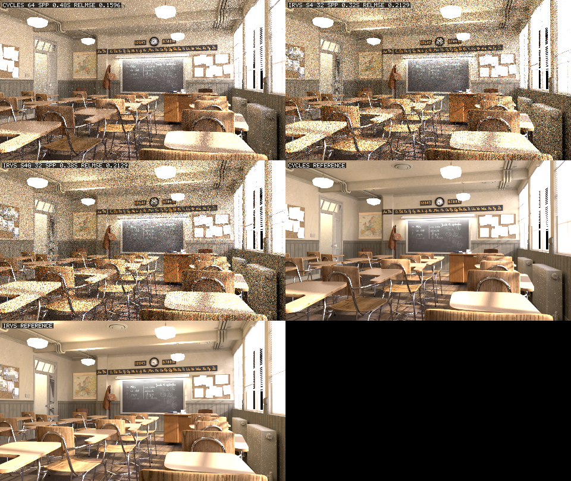
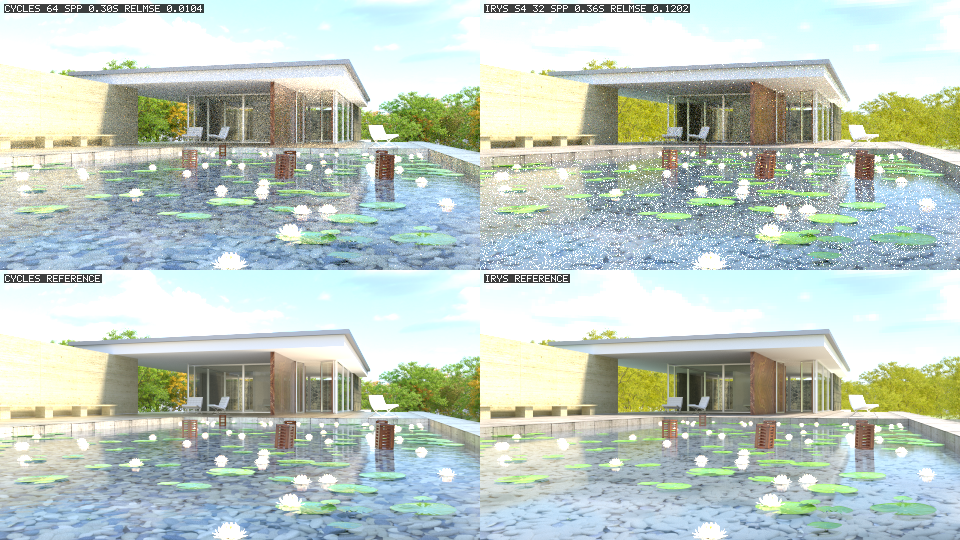

Read with three cautions. The classroom references are a different
picture from 5b's (the light fixes), so its 5b column is not the same
comparison. relMSE here is a firefly count: the 20 worst pixels are 50–87 %
of the error for **both** renderers (Cycles' classroom at 128 spp: 81 %),
so a single run's curve is not monotone (irys at 128 spp 0.25, at 256
0.06). And irys's times were taken under load: at 1024 spp it took 12–14
s on the classroom against 8.7 s for the same work when the machine was
quieter. Per sample, interleaved at 256 spp, this round against 5b's
kernel: classroom 12.0 → 15.3 ms (+28 %: twice the usable shadow rays,
the tree, lights no longer ending paths), pavilion 16.5 → 13.7 ms (−17 %).

**1080p time per sample** (the files' cameras, 7 bounces, interleaved;
Cycles at 64 spp in Blender, irys at 32 spp):

| | Cycles | irys (5b) | irys (round 4) |
|---|---|---|---|
| classroom | 86 ms | 162 ms | 216 ms |
| pavilion | 86 ms | 204 ms | 191 ms |

(5b measured Cycles at 83 and 65 ms on a quieter machine.)

**Gate verdict: not met.** The classroom is at or near parity at Cycles'
64-spp budget (0.89 unguided, 1.08 guided) and 1.4–2.75× behind above it,
where its error per sample is now Cycles' (at 1024 spp: guided 0.018,
unguided 0.025, Cycles 0.021) and the whole gap is time per sample (irys
2.5× Cycles' under this load). The clamped pavilion improved from 20–31×
to 14–17× but stays far behind: per sample its error at 1024 spp is 6×
Cycles' (0.0035 against 0.0006), and its sample is 2.2–3× slower.

### Speed round 4 risks and next

1. **The next lever is the pavilion's error per sample (6× Cycles' at
   equal spp)**, not its speed: no sampler in this round moved it more than
   25 %. An error map by path type (direct sun on foliage, the water's
   caustics under the clamp, glass, sky through leaves) on the clamped
   pavilion should say where; Cycles' indirect clamp (per path, by the
   maximum channel) differs from irys's (per contribution, per lane),
   which changes which paths are clamped.
2. The classroom's gap is time per sample (5.3 ms for Cycles at 480 × 270
   against 11–15 for irys). NEE with its shadow ray is ~40 % of a bounce;
   the tree's traversal is 13 % of the frame. A cheaper tree (wider nodes,
   quantised bounds) or lighter NEE at glossy-free diffuse vertices is next.
3. All timings were on a shared, loaded machine; the ratios should be
   re-measured on a quiet one before they gate anything.
4. relMSE is dominated by a few dozen fireflies per frame in both
   renderers; a firefly-robust companion metric (relMSE with the top 0.1 %
   of pixels trimmed, or several seeds) would make these tables steadier.
5. The light tree does not include the sun, the world or portals (fixed
   group shares still pick between them).

## Open questions

- **Name.** `irys` is a placeholder; check crates.io before step 4.
- **f64 vs f32.** kosm-render is f64 on CPU, f32 on GPU. Keep it, or go
  `Scalar`-generic all the way (costs compile time)?
- **Spectral vs RGB.** vcad's photoreal path may be RGB. irys is spectral;
  RGB is a 3-band spectrum. Confirm vcad looks don't shift.
- **Where Camera lives.** irys owns the pinhole/thin-lens model; kosm's
  `Camera` lens wraps it. Equirect (muni's 360 camera) goes in irys.
- **Licence.** Match kosm's.

## Roadmap to Cycles parity (2026-10-17)

Each phase ends on a measured gate, not a demo.

| Phase | Work | Exit gate |
|---|---|---|
| 0 seed | split kosm-render into crates, reference CI | kosm builds on irys, snapshots byte-identical |
| 1 differentiable core | tang IR BSDFs, path replay backprop, hero wavelength | marble gradients match central differences, O(1) memory |
| 2 unified scene + wavefront GPU | 3DGRT splats + BRep + mesh in one BVH, vcad on wgpu 30 | CAD rover in a splat street; pose fit from a photo |
| 3 sampling | ReSTIR PT, neural guiding, NRC | equal-time error ≤ Cycles on classroom, bistro (2026-10-17: not met; equal-spp error ≤ Cycles, throughput 2.4–3.6× short — see Phase 3; after Speed: met on room, ahead at small budgets everywhere, 1.23–1.27× behind at the largest budget on pair and cornell) |
| 4 the look | OpenPBR, layering, volumes, SSS, hair | OpenPBR reference scenes match |
| 5 product | USD + .blend import, denoiser, RL batch lane | Blender demo files render; public bench vs Cycles (2026-10-18, 5a: classroom and the Barcelona pavilion import and render; equal-material equal-time relMSE 0.16–0.59× Cycles; true materials differ, see Phase 5a) |

muni lands after phase 2. Phases 1–2 are the research risk; 3–5 are
known techniques and a lot of engineering.

## The kernel contract

Every BSDF, texture, emitter and the denoiser is a tang IR graph, written
once and pure. The compiler lowers each graph three ways:

- `eval`: f and pdf
- `sample`: u → wo, **detached**. Sampling is never differentiated.
- `adjoint`: δf → δθ, from `TensorGraph::backward`

The integrator runs a forward pass that keeps only L per path, then a
**path replay** pass (Vicini+ 2021): same seed, same path, and at each vertex
δθ += δL · (L − L_so_far) · ∂f/∂θ, atomically added. Memory is
pixels × 1, not pixels × spp × depth. Visibility discontinuities are handled
by a separate reparam kernel (warped-area, Bangaru+ 2020).

Oracle: the f64 tang interpreter runs the same graph; every backend kernel is
checked against it and against central differences.

## The look: OpenPBR, position-free

OpenPBR's slab (fuzz, coat, thin film, base metal/dielectric, subsurface) is
evaluated by position-free Monte Carlo (Guo+ 2018): an unbiased random walk
between interfaces, each interface one tang IR BSDF. Spectral by default, so
thin film and dispersion are exact. Risk: replay through a walk of random
length must consume the RNG stream identically. Test that first.

## The film: KPN-driven adaptive sampling

Render a few spp → film keeps mean, variance and AOVs → KPN denoises and
predicts its residual error → the sampler puts the next spp where that error
is → repeat until the predicted error is under target. KPN and sampler train
together as one tang IR graph (nonlinear Noise2Noise, no clean references).

## Skin (2026-10-17)

A lifelike head, as a first instance of "the look" (phase 4) on the PRB
machinery: `irys-diff::skin`, additive to everything above (no change to
`prb`, `gpu.rs` or `wavefront.wgsl`). The subject is the Lee Perry-Smith scan
— "Lee Perry-Smith" by Infinite-Realities (ir-ltd.net), CC BY 3.0
(creativecommons.org/licenses/by/3.0), via the three.js examples — read from
`$IRYS_ASSETS/lee-perry-smith` (default `/Users/cam/Developer/irys-assets`)
and never copied into the repository. The renders below are of it.


### Method

- **Mesh and maps** (`skin::mesh`). The glb's first primitive (9 279
  vertices, 17 684 triangles, a bust) through `gltf` + `image` behind an
  `assets` feature; per-vertex tangents by Lengyel's method; bilinear,
  wrapped, linear-f32 textures (sRGB decoded for colour). Two facts about
  this file, both settled by the maps rather than by convention: its UVs
  run `v` *up* the image (read as glTF says, the lips land on the chin and
  the eyebrows on the neck; `load` flips them, `the_eyebrows_are_above_the_eyes`
  holds it), and its normal map is green-up (as a height gradient, the
  green-up reading is 2.26× closer to curl-free than green-down;
  `the_normal_map_is_opengl`). 1 unit = 50 mm (4.3 units nose to occiput).
- **The medium** (`skin::optics`). One homogeneous layer per entry point,
  per mm: `σa = s (m μa_mel + h μa_blood + μa_base)`, `σs = s μs'/(1 − g)`,
  Henyey–Greenstein `g = 0.8`. Measured constituents: melanosome absorption
  `51.9 (λ/500)^−3.5` and the average-skin reduced scattering
  `4.60 (0.409 (λ/500)^−4 + 0.591 (λ/500)^−0.562)` (Jacques 2013), whole
  blood from Prahl's HbO₂/Hb extinction at 75 % saturation, Jacques' bloodless
  baseline. One 1-nm table feeds CPU and GPU. `θ = (m-scale, h-scale, s, r₁,
  r₂)`.
- **Albedo → chromophores.** The map's colour is inverted per texel to
  `(m, h)`: the walk's own total albedo (below) through the similarity
  relation, times `1 − F̄` (the entry Fresnel, cosine-averaged), integrated
  against the sRGB response, searched on a 96² grid at the nodes of a 48³
  `√rgb` grid and trilinearly interpolated (0.6 s for 1024²; mean RGB error
  0.030; 0.6 % of texels at a bound — painted stubble and lips). The head
  renders at `θ = (1, 1, 1, 0.35, 0.6)`: the inverted maps as they are.
- **The walk** (`render::walk_g`). Analog, one wavelength per walk: distances
  drawn at the sampler's `σt` (detached), `f = σs e^{−σt t}` per scatter and
  `e^{−σt d}` at the boundary, HG turns. Boundaries are any triangle of the
  closed mesh; entry and exit are diffuse transmissions (cosine in, cosine
  out about the smooth normal), `(1 − F(cos_o))` at entry, nothing at the
  inner boundary — Cycles' random walk. Each entry runs **four walks**, one
  per hero wavelength, each with NEE at its own exit; the path continues
  from one (picked uniformly, weight 4). A walk that runs out of events
  (4096) is absorbed.
- **The layer** (`skin::graph::Spec`). Dual-lobe GGX dielectric, Schlick at
  `η = 1.4`, height-correlated Smith, lobes 0.85 / 0.15 at perceptual
  roughness `r₁ = 0.35`, `r₂ = 0.6` (`α = r²`), scaled by Map-SPEC
  normalised to a mean of 0.7. VNDF sampling of the lobe picked by its
  weight, MIS against the lights with the mixture's pdf. Reflect-or-enter at
  `P_r = clamp(4 F k, 0.1, 0.6)`, detached.
- **Portrait** (`skin::head`, `render`). Three softbox quads (warm key
  7 × 7, cool fill 10 × 10, rim strip), NEE picking a light by
  power × the two cosines / d² (detached; the MIS pdf recomputes it at the
  vertex the ray left), MIS with every BSDF-sampled light hit; a dark
  studio gradient; thin lens (Shirley–Chiu); ACES (Narkowicz's fit) and
  the sRGB curve on display only, exposure from the lit pixels' median.
- **Differentiable** (`skin::graph`, `render::replay`). Both factors are tang
  IR graphs. `Medium` is written in the log domain, `ℓ = s ln σs − t σt`,
  and `ℓ` is linear in `(s, t)` for fixed coefficients, so every event of a
  walk — which all share `W = δL (L − L_entry⁺)`, nothing being collected
  inside — reduces exactly to one adjoint lane with `s = W · #scatters`,
  `t = W · Σt`: the replay runs the adjoint once per walk, not once per
  event (155 records for 43 k events in the test). Records are reduced in
  path order through the compiled adjoints: the gradient is bit-identical
  run to run.
- **GPU** (`skin/gpu.rs`, `skin.wgsl`). The same path as one WGSL
  megakernel, one thread per pixel per sample, samples as separate
  dispatches in order (no atomics), the frame chunked at 64 k pixels per
  command buffer. Forward only.
- **Safe sphere** (`skin::accel`). A walk asks once how far the nearest
  triangle is; every later step ending inside that sphere cannot reach the
  boundary and is not traced. Outcomes are unchanged (a step is either
  provably clear or traced as before); the GPU walk got 3.8× faster
  (256² × 64 spp: 38 s → 9.9 s).

### Validation

| Gate (release, M-series) | Result |
|---|---|
| walk vs Chandrasekhar's `H` (semi-infinite, isotropic, index-matched), `ϖ` 0.3 … 0.999, diffuse and normal incidence, 50 k–400 k walks | every case within 1.7 σ; rel error ≤ 4.3e-3 (e.g. `ϖ = 0.99`: 0.79404 ± 0.00096 vs 0.79456 diffuse, 0.75268 ± 0.00103 vs 0.75272 normal) |
| `g = 0.8` walk vs the similarity relation (what the inversion assumes) | absolute albedo error ≤ 0.0025 at `ϖ` 0.9 … 0.999 |
| `∫ H dμ` vs `(2/ϖ)(1 − √(1 − ϖ))` | < 1e-10 |
| `Spec`, `Medium` graphs vs their f64 twins (interpreter) | ≤ 1e-12; `Medium` adjoint vs analytic `∂ℓ` ≤ 1e-10 |
| compiled C (f32) vs interpreter adjoint, full replay | rel ≤ 3.1e-6 on all five θ |
| replay vs forward, SSS ball (16² × 2 spp × 4 λ, 1000 walks, 199 k events) and Lambert | 2048 / 2048 lanes bit-identical, both; δθ bit-identical twice |
| PRB vs central differences, frozen sampler, CRN, f64 | mean loss: rel ≤ 6.3e-9 on all five θ; L2 to a target: ≤ 3.2e-8 |
| live sampler (distances drawn at the current θ), melanin, 24 seeds | PRB −0.370 ± 0.011 vs CD −0.388 ± 0.041 (0.4 σ) |
| GPU f32 vs CPU f64, per lane, ball, Lambert / SSS | median rel 8.3e-8 / 8.4e-8; > 1e-3: 0 / 8192 and 17 / 73 728 — the walks follow the same paths in f32 |
| same, a 32² crop of the face, Lambert / SSS | median 1.3e-6 / 2.7e-6; frame sum rel 3e-7 / 2.5e-4 |
| GPU frame twice | bit-identical |

### Renders and timings

`examples/skin` (GPU, release, Metal, M-series; depth 5, 4 λ per path):

| Frame | Size × spp | Time |
|---|---|---|
| `skin-head-front.png` | 1024² × 256 | 260 s (1.03 Mpaths/s) |
| `skin-head-3q.png` | 1024² × 256 | 252 s (1.07 Mpaths/s) |
| `skin-compare.png`, per panel: Lambert + 1 GGX / SSS + 1 GGX / SSS + 2 GGX | 512 × 640 × 256 | 0.9 s / 98 s / ≈ 100 s |

SSS costs ≈ 100× the surface model: four walks per entry, ≈ 300 events each.

### The fit

`examples/skin_fit` (CPU f64 forward, compiled-C adjoints): the head with
uniform chromophores, target rendered at truth `(m, h, r₁) = (0.030, 0.012,
0.30)` at 96² × 32 spp; start `(0.090, 0.004, 0.50)` (3× melanin, ⅓ blood,
rougher); Adam on `(ln m, ln h, r₁)`, 96² × 16 spp per gradient with
decorrelated primal/adjoint seeds, 300 steps, cosine decay; 340 s.
Last-10 mean: **melanin 0.0306, blood 0.0103, r₁ 0.311** — melanin and
roughness within 4 %, blood 14 % low (its signal is the 540–580 nm band, and
it trades against melanin there).

 (`skin-fit.csv`: every iteration's loss and θ.)

### Deviations

1. **One layer, not two.** Donner & Jensen's epidermis (melanin) over
   dermis (blood) is folded into one bulk medium per entry point: the
   inversion can only identify two numbers from a colour anyway, and a
   layered walk is the position-free machinery this section did not build.
   The chromophores are the entry texel's for the whole walk.
2. **Diffuse transmission at the boundary**, no inner Fresnel, no rough
   refraction — Cycles' convention, and the reason the walk's albedo has an
   exact reference.
3. **One wavelength per walk.** The first version walked all four hero
   wavelengths together with spectral MIS (one-sample balance over lanes,
   throughput-weighted): the per-event weight's variance compounds over
   hundreds of events and the frame was chroma noise. Four separate walks
   cost 4× the events and keep the four-wavelength colour of the direct
   light; the indirect continuation is one wavelength.
4. **`f` is computed in Rust f64 on the CPU**, the graphs' twins (held equal
   to 1e-12 against the interpreter); the IR runs the adjoints. Phase 1's
   note 5 (one eval program for `f`) is about f32 rounding between lowerings;
   here both passes run the same Rust, and replay is bit-exact.
5. **The GPU is forward only** and its `f` is hand-written WGSL of the same
   formulas, not the IR's emitted kernels. The gradients are the CPU's.
6. **Capped walks.** 3–4 % of walks on the head reach 4096 events (deep red
   transport through the skull's volume, which is not skin anyway) and are
   absorbed: a small darkening bias in the reds.
7. **No eyes.** The scan's eyelids are closed; there is no socket to put an
   eyeball in, so no sclera or cornea. Deferred to a subject with open eyes.
8. **The normal map** bends the specular layer and the entry Fresnel only;
   the exit lobe uses the smooth interpolated normal (the geometric normal
   showed the facets; a bumped exit would put back the pores the medium
   blurs).

### Gaps to MetaHuman-level realism

- **Hair.** None as geometry: eyebrows, lashes and stubble are paint in a
  1K albedo, the scalp is bald. Strand hair (Marschner/d'Eon fibres, a
  Chiang-style BCSDF) is a phase-4 item.
- **Eyes.** Closed in the scan; no eyeball, cornea, tear line or caruncle.
- **Maps.** 1024² colour, specular and normal. MetaHumans carry 4–8K
  albedo, cavity, roughness and per-region normal maps plus animated
  wrinkle maps; here the pores are a few texels wide.
- **No displacement.** 17.7 k triangles; silhouettes (ears, nostrils, lips)
  are polygonal and all fine detail is the normal map.
- **No measured SSS maps.** Chromophores come from inverting an albedo that
  has lighting and occlusion baked in; there is no measured scatter radius,
  no spatially varying density, no epidermis/dermis split, no
  hemoglobin-oxygenation map, no peach fuzz / sheen.
- **No mouth interior, teeth, or neck/shoulder cloth**, and the bust's
  bottom is open (walks that leave through it are lost — rare).
- **Lighting** is three analytic quads and a gradient, not a captured HDRI
  stage; there is no denoiser, and 256 spp still shows SSS grain in the
  shadows.

### Risks and next

1. **Walk cost** dominates (≈ 300 events per walk, four walks per entry). A
   majorant/null-collision walk over a coarse density grid, or a
   diffusion-guided exit (Křivánek & d'Eon's zero-variance walks), would
   cut it; so would path guiding at the exit (the phase-3 branch's work).
2. **Position-free layering** (the design's flagged risk) is now shown
   safe for a random walk of random length: replay re-consumes the stream
   identically. A layered OpenPBR slab is the same machinery with more than
   one medium.
3. **GPU gradients.** The megakernel is forward-only; the walk's adjoint
   reduces per walk, so a device replay needs only one record per walk per
   lane — the wavefront's reduction scheme applies directly.
4. **Fit from a photo** needs a camera and lighting fit first (phases 2d–2f
   have both), and the albedo's baked lighting separated from the
   chromophores.

## Phase 4: the look (2026-10-18)

`irys-diff::look`, additive: new modules, tests and examples. `gpu.rs`,
`wavefront.wgsl`, `Env::pick` and the speed tests are untouched; the only
shared file edited is `crates/irys-diff/Cargo.toml` (three `[[example]]`
entries). The integrators here are CPU f64. Every BSDF is a tang IR graph
whose WGSL lowering is checked on the device against the f64 twin.

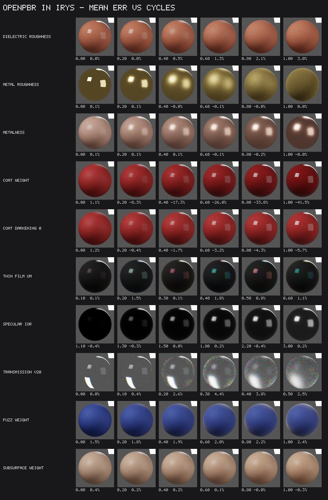

### 1. OpenPBR Surface (`look::openpbr`, `look::graph`, `look::swatch`)

- **Spec conformance.** The parameters are OpenPBR 1.x's names and defaults,
  and so is the slab tree: fuzz over coat over mix(metal, mix(translucent,
  mix(glossy-diffuse, subsurface))). The spec gives **albedo scaling** as
  its reference `layer` (`w f_top + lerp(1, T(1 − E_top(ω_o)), w) f_sub`), so
  that is what is used here. The design's position-free walk (Guo+ 2018)
  is not: the spec does not define it, and a Monte Carlo layer would not
  match the spec's own reference. The albedos `E` (rough dielectric
  `(μ, r, η)`, 32×32×33; metal `∫G2/G1`, `∫(1−μ)⁵`, `∫ F82-weight`; fuzz)
  are tabulated once, by quadrature of the very lobes being evaluated
  (24² visible-normal strata). The η axis has an odd node count, so `η = 1`
  (where TIR starts) is a node. The pieces:
  - metal: F82-tint (`μ̄ = 1/7`);
  - dielectric: exact Fresnel at the specular-weight-modulated index
    (spec `ε` form), tinted by `specular_color`;
  - diffuse: Lambert;
  - coat: GGX, absorption `coat_color^{(1/μᵢ' + 1/μₒ')/2}`, and darkening
    `Δ = (1 − K)/(1 − E_b K)`, `K = lerp(K_s, K_r, r_b)`. The base under the
    coat sees `η/η_c`, and the stack evaluates the base both ways and mixes
    by coverage, which is the weighted layer, exactly;
  - fuzz: see deviation 2;
  - thin film: the **exact Airy sum** at the path's wavelength (s and p
    averaged), folded into the dielectric and metal Fresnel by
    `thin_film_weight`;
  - transmission: Walter's rough dielectric BTDF, tint at `depth = 0` or
    Beer–Lambert `μ_t = −ln(T)/depth`, with Cauchy dispersion from
    `V_d = abbe/scale`;
  - subsurface: van de Hulst's inversion for the albedo, `μ_t = 1/(r · scale)`,
    walked by the skin random walk (`skin::render::walk_g`) on an icosphere
    copy of the swatch.
- **One source.** `graph::stack<S: Scalar>` is the stack's `f` for one lane
  (reflect / transmit / subsurface-entry, one-hot). At `ExprId` it is the
  `Stack` graph, whose eval and adjoint come from `TensorGraph::backward`.
  At `f64` it is the integrator's `f`. `θ = (base colour on 3 hats,
  metalness, specular roughness, coat weight, fuzz weight, base weight)`.
  Tabulated albedos enter linearised at the current roughness, so the
  adjoint is the interpolant's exact gradient. The lanes' 49 columns are one
  `[n, 49]` input, because Metal allows 29 storage buffers per stage.
- **Colour.** An sRGB colour is lifted onto the hats through `M⁻¹`, where `M`
  is the hat basis as the hero-wavelength integrator renders it. A colour
  then round-trips to < 2e-3, which matters for any comparison with an RGB
  renderer. Wavelengths are stratified over a pixel's samples.
- **Sampling** (detached): lobe by its albedo at `ω_o`, VNDF for the GGX
  lobes, cosine for diffuse and fuzz, refraction through a VNDF normal,
  one-sample MIS over the directional lobes, and the subsurface entry as a
  discrete event.

| Gate (`tests/look.rs`, `look_gpu.rs`) | Result |
|---|---|
| white furnace, importance-sampled `∫ f cos` at μ 0.15/0.5/0.95: Lambert, glossy-diffuse r 0.1/0.5/1, coat over white (δ = 0), fuzz over white, subsurface white | all within 2.2e-3 of 1 (worst: glossy r 0.1 at μ 0.15, 0.9979) |
| energy ≤ 1, 40 random physical materials (incl. transmission, film) | ✓; every table entry in [0, 1] (fuzz after normalisation) |
| metal furnace vs the single-scatter table | ≤ 1.1e-3 |
| reciprocity: metal, dielectric specular, coat lobes alone | ≤ 1e-9 rel |
| rough BTDF generalised reciprocity `f(o→i) η² = f(i→o)` | 7.4e-11 |
| stack graph vs twin: interpreter / compiled C f32 / device WGSL f32 | 5e-16 / 1.7e-6 / 1.1e-5 (0 of 4096 lanes > 1e-4) |
| adjoint vs central differences (interpreter); device adjoint vs CPU | ≤ 1e-9 rel; ≤ 1.4e-4 rel |
| Airy: no film, ambient-index film and film = substrate give Fresnel; quarter-wave AR gives 0; half-wave gives the bare substrate | 1e-12 |
| dispersion: `(n_d − 1)/(n_F − n_C)` | = V to 1e-6 |
| swatch replay vs forward (20² × 4 spp, every lobe on) | every path bit-identical, δθ bit-identical twice |
| swatch PRB vs CD (frozen sampler, all 8 θ) | ≤ 7.4e-9 rel |

The albedo-scaled stack is **not reciprocal** (the spec says as much). On the
default glossy-diffuse the worst `|f(o,i) − f(i,o)|/f` is 0.34, at grazing
angles.

### 2. Reference match (`examples/look_sweep`, `scripts/openpbr_cycles.py`)

The OpenPBR repository publishes the spec and MaterialX graphs but no
reference images with pixel values. The quantitative reference is
therefore Blender 4.4.3 Cycles' Principled BSDF, whose structure follows
OpenPBR: F82 metals, specular IOR level, coat with tint and IOR, sheen,
thin film, random-walk SSS. Both renderers see the same scene: a unit
sphere, three white quads, a constant 0.08 environment, an orthographic
camera, a box filter, depth 12, no clamping, single-scatter GGX. The
swatches are 96² at 1024 spp (irys) and 2048 spp (Cycles). The table gives
each swatch's error in mean sphere radiance. Pixel MAE is in
`look-openpbr-match.csv`; its floor is about 7–8 %, which is noise at
these sample counts. The Cycles grid is `look-openpbr-cycles.png`.

| Row (6 swatches each) | Mean-radiance error vs Cycles |
|---|---|
| dielectric roughness 0 … 1 | +0.0 … +3.0 % (grows with r: albedo-scaling tables differ at r → 1) |
| metal roughness 0 … 1 (gold F82) | −0.05 … +0.08 % |
| metalness 0 … 1 | −0.19 … +0.15 % |
| specular IOR 1.1 … 3.0 | −0.45 … +0.21 % |
| thin film 0.1 … 0.6 µm | +0.1 … +1.8 % (exact Airy vs Cycles' fit) |
| coat weight 0 … 1, `coat_darkening = 1` (spec default) | +1.1 … **−41.5 %**: Cycles does not darken |
| coat weight 0 … 1, `coat_darkening = 0` | +1.2 … −5.7 % |
| transmission r 0 … 0.5, V = 20 (Cycles: no dispersion) | +0.0 … +4.4 % |
| fuzz weight 0 … 1 | +1.5 … +17.1 % (Charlie vs Zeltner's microfibre) |
| subsurface weight 0 … 1 | +0.5 … +13.5 % (van de Hulst vs Cycles' albedo inversion; diffuse boundary) |

So on base, metal, metalness, IOR and film the gate is met: the error is
within the noise. Coat, fuzz and SSS differ, each because the two
renderers implement a different model, not because of a bug. Each
difference is named above and listed below as a deviation.

### 3. Volumes (`look::volume`)

- **Media.** Homogeneous or gridded (trilinear) density in a box with an
  index-matched boundary. `σ_t = s·d(x)·c(λ)` (spectral shape on the hats),
  `σ_s = α(λ)σ_t`, Henyey–Greenstein phase.
- **Tracking.** Free flight is delta tracking against the sampler's
  majorant. Real and null weights are frozen-sampler ratios (analog at
  `θ = θ_s`, absorption folded into `α`). Light samples are NEE through
  the medium, with ratio tracking for the transmittance, MIS with the
  phase pdf, and a Lambertian floor. There is an emission grid
  (`β e L_e / μ̄` at every tentative collision).
- **Differentiable.** Every θ-dependent factor (real, null, ratio track)
  is one `VolEvent` IR lane, `ℓ = real·ln(α s d c) + null·ln(μ̄ − s d c)`.
  PRB owes `W = L − L_j`, or `C` for a light sample's track.
  `θ = (density scale, albedo on 3 hats)`.

| Gate (`tests/look_volume.rs`) | Result |
|---|---|
| homogeneous ratio tracking and delta-tracking escape vs `e^{−σd}`, d = 0.2, 1, 3 | within 2.0 σ (e.g. 0.27391 ± 0.00083 vs 0.27253) |
| heterogeneous grid vs `e^{−∫σ}` (τ = 1.564) | 0.20952 ± 0.00044 vs 0.20929 |
| half-space diffuse reflectance vs Chandrasekhar `H`, ϖ 0.3/0.8/0.95/0.99 | 2.2 / 2.6 / 2.0 / 0.9 σ (e.g. 0.79544 ± 0.00096 vs 0.79456) |
| event graph vs twin; adjoint vs CD; device WGSL vs twin | 1e-12; 1e-6; 3e-7 abs |
| replay bit-exact; PRB vs CD (smoke scene with emission, 4 θ) | ✓; ≤ 1.6e-9 rel |

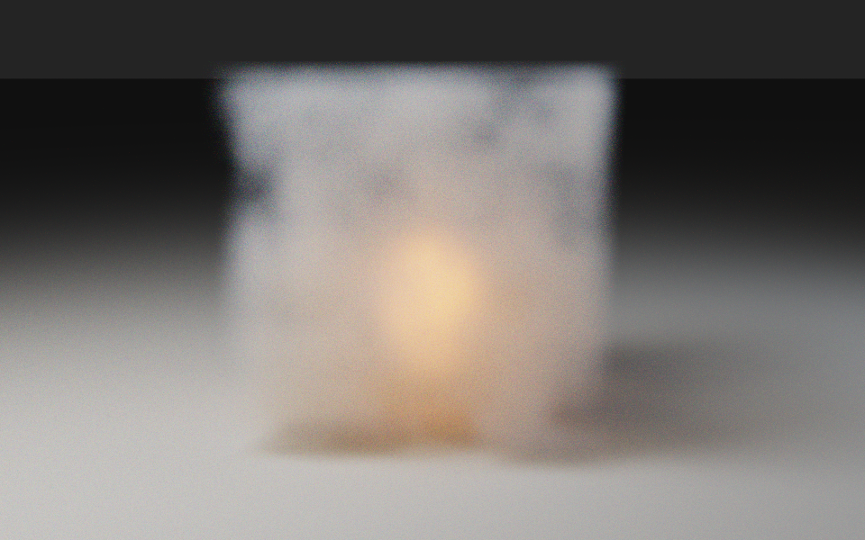

`look-volume.png`: a 96³ fbm smoke cube with a warm emissive core, two
softboxes, 480×300 × 256 spp, depth 10, 1967 s on the CPU (0.02 Mpaths/s, sharing the machine with the hair render). The
renderer is slow at 0.06–0.1 Mpaths/s. One global majorant over a sparse
grid wastes most of the tentative collisions; a per-cell majorant grid
(DDA) is the next step.

### 4. Hair (`look::hair`)

- **The BCSDF.** Chiang et al. 2016 as in pbrt-v3: R/TT/TRT and a residual;
  d'Eon's `M_p` with `I₀`; the trimmed-logistic `N_p`; a 2° cuticle tilt;
  exact `A_p` with `T = e^{−σ_a·2cos γ_t/cos θ_t}`. Absorption is melanin,
  `σ_a = c_e E(λ) + c_p P(λ)`, with Chiang's RGB spectra on the hats. The
  `Hair` IR graph carries `θ = (eumelanin, pheomelanin)`. The θ-free
  `M_p N_p`, `F` and the path length are columns.
- **Geometry.** Polylines are swept as round cylinders, `Strands: Geometry`
  under irys's software BVH, and `h` comes from the hit normal in the
  ray-facing frame. wgpu 30's ray queries on Metal intersect triangle
  BLASes only, with no curve or procedural primitive. Hardware curves
  would mean tessellated ribbons or an AABB intersection shader, and wgpu
  has neither on Metal yet. So the fibres are traced in software, and the
  hair is CPU only.

| Gate (`tests/look_hair.rs`) | Result |
|---|---|
| white furnace `∫ f dω` (σ_a = 0) at four `(h, θ_o)` | 0.990 … 1.009 (the tilt makes `M_p` not exactly normalised) |
| `∫ pdf dω`; `E[f/pdf]` vs uniform | 0.990 … 1.009; = 1.0000 (the sampler is exact at σ_a = 0) |
| melanin: blonde red/blue 1.70, red-head 7.29, black albedo 0.046 | ✓ |
| graph vs twin interp / C / WGSL; adjoint vs CD | 4e-16 / 2.6e-7 / 6.7e-7; 1e-6 |
| replay bit-exact; PRB vs CD (400-strand clump) | ✓; ≤ 9.1e-10 rel |

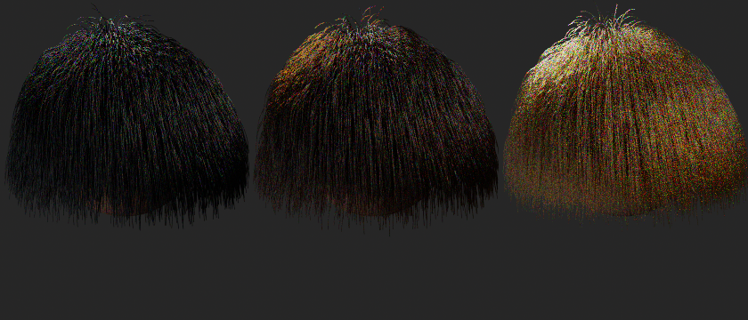

`look-hair.png`: three procedural haircuts on spheres, 9 000 strands ×
14 segments each, black / brown / blonde by melanin alone
(`c_e = 8, 1.3, 0.3`). 840×360 × 256 spp, depth 24, 777 s on the CPU (sharing the machine).
The Lee Perry-Smith head was not given hair: the skin integrator has no
strand primitive, and merging the two integrators is its own piece of
work.

### Phase 4 deviations

1. **Albedo scaling, not position-free layering.** This follows the spec's
   reference evaluation, and the stack is non-reciprocal as the spec's is.
2. **Fuzz is Charlie sheen** (Estevez–Kulla, Neubelt–Pettineo visibility),
   not the spec's recommended Zeltner+ 2022 LTC fit, and it is scaled so
   its albedo is ≤ 1. Raw Charlie reflects up to 1.40× at grazing angles.
   Against Cycles' microfibre sheen it is +17 % at full weight.
3. **No** `base_diffuse_roughness` (EON), anisotropy, `transmission_scatter`,
   thin-walled mode or `geometry_opacity`. Emission is added unattenuated by
   the coat and fuzz.
4. **The thin film on a metal** uses the real index implied by F0, not
   the F82 tint, and it is detached in the base colour: the PRB gate runs
   without it. The film's change to the dielectric albedo enters as the
   Fresnel ratio at `ω_o`.
5. **The base under the coat uses `max(η/η_c, η_c/η)`**, because albedo
   scaling has no refraction into the coat.
6. **Subsurface** uses a diffuse (Lambertian) boundary at entry and exit,
   as the skin walk does, and a tessellated copy of the shape for the walk.
7. **CPU integrators.** Only the graphs run on the device. A GPU tier of the
   swatch, volume or hair integrators is not built.

### Phase 4 risks and next

- **Coat darkening is the largest disagreement with Cycles (−41 %)**, and it
  is on purpose: the spec's physics says a coated dark paint is darker. Any
  scene matched against Blender should set `coat_darkening = 0`.
- **Fuzz and SSS do not match Cycles yet.** Fuzz needs the LTC table; SSS
  differs by the boundary and inversion models.
- **The volume speed is poor** (one global majorant). The next steps are a
  majorant grid, then the device.
- **Hair has no device path** until wgpu exposes custom intersection on
  Metal.
- **The tables are built per process (≈ 1 s) and are not shared with the
  device.** A device integrator would upload them as textures.

## Phase 4b: closing the look's gaps (2026-10-18)

Four pieces, each its own commit. Coat darkening stays **on** by default, as
the spec says; Blender comparisons set `coat_darkening = 0`.


### Match vs Cycles, before → after

| Row | Phase 4 | Phase 4b |
|---|---|---|
| fuzz weight 0 … 1 | +1.5 … +17.1 % | **+1.5 … +2.4 %** |
| subsurface weight 0 … 1 | +0.5 … +13.5 % | **−0.3 … +0.4 %** (Cycles mode) |
| every other row | unchanged | unchanged (`look-openpbr-match.csv`) |

- **Fuzz** (`look::sheen`): Zeltner, Burley & Chiang 2022's LTC microfibre
  sheen, the model the spec recommends. The `(a, b, R)` fit is Cycles'
  `table_sheen_ltc` (Blender v4.4.3, Apache-2.0), read the way Cycles reads
  it, so the lobe is Principled sheen by construction. `R(μ_o, r)` is the
  layer albedo used by albedo scaling, and it needs no normaliser. The
  remaining +1.5 % is the base's own offset (it is there at weight 0).
- **Subsurface** (`SubsurfaceMode::Cycles`, next to the default `Physical`):
  Blender 4.4's `Random Walk`, read from `bssrdf.h`, `subsurface.h` and
  `subsurface_random_walk.h`. The mean free path is `radius·scale/4π`,
  `σ_t = 1/(d(1−g))`, and the albedo comes from Chiang+ 2016's fit with its
  0.2 floor. Entry is a GGX refraction at `(r², IOR)` with no Fresnel
  weight; the exit is diffuse. The +13.5 % in phase 4 came almost entirely
  from the mean free path, which is 4π× shorter in Cycles. New gate: the
  fit, walked on a half-space with diffuse entry, returns the colour
  (±0.015; at 0.95 the fit saturates, as in Cycles). The skin's spectral
  walk is untouched.

### Volumes

The phase-4 volume did run at 0.06 Mpaths/s, but the cause was not the
majorant. `Track::new` scanned the 96³ grid for its maximum on every path.
`Grid::max` is now computed once. On top of that, `Medium::with_majorant_grid(r)`
tracks against per-supervoxel majorants: the maximum any trilinear lookup
inside the supervoxel can return, with a floor where there is emission. It
spends one Exp(1) optical depth across supervoxels. Each event lane carries
its local majorant, so PRB is unchanged.

| look-volume (M-series, loaded machine) | Mpaths/s |
|---|---|
| phase 4 | 0.06 |
| max cached, global majorant | 7.3 |
| 4³ / 8³ / 16³ majorant grid | 9.2 / 9.2 / 8.0 |

On this dense smoke the grid only gains about 1.25×: the mean supervoxel
majorant is 0.41 of the global one at 8³, and the DDA's per-cell cost eats
the rest. A sparser medium gains more. New gates: grid frame vs global
frame (+0.66 σ at 8³), grid PRB vs central differences (≤ 5e-9), and grid
heterogeneous transmittance. `look-volume.png` is now 960×600 × 1024 spp in
70 s. **Not ported to the GPU.** The CPU now meets the "clean frame under a
minute" goal at the original 480×300 size (≈ 17 s). A device port would
need the hat lift and `Rng` in WGSL, as hair has now.

### Hair on the GPU

wgpu 30's Metal ray queries are triangles only, so I measured both options
on `look_hair`'s brown cut (126 k segments, 280×360, depth 24;
`examples/look_hair_gpu`):

| Primitive | Prims | Primary Mrays/s | Same fibre as CPU | Converged frame mean vs CPU | Paths Mpaths/s |
|---|---|---|---|---|---|
| **Cylinders** (AABB + exact intersection in the query) | 126 k | 71 | **1.0000** | +0.25 % (noise) | 4.8 |
| tubes, 3 sides | 756 k | 539 | 0.944 | +2.1 % | 31.9 |
| tubes, 4 sides | 1.0 M | 549 | 0.973 | −1.5 % | 29.8 |
| tubes, 6 sides | 1.5 M | 472 | 0.983 | −1.4 % | 27.2 |
| tubes, 8 sides | 2.0 M | 493 | 0.990 | −2.3 % | 25.4 |

(CPU f64 reference: 0.48–0.75 Mpaths/s.) **I chose cylinders.** They are
the CPU's round fibre exactly: same fibre on every primary ray, `|Δh|`
1.5e-5, shadow rays 0/5536 disagree. The device kernel walks the CPU's
paths: at depth 2, 98 % agree per path and the frame sum agrees to 5e-4;
at depth 10, 87 % agree and the frame sum agrees to 1.1e-4. That keeps
the GPU-vs-CPU invariant. Tubes are 5–7× faster but they are a different
fibre: the frame is biased 1.4–2.3 % and `h` is off by 0.03–0.07, which
moves the azimuthal lobes. They are also not needed on the head, where
the skin's walks dominate (below). Tubes remain available as `StrandPrim::Tubes(n)`.

Two f32 details: a ray leaving through its own fibre starts on that fibre's
surface, so roots within 1e-2 r are rejected (f64 gets this right at 1e-7).
A shadow query must return at the first generated hit, because a generated
intersection is committed only by the next `rayQueryProceed`.

### Strands on the head

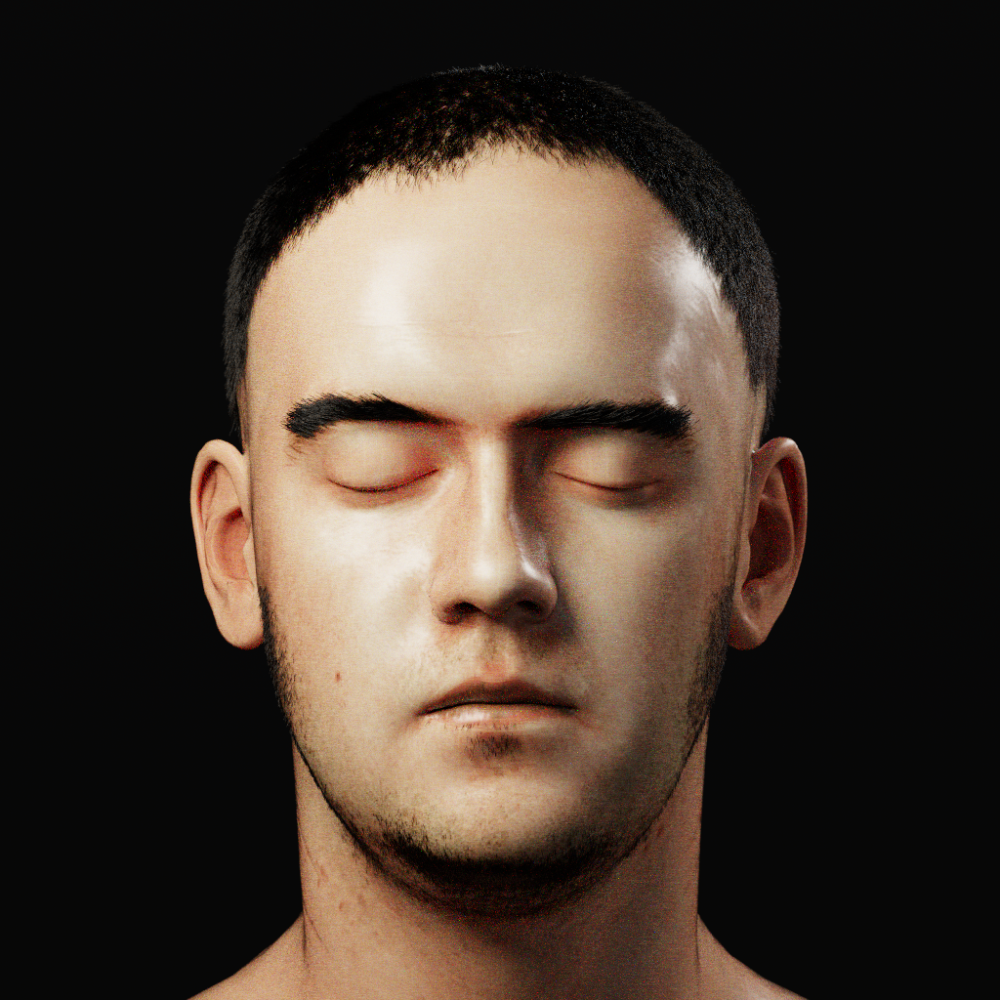

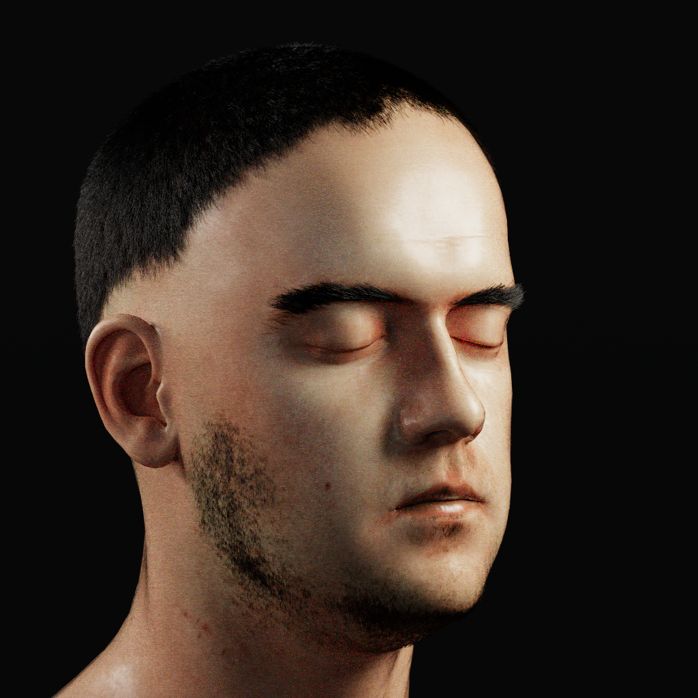

`skin::groom` draws roots area-uniformly on the scan:

- **Scalp**: above a soft, azimuth-dependent hairline, ears excluded,
  combed away from the crown and clumped onto guides on a 0.08-unit grid.
  191 k strands, 5 segments each, 4.5–8 mm long.
- **Eyebrows**: where the painted brows are, from a blurred albedo map.
  1.7 k strands.
- **Stubble**: jaw, chin, upper lip and neck, with density from the painted
  stubble and a floor. 50 k strands, 0.75–2 mm.

That is 1.06 M segments, grown in 0.5 s, with the BLAS built in 0.05 s.
Melanin is θ = (5, 0.4) with a scale per region. `GpuSkin::with_strands`
takes the nearest of skin and fibre per ray, evaluates Chiang's BCSDF at a
fibre per hero wavelength (lobes picked by the lanes' mean `A_p`), and
includes fibres in every shadow test, the SSS exits' too. The walks see
only the skin. Without strands the kernel is bit-identical to before. A
test checks that far-away strands leave every lane unchanged and that near
strands darken the frame deterministically.

| 1024² × 256 spp, depth 5 | With hair | Skin only |
|---|---|---|
| front | 220 s (1.22 Mpaths/s) | 204 s |
| three-quarter | 241 s (1.11 Mpaths/s) | 224 s |

### Deviations and risks

1. The sheen table is Cycles' copy of the paper's fit. The paper's own
   data was not imported separately.
2. Cycles mode is only for comparisons. The physical (spec) mode stays the
   default, and the two differ by ≈ 13 % on the swatch.
3. The majorant grid helps sparse media. This smoke is not sparse.
4. Hair in the skin kernel is **forward only** and GPU only. The CPU skin
   integrator has no strands, so the head's hair has no gradient or CPU
   reference; only the HairScene kernel is checked per path against the
   CPU. The four-wavelength lobe choice (mean `A_p`) is the skin kernel's
   own convention.
5. The groom is procedural: regions are hand-set heights and azimuths on
   this scan, the painted brows and stubble stay in the albedo under the
   fibres, there are no eyelashes, and fibre radii (55–65 µm) are a little
   thick so they read at 1024².
6. Per-path GPU/CPU agreement falls with hair depth: f32 rounding moves
   lobe choices, while the frames still agree.

## M1: the belief codec's prerequisites (2026-10-19)

docs/belief-codec.md, M1. Everything is new files in `look/` except a
handful of additive hooks in `scene_gpu.rs` / `scene.wgsl` (listed under
deviations). Timings are `--release` on the M4 Max with other sessions
sharing the GPU, so single numbers move ±30 %; the tables give medians.

### 1. Splats in the scene kernel (`irys_light::ply`, `look::splat_gpu`, `splat.wgsl`)

- **Loader.** `PlyCloud::load` reads the standard 3DGS layout (any property
  order, binary LE or ASCII): `x y z`, `scale_*` (log → `exp`), `rot_0..3`
  (`[w, x, y, z]`, normalised), `opacity` (logit → sigmoid), `f_dc_*`, and
  `f_rest_*` (channel-major in the file, transposed to coefficient-major;
  degree from the count, 0/9/24/45 → 0–3). The garage files carry
  `nx ny nz` (skipped) and degree 0 only: `splat.ply` 274 499 splats,
  `splat7k.ply` 623 176, `splat30k.ply` 1 705 391.
- **TLAS.** One more TLAS instance (mask `0x10`, which no existing ray
  carries) holds an AABB BLAS of every splat's proxy box. Splats occlude
  meshes and meshes occlude splats on the camera segment: the opaque hit
  is traced first and the splats are composited over `(0, t_hit)`; the
  path continues with `T`.
- **Composite.** 3DGRT's k-buffer in rounds (K = 16 in the scene kernel,
  64 in the sensor kernel): one ray query per round collects the K nearest
  responses after the last composited `(t, index)` — a total order, so
  the hardware's candidate order cannot change the result — and once the
  buffer is full commits the K-th `t`, so the traversal culls boxes past
  it. `C += T α c; T *= 1 − α`, out at `T ≤ 1e-4`.
- **Response.** Sort key `t* = −dᵀAΔ / dᵀAd` (the peak along the ray);
  `α = min(0.99, o · exp(−½ q))` where `q` is the ray's Mahalanobis
  distance under Σ's marginal across the ray **plus the trainer's 0.3 px²
  screen-space dilation** at distance `t*` (`pix` = the camera's angular
  pixel size). Cut at α < 1/255 (the trainer's cut, not 3σ: a hard 3σ cut
  showed as facets on large opaque splats). Proxy box = the ellipsoid
  where α reaches 1/255 (`√(2 ln 255 o) σ`) plus 2 cm for the dilation;
  a response whose peak falls outside its box is dropped, on the device
  and in the f64 twin alike, so culling by box is exact.
- **Colour.** SH up to degree 3 at the ray direction (+ ½, clamped), stored
  as f16. The cloud is trained on sRGB images, so the layer is composited
  in sRGB (as the trainer does) and decoded once per layer:
  `L = dec(C / α) · α`. In the spectral kernel it enters as emission lifted
  onto the hats.

| Gate | Result |
|---|---|
| device vs `splat_gpu::composite_cpu` (f64 brute force: same response, order, cut-offs), 400 random degree-3 splats around a quad, 48 × 40 | max \|Δ\| 2.0e-6 (rgb and coverage), 0 px over 1e-3; splat-depth Δt 7e-7; quad pixels exact distance, misses `+∞` |
| AOVs and frames run twice; batch vs one by one | bit-identical |
| path tracer (64 spp, jittered) vs the sensor's unjittered splat layer, frame mean | 0.0240 vs 0.0239 |
| irys vs a CPU EWA rasteriser written for the gate (`examples/m1_garage`: projection, 0.3 px dilation, depth sort, tiles), small far splats | 1 splat 46.6 dB, 5: 43.8, 30: 36.0, 300: 26.4, 3000 (dense overlap): 26.3 dB |

The garage at four of the map's held-out training cameras (518 × 420,
`examples/m1_garage`), irys's splat layer against the CPU EWA rasteriser
(near plane 0.01 m and Jacobian clamp as gsplat's defaults):

| cloud | splats | upload + BLAS | PSNR vs CPU raster, views 0 / 32 / 64 / 96 | sensor ms | scene kernel, 1 spp, ms |
|---|---|---|---|---|---|
| `splat7k.ply` | 623 176 | 0.08 s | 25.5 / 17.3 / 19.2 / 15.3 | 170–1050 | 500–4360 |
| `splat30k.ply` | 1 705 391 | 0.39 s | 13.7 / 14.3 / 19.5 / 15.3 | 700–2300 | 3000–9000 |
| `splat.ply` (the map's) | 274 499 | 0.11 s | 20.3 / 15.5 / 16.5 / 19.3 | 155–500 | 500–1750 |


**Real frames.** The garage map is in its own floor frame (built from the
`perim` capture through VGGT); the 2026-08-14 sweep's `poses.jsonl` is in
the sweep's own VGGT frame. Registering one to the other is M0's step 1. A
quick yaw + translation search plus ICP against the sweep's StereoNet
depth did not converge (most keyframe depth is the 80–130 mm floor
StereoNet reports when unsure, 1.6 k usable pairs at 5 cm), and renders at
those poses scored 6–11 dB against the frames for irys *and* the CPU
rasteriser alike: a pose problem, not a renderer one. The training
images of the map are not on this machine (`perim.derived` holds poses and
depth, not `views/`), and gsplat is CUDA-only. So the gate here is irys
against the trainer-style CPU rasteriser at the map's own held-out
training cameras (`splat_train.py`'s every-8th views, reconstructed from
`extri.npy`, `intri.npy`, `floor.npy`): ray-traced 3DGS and EWA splatting
are different approximations, and they part where the splats are large,
near and overlapping — exactly this map (an under-trained, blurry cloud).
The PSNR against real JPEGs waits on M0's registration.

### 2. AOVs (`look::sensor`, `sensor.wgsl`)

`Sensor::new(&look, (w, h), max_cameras)`, then `trace(&cams, aov::DIST |
aov::INST | …)` (one submit, no wait) and `read(which)` (one wait, one
mapped copy for every AOV asked for), or `render` for both. Each AOV is its
own device buffer, camera-major, read back only on request; `buffer(aov)`
hands one to another device pass (the residual).

| AOV | type | miss | splat layer |
|---|---|---|---|
| `DIST` | f32, metres along the unit ray (`Pinhole::z_per_dist` → optical z) | `+∞` | `t` where `T` crossed ½ |
| `INST` | u32 instance index | `u32::MAX` | `0xffff_fffe` |
| `MAT` | u32 material index | `u32::MAX` | `0xffff_fffe` |
| `NORMAL` | world shading normal facing the camera, octahedral snorm16 (decoded to `[f32; 3]`) | 0 | 0 |
| `SIGMA` | f32: the caller's σ per instance slot / splats / miss (`set_sigma`) of what the pixel sees | miss σ | splat σ |
| `RGB` | the splat layer: linear premultiplied rgb + coverage | 0 | — |

The kernel is `scene.wgsl`'s own `trace_ray` (cut-outs alpha-tested,
masks as the camera's) and `splat_segment`, one ray per pixel at the pixel
centre, no shading; `sensor.wgsl` is appended to the scene module and binds
the scene's buffers directly (bindings 70–78).

### 3. Batched cameras (`Sensor`, `look::batch`)

N cameras of one size in one dispatch (x: pixel, y: camera). Depth only,
544 × 448, 30 instances (≈ 67 k placed triangles), `examples/m1_bench`:

| batch | total ms | per camera ms |
|---|---|---|
| 1 | 0.93 | 0.93 |
| 8 | 2.30 | **0.29** |
| 64 | 13.8 | **0.22** |

That is with the readback of every depth (1 MB per camera) included; the
target (< 0.5 ms per camera) holds from batch 8 on. All six AOVs at batch
8: 2.4 ms per camera (the readback of 28 B per pixel dominates). "M
scenes" are M placements of the scene in one TLAS (muni's environments
40 m apart), moved with `set_instances`.

`GpuLook::render_batch(&cams, &opts, spectrum)` does the same for the path
tracer: every sample of every camera in one submit (the scene's params
uniform is now a ring of 4096 256-byte slots with dynamic offsets), one
wait, one readback, the spectrum optional. Bit-identical to `render`
camera by camera.

### 4. TLAS-only rebuild (`look::instances`)

`GpuLook::set_instances(&[Instance])` rewrites the 16-byte instance table
and rebuilds the TLAS; no BLAS, vertex, material or texture buffer is
touched. Up to the instance count the scene was built with (slots beyond
the current count are emptied); emitting placements must stay put (their
light samples are baked in world space) and are refused otherwise. The
build is waited on before return — wgpu 30's Metal backend orders no
acceleration-structure build before the work that reads it (the speed
round's device fact); without the wait the next trace could read the old
TLAS. A scene rebuilt with `set_instances` renders bit-identically (AOVs and
frames) to one built from scratch with the same placements.

30 placements (`examples/m1_bench`): median **0.79 ms** (min 0.65, max
3.2 under load), the wait included; `tests/m1.rs` measures 0.45–0.74 ms
on a smaller scene.

### 5. Camera principal point (`look::pinhole`)

`Pinhole { width, height, fx, fy, cx, cy, rot, pos }` with OpenCV's
conventions (pixel `(0, 0)`'s centre at `(0, 0)`; x right, y down, z
forward; `rot` = camera → world). `from_camera_info` reads a ROS
`camera_info.json` (distortion must be zero). `camera()` builds the
kernel's `Camera` with `tan_half` = 1 and the principal point and focal
lengths folded into unnormalised `forward / right / up`, so the scene
kernel needed no change: its pixel `(i, j)` + jitter ½ lands exactly on
OpenCV's `(i, j)`. Tested against analytic ray–plane depths on a tilted
plane (worst relative error 4e-7), `project` ∘ `ray` round trips, and the
kernel's ray formula at four pixels (1e-12).

### 6. The residual pass (`look::residual`, `residual.wgsl`)

`Residual::run_sensor(real_rgb, real_z, &sensor, camera, sigma, &k, &noise)`
reads the predicted RGB / DIST / SIGMA straight from the sensor's device
buffers (`run_host` takes them from the host).

- **Model.** Colour in sRGB: `σ_c² = floor² + shot · c_real`; depth as
  optical z: `σ_z = a + b z²` (stereo), plus the belief's σ in quadrature.
  `e` = mean colour χ² + depth χ²; explained when `e < τ` (9.21: χ²₂ at
  99 %). Ranged by the camera but missed by the prediction: unexplained.
- **Components.** 4-connected over unexplained pixels, joined only across
  depth-continuous neighbours (`|Δz| ≤ 5 cm + 5 %`, either depth missing:
  joined). Min-label propagation + pointer jumping (32 steps per submit
  between convergence checks); the fixed point is each component's
  smallest pixel index whatever the thread order. Count, bbox and Σz (mm)
  by integer atomics; a compact list of components ≥ `min_pixels`, sorted
  by root on the host.
- **Gate** (`tests/m1_residual.rs`): mask identical to the f64 host model;
  components identical to a host union–find on the device's mask; planted
  box / box behind it (split by a 0.3 m step) / poster (colour only) /
  unranged hole found with exact bboxes and pixel counts, noise explained;
  run twice identical; device-resident and host-upload inputs identical.

544 × 448 (`examples/m1_bench`, the real frame uploaded from the host):
7–12 ms, three convergence rounds on a frame-sized component, one
readback of the list and the explained count.

### 7. irys-ffi and the IOSurface (`crates/irys-ffi`)

**wgpu 30 can do it, with no copy.** `Device::as_hal::<Metal>()` gives the
`MTLDevice`; `newTextureWithDescriptor:iosurface:plane:` makes a texture
whose storage is the IOSurface (`RGBA8Unorm`, shader read/write, shared);
`hal::metal::Device::texture_from_raw` + `Device::create_texture_from_hal`
make it an ordinary `wgpu::Texture`. `look::present::Present` writes the
path tracer's accumulator into it (÷ spp, sRGB) as a storage texture in the
same submit as the samples, and waits; Swift presents the surface. The
objc2 crates are the versions wgpu-hal links (objc2 0.6, objc2-metal 0.3),
so the types are one type.

C ABI (`include/irys.h`): `irys_context_create`, `irys_scene_load(ctx,
export_dir, splat_ply, w, h)` (either may be NULL; neither: a demo scene),
`irys_scene_set_camera(fx, fy, cx, cy, rot[9], pos[3])` (OpenCV),
`irys_scene_render_iosurface(scene, IOSurfaceRef, spp)` /
`_iosurface_id(scene, IOSurfaceGetID, spp)`, `irys_scene_render_rgba8`
(the readback path, for comparison), `irys_last_error`.

`harness/run.sh` builds the dylib and a headless Swift program
(`swiftc -import-objc-header`): it makes a 320 × 240 'RGBA' IOSurface,
renders into it, locks it and reads it on the CPU, and compares with
`irys_scene_render_rgba8`: **max |Δ| 0** (bit-identical), first frame
287 ms (pipeline and BLAS builds, the texture wrap), then 10.2 ms per
8-spp frame of the demo scene. The fallback (one GPU copy into a shared
IOSurface-backed buffer) is not needed.

### M1 deviations

1. **Shared files touched** (all additive): `look/scene_gpu.rs` — the
   splat include and `with_splats`, one more TLAS slot (mask `0x10`),
   bindings 60–62, binding 0 becomes a dynamic-offset ring of 4096 slots,
   `pub(super)` accessors, `m1: Shared` (clones of the geometry buffers,
   TLAS and BLASes for the sensor and `set_instances`); `look/scene.wgsl`
   — the camera-segment splat composite in `trace` (14 lines);
   `look/mod.rs`; `irys-light/src/lib.rs`; the workspace `Cargo.toml`
   (`irys-ffi`).
2. Splats are on **camera segments only** in the scene kernel: they cast
   no shadows and bounce rays do not see them (2b composited every
   segment). The sensor needs nothing else; relighting splats (per-splat
   material) is not started.
3. **Splat cost** is the open problem (below): every candidate is a
   procedural-AABB callback, and this map's splats are large.
4. The emitter table is baked in world space, so `set_instances` refuses
   to move emitters rather than re-pack them.
5. The garage's PSNR against real frames is blocked on M0's registration
   (above), and gsplat is unavailable here; the CPU rasteriser stands in.

### M1 risks and next

1. **Splat speed.** 155 ms – 2.3 s per 518 × 420 garage frame in the
   sensor (≈ 230–420 AABB candidates per ray on the map's cloud, ~1.3
   rounds at K = 64, more on the 30k cloud); the scene kernel 2–4× that.
   Far from M0's needs. 3DGRT's own answer is stretched-icosahedron
   triangle proxies (hardware any-hit instead of a shader callback per
   box); a cheaper first step is a tighter, opacity- and size-aware proxy
   and pruning the map's huge low-opacity splats.
2. **Ray-traced vs rasterised 3DGS.** A rasteriser-trained cloud traced
   per pixel differs where splats are large, near and overlapping
   (13–25 dB here, 26 dB on dense synthetic clouds, > 36 dB sparse). 3DGRT
   fine-tunes in its own renderer; for M0 the codec's prediction should be
   the irys render, so retraining (or fine-tuning) against irys is the fix
   if the residual is dominated by it.
3. The k-buffer arrays (64 × 8 B per thread in the sensor) and the splat
   code in the megakernel may cost occupancy for scenes without splats;
   not separated from other sessions' GPU load in the timings here.
4. `set_instances` waits on the TLAS build (≈ 0.9 ms of its time). An
   in-encoder build with an explicit barrier would remove the wait if
   wgpu's Metal backend ever orders it.
5. The params ring assumes `size_of::<Params>()` rounds to 256 B slots;
   it is computed, so a larger `Params` (the speed round adds fields)
   only halves the slots per submit.
