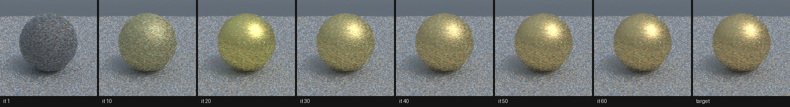
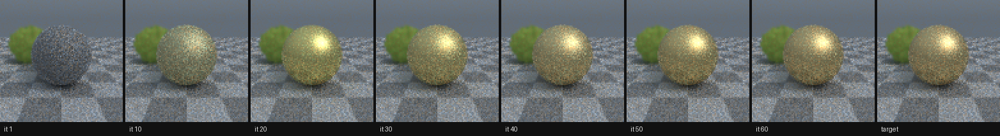
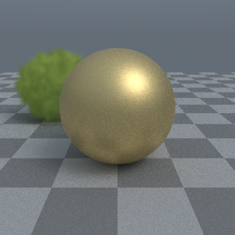
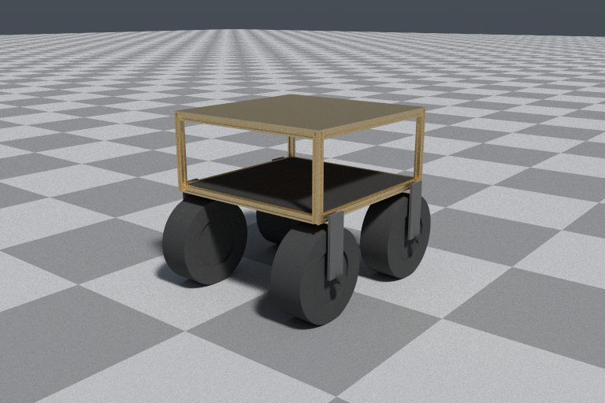
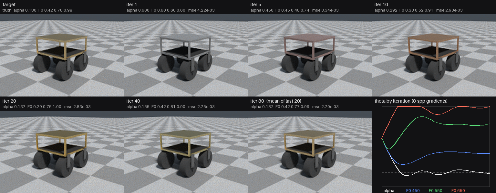
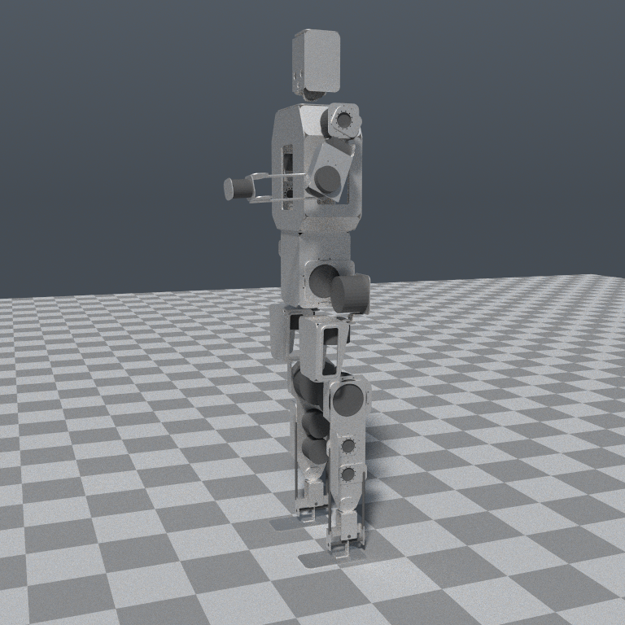
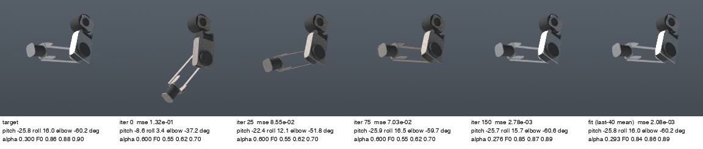

# irys — design

One renderer for the stack. vcad, kosm, ipse, rose and muni each draw pixels
today, in five different ways. irys is where the light lives; every repo above
it is a client that hands over geometry and a camera and gets a frame back.

Status: proposal, 2026-10-17. Phase 0 (seed + split) has landed; see below.

## Why now

The survey (2026-10-17) found:

| Where | What | Problem |
|---|---|---|
| `kosm/crates/kosm-render` (41k LOC) | spectral path tracer, BVH/TLAS, caustics, splats, heightfield, blue noise, GPU tier (wgpu 30) | already geometry-agnostic — but lives in a game's repo and is versioned with it |
| `kosm/crates/kosm-view` (10k) | winit viewer, temporal history, à-trous, raster live tier | duplicates `kosm-render::gpu::{history,budget}` |
| `vcad/crates/vcad-kernel-raytrace` (16k) | direct BRep ray tracing, its own `Bvh`/`Tlas`/`Instance`/`pathtrace`, wgpu 23 | second copy of the same acceleration stack, same type names |
| `vcad/crates/vcad-kernel-gpu` (4k) | wgpu context, wavefront | third GPU context layer |
| `vcad/crates/vcad-render` (13k) | hidden-line SVG/PNG, `photoreal`, `materials`, `envmap` | second material/env model; rose's only renderer |
| `phyz/crates/phyz-camera` (3k) | wgpu 23 rasterizer for sim cameras | fourth GPU context, own mesh/scene types |
| `muni/depot/splat-worker`, ipse `scripts/splat_*` | Python gsplat on CUDA | splats rendered by a stack irys can't call |
| `muni/depot/console`, `vcad/packages/app` | three.js | out of scope for v1 (see below) |

`kosm-view` building vcad-raytrace with `gpu` means one binary links wgpu 23
*and* 30. That alone is worth fixing.

## Principles

1. **irys owns no geometry.** It never depends on vcad, phyz, kosm or ipse.
   Clients implement `Geometry`; irys bounds it, traverses it and shades it.
   This is the rule `kosm-render` already follows — keep it.
2. **A substance is not a look.** irys takes optical constants (spectral
   albedo, IOR/Sellmeier, roughness, emission). kosm's `material` library
   stays in kosm and derives them; irys never carries a second brass.
3. **CPU is the reference, GPU is a tier.** Every GPU result has a CPU path
   it is tested against. Headless and CI build with no device.
4. **One wgpu.** The whole graph agrees on one major version, bumped in irys
   first.
5. **Pure frame.** `render(scene, camera, budget) -> Frame` is a function.
   Temporal state (history, reprojection) is an explicit value the caller
   threads, not hidden in a viewer — so kosm's "same id, same bytes" holds.
6. **Differentiable where it is cheap.** Scalars are `tang::Scalar` so duals
   flow through optics and the frame (kosm's marble already depends on this).

## Crate split

```
irys/
  crates/
    irys-core     math, Ray/Hit, Aabb, Geometry trait, Bvh/Sah, Tlas/Instance,
                  Camera, Frame (rgba + depth + normal + id AOVs). no deps but tang.
    irys-light    spectrum (CIE, Sellmeier), optics (Fresnel), BSDFs, env/HDR,
                  sampler (blue noise), CPU pathtrace, caustics/photon map.
    irys-prims    stock Geometry impls: TriMesh, Analytic, HeightField, Splats.
    irys-gpu      one wgpu context, buffers, resident scene, WGSL integrator,
                  history/budget/à-trous/firefly cap, neural denoiser. feature-
                  gated; the only crate that names wgpu.
    irys-raster   fast live tier: forward pass, shadow map, SH probes (from
                  kosm-view/raster) + a sim-camera mode (absorbs phyz-camera).
    irys-line     hidden-line / flat-shaded SVG+PNG (from vcad-render's core).
    irys-view     winit window over irys-gpu/raster. optional, never in CI.
    irys          facade: `use irys::prelude::*;`, re-exports by feature.
```

Rule of thumb for a boundary: a crate exists if some client wants it without
the rest. rose wants `irys-line` only. phyz wants `irys-raster` only. A
headless kosm test wants `irys-core + irys-light` only.

## The Geometry trait

Keep `kosm-render`'s trait as is — it has survived BRep, meshes, splats and
heightfields:

```rust
pub trait Geometry {
    fn len(&self) -> usize;
    fn is_empty(&self) -> bool { self.len() == 0 }
    fn bounds(&self, i: usize) -> Aabb;
    fn intersect(&self, ray: &Ray, i: usize, t_min: f64, t_max: f64) -> Option<Hit>;
    fn intersect_all(&self, ray: &Ray, i: usize, out: &mut Vec<Hit>) { /* convex default */ }
    fn occludes(&self, ray: &Ray, i: usize, t_min: f64, t_max: f64) -> bool { /* via intersect */ }
}
```

Additions, each optional with a default so no existing impl breaks:

- `fn material(&self, i: usize) -> MaterialId` — today materials ride in
  `Hit`; making it a trait method lets the GPU tier upload it once.
- `fn gpu(&self) -> Option<GpuGeometry<'_>>` — how a primitive set
  describes itself to `irys-gpu` (triangle soup, analytic prim table, splat
  buffer, heightfield texture). `None` means CPU-only, and the GPU tier
  falls back or refuses loudly, never silently drops it.
- `fn tessellate(&self) -> Option<TriMesh>` — for `irys-raster` and
  `irys-line`, which need triangles. BRep impls in vcad return the
  tessellator's mesh; analytic prims tessellate themselves.

What stays out: transforms (that's `Tlas`/`Instance`), animation, and any
notion of a document or scene graph. A client's scene graph builds a `Tlas`.

**vcad's BRep** becomes `impl Geometry for BrepFaces` in vcad (in
`vcad-kernel-raytrace`, shrunk to the surface intersectors + trimming).
Its `Bvh`, `Tlas`, `pathtrace` and `gpu/` are deleted in favour of irys's.

## Clients after the move

| Client | Depends on | Keeps locally |
|---|---|---|
| kosm | `irys` (light, gpu, view) | `Camera` as a `Lens`, materials → optics constants, `brep::Scene` adapter |
| vcad | `irys-core`, `irys-light`, `irys-line`, `irys-gpu` (wasm) | BRep `Geometry` impl, `.vcad` → scene, CLI flags |
| rose | `vcad-render` → `irys-line` | nothing new; `render.sh` unchanged |
| phyz | `irys-raster` | `phyz-camera` becomes a thin adapter |
| ipse | `irys-prims::Splats` + `irys-gpu` | map → splat buffer adapter |
| muni | see below | |

## muni

muni is the reason this has to be a library and not a kosm crate. What it
needs, in order:

1. **sim-world depth/RGB from 3DGS** (`docs/sim-service-plan.md`). Today that
   plan is Python gsplat in a container. With `irys-prims::Splats` +
   `irys-gpu`, sim-bridge renders depth from arbitrary poses in Rust, in
   process, no ZMQ hop, and the same renderer trains the world model and
   tests the policy. This is the first muni deliverable.
2. **Sim cameras for bvr's `sim` crate** — `irys-raster`'s sim-camera mode,
   batched like kosm's `step_batch`.
3. **Depot digital twin.** The console stays three.js for now. Later,
   `irys-gpu` on wasm/WebGPU can render the splat map behind the three.js
   overlays. Not v1.
4. **Splat training** stays Python (gsplat/CUDA). irys consumes the `.ply`;
   it does not train splats in v1.

Out of scope: teleop video (GStreamer), Rerun replay, the marketing site.

## Migration order

Each step lands green on its own; nothing is a flag day.

1. **Seed.** `git subtree split` `kosm/crates/kosm-render` into
   `irys/crates/irys-core` with history; republish nothing yet. kosm points at
   it by path via `.cargo/config.toml`, CI by git rev.
2. **Split** that crate into `irys-core`, `irys-light`, `irys-prims`,
   `irys-gpu` along the module lines above. Pure moves; `kosm-render` becomes
   a re-export shim so kosm and vcad 0.10 keep compiling.
3. **Hoist kosm-view's** history/budget/temporal into `irys-gpu` (dedupe with
   `kosm-render::gpu`), raster into `irys-raster`, window into `irys-view`.
4. **Publish** `irys-*` 0.1 to crates.io. kosm drops the shim and depends on
   irys directly.
5. **vcad onto wgpu 30 + irys.** `vcad-kernel-raytrace` keeps surface
   intersectors and implements `Geometry`; its BVH/TLAS/pathtrace/gpu go.
   `vcad-kernel-gpu`'s context is replaced by `irys-gpu`'s for rendering
   (its compute-only parts — narrowphase, router — stay in vcad).
   Snapshot every vcad render test before and after.
6. **vcad-render → irys-line + thin CLI.** rose is checked with its
   `render.sh` output diffed pixel-wise.
7. **phyz-camera → irys-raster** adapter.
8. **muni sim-bridge** renders splat depth through irys (muni #1 above).
9. **ipse** splat viewer/compare scripts move to a irys example.

Steps 1–4 are kosm-only and low risk. Step 5 is the big one: two BVHs with
the same names, a wgpu major bump, and wasm in the vcad app.

## Phase 0: the split as built (2026-10-17)

Pure moves (`git mv`), no behaviour change. What landed differs from the
sketch above in three places, all because a module-line split would have
made a cycle:

- **Splats live in `irys-light`, not `irys-prims`.** `splats.rs` shades
  through `pathtrace`'s surface model and the CPU integrator composites
  splats itself (`Scene::splats`), so prims → light → prims. `irys-prims` is
  `analytic` + `heightfield`.
- **TriMesh stays in `irys-core`.** It is defined in `geometry.rs` beside
  the trait, and the integrator, the GPU tier and the tests all name it.
- **The sampler (blue-noise mask, Sobol) is in `irys-core`**, because both
  tiers read it; `spectrum`/`optics` call each other and go to `irys-light`
  together with `tables`, `env`, `caustics`, the CPU tier (`cpu/`,
  `pathtrace`) and the CPU half of the neural denoiser (`neural`). There is
  no `irys-neural`: the device half is `irys-gpu::neural`.

```
irys-core   (tang)                       math ray geometry bvh sah tlas sampler
irys-prims  -> core                      analytic heightfield
irys-light  -> core   (rayon native)     spectrum optics tables env cpu pathtrace
                                         caustics splats neural
irys-gpu    -> core, light (wgpu 30)     the old gpu/ module + shaders
irys        -> core, light, prims, gpu?  facade, kosm-render 0.2's public paths;
                                         `gpu` feature pulls irys-gpu
kosm-render -> irys                      0.2.1 shim, `pub use irys::*`
```

Each moved module keeps its `crate::x` paths through a private
`use irys_core::{..}` at its new crate root. The integration tests live in
the facade (`crates/irys/tests`) since they span tiers.

## Phase 1 spike: the contract on CPU (2026-10-17)

`crates/irys-diff`, its own crate because tang-compile is a git dependency
(`bfc8003`, kosm's rev) and irys-light has to stay publishable. The
workspace `[patch.crates-io]` sends `tang`/`tang-expr` to that rev so the
graph holds one tang; it folds into irys-light when the IR publishes.

- `ggx.rs` — a rough conductor (GGX, height-correlated Smith, Schlick with a
  three-hat spectral F0), `θ = (α, F0₀, F0₁, F0₂)`, written once as one
  `TensorGraph` batched over a wavefront: inputs are `[n]` columns of vertex
  cosines and hero-wavelength hat weights. Lowered to eval (`f`, `pdf`) and
  adjoint (`backward` of `Σ δf·f`, so the batch sum is the reduction).
  Sampling (VNDF) is f64 CPU code and detached.
- `prb.rs` — forward pass keeps `L` per path; replay reseeds, re-walks, and
  adds `δL (L − L_j) ∂f_j/f_j`. The derivation is the module doc.
- `ir.rs` — compiled C (f32) or interpreter (f64), `IRYS_IR=interp` forces
  the latter.

Scene: GGX ball on a grey Lambertian disc under a smooth sky + soft sun,
`irys_core::Bvh` over `irys_prims::Analytic`, one hero wavelength per path
through `irys_light::spectrum`. Results (debug build, M-series):

| Gate | Result |
|---|---|
| gradient vs CRN central differences, sampler frozen, L2, f64 | rel error 1.6e-10 … 1.9e-9 on all four θ |
| same, sampler at current α (paths move), mean pixel, 64 seeds | α: −5.84e-2 ± 0.40e-2 vs −5.79e-2 ± 1.2e-2 (0.0σ); F0 bands rel ≤ 1e-6 |
| compiled C f32 vs interpreter f64 | f 1.6e-6, pdf 1.7e-6, δθ 9.4e-7 worst rel; interpreter = hand f64 to 1e-12 |
| replay vs forward | bit-identical L on 512/512 paths, both backends |
| memory | 30.1 f64 words per path at depth 2 and 8, nothing per vertex |
| inverse: α 0.6 → 0.25, 32×32×4, Adam | within 0.02 at iteration ~20; last-10 mean 0.265 |
| timing | gradient (render + forward + replay) 4096 paths ≈ 35 ms native, ≈ 1.3 s interpreted; 512 paths interpreted 0.17 s |

What the spike says the design got wrong or left out:

1. **The replay weight has a `1/f`.** It is `δL (L − L_j) ∂θ log f_j`; the
   contract's "`(L − L_so_far) · ∂f/∂θ`" is off by `f_j`.
2. **A nonlinear loss needs two seeds.** With one, the L2 gradient
   `2 (I − T) ∂I` correlates the noise in both factors and descent also
   minimises variance: the first inverse run walked α from 0.6 to 1.0.
   `prb::gradient` takes `(primal, adjoint)` seeds; same seed only for the
   CRN check.
3. **Memory is paths × 1, not pixels × 1**, once forward and replay are
   separate wavefront passes (`L` per path between them). Pixels × 1 needs
   the replay fused into the forward kernel per path, or a third pass.
4. **The pdf the integrator divides by is the sampler's**, not the eval
   graph's: the two agree (tested to 1e-9), but the one that drew the
   direction is the one that counts (frozen sampling makes that explicit).
   The graph's pdf is for MIS.
5. **Replay bit-exactness needs one program for `f`.** The eval and adjoint
   lowerings fuse differently and may round differently in f32, so replay
   re-evaluates `f` with the eval program and runs the adjoint only for `δθ`.
   The C is built with `-ffp-contract=off` for the same reason.
6. **tang-gpu is out.** Its `CpuProgram` links wgpu 25 (principle 4); `ir.rs`
   carries the forty-line loader instead.
7. Not done: PRB inside `irys-light`'s integrator (the spike has its own
   200-line wavefront), the floor's BSDF as a graph, NEE/MIS, Russian roulette, visibility (reparam) gradients.

### Hero wavelengths ×4 (2026-10-17)

Each path now carries four stratified wavelengths, the hero and three
rotated by `k/4` of the band (Wilkie+ 2014). The hero alone draws the
direction; the graph runs per *lane* (path × wavelength, so the wavefront is
4× wider) and the image splats each lane at `hero_weight(λ_k) / (4 spp)`.
GGX's sampler is λ-free, so all four share the hero's pdf and the MIS weight
is a flat ¼. Each lane is its own PRB path (`L`, `L_j`, `δL`).

| | |
|---|---|
| per-pixel variance, 24×24×2, 16 seeds, 1 λ → 4 λ | total 7.4× lower, chroma (channel − grey) 28.7× lower |
| frozen-sampler gradient vs CRN central differences | rel ≤ 6.1e-10, unchanged gate |
| live sampler, 64 seeds | α 0.4σ, F0 bands rel ≤ 1e-6 |
| replay vs forward | bit-identical on every lane, both backends; 63.1 words/path at depth 2 and 8 |
| inverse α 0.6 → 0.25 | within 0.02 at iteration 13; last-10 mean 0.234 |
| `examples/fit`, 96×96×8, 60 its | θ = [0.188, 0.334, 0.783, 0.997] vs truth [0.2, 0.34, 0.78, 1.0] |

No tolerance changed.

## Phase 2a: the PRB wavefront on the GPU (2026-10-17)

`irys-diff::gpu` behind a `gpu` feature, on `irys-gpu`'s wgpu 30 context.
The phase-2 risk was replay bit-exactness on a device; it held first time.

**The IR does emit WGSL.** tang-compile at `bfc8003` has
`TensorGraph::to_wgsl` (one kernel per materialised comp, views as index
arithmetic, `split` schedules for reductions). So nothing is hand-lowered:
the GGX eval lowering (`f`, `pdf`) and adjoint lowering (`δθ`) are the IR's
own kernels, dispatched as wavefront stages. Only the path logic is hand
WGSL (`src/gpu/wavefront.wgsl`): `gen`, `bounce` (intersect the two
analytic prims, VNDF-sample at the hero, write the seven graph columns per
lane), `update` (`T *= f cos/p`, and in replay `δf = δL (L − L_j)/f`),
`finish` (`L` per lane), `accumulate`. A bounce is bounce → eval IR →
update [→ adjoint IR → accumulate], one compute pass per frame.

**Bit-exactness, by construction.** Forward and replay dispatch the same
`ComputePipeline`s over the same bind groups — one shader module per
kernel, built once — so `f` and everything feeding a path is the same
machine code on the same inputs. The replay differs only in a uniform that
gates the `δf` store. The adjoint program recomputes `f` internally; that
copy never touches throughput (note 5 above). RNG: `prb::Rng` ported
exactly (SplitMix64 on `u32` pairs, 64-bit add/mul by 16-bit limbs); a
uniform keeps the top 24 of the CPU's 53 bits, so CPU and GPU walk the same
paths up to f32 rounding. Nothing broke; the only f32 accommodation is the
surface offset, 1e-4 (t_min 1e-5) instead of the CPU's 1e-6.

**The reduction: no atomics.** WGSL has no float atomics and a CAS loop on
`atomic<u32>` makes the sum order (so the gradient's low bits) depend on
scheduling. Instead the adjoint's `Σ_lanes` stays the IR's own monoid
reduction, scheduled `split = 256` (one workgroup per parameter, threads
stride the lanes, tree combine); `accumulate` adds the four results per
bounce in bounce order. The gradient is bit-deterministic run to run
(tested).

| Gate (debug build, M-series, Metal) | Result |
|---|---|
| replay `L` vs forward `L`, 64×64×4 × 4 λ | 65536/65536 lanes bit-identical, depth 2 and 8; `δθ` identical twice |
| GPU f32 vs CPU f64 interpreter, frozen sampler, 32×32×4, one seed | `L` median rel 1.2e-7, p99 1.5e-4 (14/16384 lanes > 1e-3: silhouette rays); loss rel 5.8e-7; `δθ` rel 8.3e-5, 7.0e-6, 1.9e-5, 3.5e-4 |
| GPU PRB vs GPU central differences (h = 1e-3, CRN) | rel 1.1e-6, 9.9e-6, 6.9e-6, 1.9e-3 (θ₃, the smallest gradient, is f32 FD noise) |
| throughput, 96×96×8 (73 728 paths × 4 λ, depth 4) | forward 1.1 ms incl. readback (≈ 66 Mpaths/s); replay 20.6 ms; gradient with host scoring 166 ms |
| CPU compiled-C path, same frame, same profile | forward 453 ms (0.16 Mpaths/s), gradient 1543 ms: GPU 9× end to end, ~400× on the forward pass |
| `examples/fit_gpu`, same seeds and Adam as `fit` | θ = [0.188, 0.334, 0.783, 0.997] vs truth [0.2, 0.34, 0.78, 1.0] — the CPU run's numbers to three places; 60 iterations + previews in 14 s vs ≈ 2 min |

 (`phase2a-loss.csv` is its loss and θ.)

Remaining risks and follow-ups:

1. **Host scoring dominates.** ~140 ms of the 166 ms gradient is the host
   building the image, the loss and `δL` per lane from `L` (debug Rust).
   Image, loss and `lane_adjoint` belong on the device; then the host reads
   back four floats. *Done in phase 2b, piece 1.*
2. **Replay cost is the adjoint.** Four split reductions per bounce, each
   recomputing `f` and its derivative per lane: 20 ms vs 1 ms forward. A
   fused one-pass reduction over all four parameters (one kernel, width-4
   accumulator) is an IR schedule, not a design change.
3. **The scene is hand-written in WGSL.** Two analytic prims, no BVH. Phase
   2 proper needs `irys-gpu`'s scene traversal inside `bounce`; bit-exactness
   then also depends on traversal order being deterministic (it is, for a
   stackful BVH walk, but test it). *Done in phase 2b, piece 2; tested.*
4. **Lane layout.** Graph inputs are seven separate `[lanes]` columns because
   that is how `to_wgsl` binds inputs; that is 9 storage bindings in `bounce`.
   A struct-of-columns input or a `[lanes, 7]` view would cut it.
5. **Cross-vendor.** Bit-exactness is per device and driver: the same
   pipeline on the same GPU. Replaying on another adapter is not promised,
   and nothing needs it.
6. f32 everywhere on the device; long paths and big scenes will want the
   offset scaled to the hit distance. *Done in phase 2c, piece 2.*

## Phase 2b: the real scene on the GPU wavefront (2026-10-17)

Two pieces, both in `irys-diff::gpu`.

**Piece 1 — scoring on the device** (phase 2a risk 1). Three more wavefront
kernels: `score` (one thread per pixel sums its `spp × 4` contiguous lanes
in lane order through a WGSL port of `spectrum::hero_weight`, then writes
the residual's `∂loss/∂image` and squared error), `loss_sum` (one workgroup:
a fixed per-thread stride, then a fixed tree), `lane_adjoint` (δL per lane
from the adjoint frame's own wavelengths). No float atomics anywhere; the
host writes uniforms and reads back five floats, `loss` and `δθ`
(`GpuPrb::gradient_l2`). The host-scored `gpu::gradient` stays as the
reference and for non-L2 losses.

| Gate | Result |
|---|---|
| device image / δL vs host f64 scoring of the same `L` | max err / max 1.0e-6 / 1.6e-6; loss rel 5.3e-8; `δθ` rel ≤ 5.3e-5 |
| device-scored gradient, two seeds, run twice | bit-identical loss and `δθ` |
| gradient, 96×96×8, debug | 170–178 ms host-scored → **11.6–12.8 ms** device-scored; CPU compiled C 1583 ms (124×) |
| same, `--release` | 27–42 ms → **7.0–7.8 ms**; CPU 116–129 ms (17×) |
| `fit_gpu` | same θ to three places, 60 iterations 14 s → 5 s |

**Piece 2 — irys's BVH on the wavefront.** `irys-gpu` has no traversal of
its own (its geometry seam leaves `trace_scene` to the client), so the
wavefront ports `irys-core`'s flat BVH: `Bvh::flatten` of two trees packed
into one node array (opaque tree at 0, splat tree after it), one
leaf-index array, one `vec4` record array — three bindings. `prb::Scene`
is now that: `Bvh<Opaque>` (a `TriMesh` and an `Analytic` behind one
`Geometry`, combined indices, a `Surface` per prim) plus an optional
`Bvh<Splats>`; the CPU reference traces the same trees. `Scene::new` is the
phase 1/2a scene, now traced through the BVH on the device too (its tests
are unchanged and pass); `Scene::garden` is the ball on a 512-triangle
checkered floor in front of a 900-splat procedural bush.

- **Walk order.** A 64-entry stack, near child first by slab entry (left on
  a tie), the far child pushed under it; nodes are culled against the
  current closest `t`. The walk is a function of the ray, so replay
  retraces it; tested bitwise across runs and across two wavefronts.
- **Splats, 3DGRT-style.** The 3σ boxes are the proxies in the splat tree.
  A segment (up to the opaque hit, or ∞) composites in rounds: each round
  walks the tree and keeps a sorted K = 16 buffer of the nearest hits
  strictly after the last one composited, ordered by `(t, index)` — a total
  order, so the result does not depend on which nodes the walk visits
  first — and culls boxes past the buffer's last entry once full.
  `C += T α c; T *= 1 − α`, out at `T ≤ 1e-4`, exactly
  `irys_light::splats::composite`'s model (emissive and absorbing, baked
  lighting, no shading, no secondary rays). Spectral radiance is the sRGB
  colour lifted onto the conductor's three hats (`prb::splat_radiance`).
- **Differentiable in θ only.** Splats are θ-free factors on the path
  (`L` gains `T_path · C`, the throughput gains `T`), so the PRB estimator
  is unchanged. Splat parameters (means, covariances, opacity, colour) are
  the follow-up: 3DGRT's backward is a second ordered walk per segment.

| Gate (debug, M-series, Metal) | Result |
|---|---|
| replay vs forward, garden 64×64×4 × 4 λ | 65536/65536 lanes bit-identical at depth 2 and 6; `δθ` identical twice |
| walk-order determinism | two wavefronts × two runs: `L`, image, loss, `δθ` bitwise identical |
| GPU f32 vs CPU f64 (same trees, CPU `splats::composite`), frozen sampler, 32×32×4 | `L` median rel 1.2e-7, p99 2.5e-4, 31/16384 lanes > 1e-3; loss rel 5.2e-6; `δθ` rel 4.6e-5, 1.2e-5, 2.1e-5, 2.4e-4 |
| GPU PRB vs GPU central differences (h = 4e-3, CRN, device loss) | rel 2.0e-4, 3.3e-5, 4.8e-5, 3.8e-3 (θ₃ again the f32 floor) |
| the bush is composited | 277/2304 pixels change with the splats removed |
| throughput, garden 96×96×8 | forward 5.6 ms (13 Mpaths/s), gradient 19.6 ms; release 4.6 / 18.4 ms; CPU compiled forward 665 ms debug, 56 ms release |
| `examples/fit_scene`, 96×96×8, 60 its, same seeds and Adam | θ = [0.208, 0.339, 0.788, 0.998] vs truth [0.2, 0.34, 0.78, 1.0], 60 iterations in 1.3 s |
| beauty, 384×384, 256 spp (64 × 4 spp), depth 6, fitted θ | 1.3 s |

 (`phase2b-loss.csv` is its loss and θ.)



Deviations:

1. **No reuse of irys-gpu traversal**, because there is none: irys-gpu's
   integrator takes `trace_scene` from the client. The port is ~150 lines of
   WGSL in `wavefront.wgsl`. Once a second client needs it, it belongs in
   irys-gpu as the stock `GeometryModule` for `Bvh` + `TriMesh` + `Analytic`.
2. **One BVH per kind, not a TLAS.** Two trees in one node buffer; no
   instance transforms. `Tlas` is generic over one geometry type, and mixing
   kinds needs either an enum geometry (what `Opaque` is) or per-instance
   kinds in the WGSL. The traversal is the same code either way. *A TLAS over
   instances in phase 2c, piece 1 (one `Opaque` kind per tree).*
3. **GPU analytic prims are spheres and discs**, and splat colour is
   degree 0; `pack` panics on anything else rather than dropping it.
4. **Splats are not differentiated**, and they cast no shadows (there are
   no shadow rays: no NEE yet). The CPU and GPU agree on that model.
5. Splat proxies use the CPU's 3σ box; the peak `t` is reported in f32, and
   a peak computed a hair outside its own box can be culled by the K-buffer
   — deterministic, so it never breaks replay, but CPU and GPU may differ on
   such a splat.

Risks and next:

1. **Splat cost.** The garden's forward is 4.6× the two-prim scene's,
   nearly all of it the compositing rounds (every round re-walks the splat
   tree). Real captures are 10⁵–10⁶ splats: K = 16 with a re-walk per round
   will not hold; 3DGRT's answer is hardware any-hit with a k-buffer, ours
   is probably a larger K in workgroup memory and a per-ray resume point.
2. **Replay cost is still the adjoint** (phase 2a risk 2): the fused
   four-parameter reduction is unchanged work.
3. **The IR's grid limit.** `to_wgsl` dispatches one-dimensional grids, so a
   frame is capped at 65535 × 64 lanes (the beauty frame renders 4 spp at a
   time). A 2D grid split, or chunking lanes, lifts it. *Done in phase 2c,
   piece 2 (chunks).*
4. **f32 offsets** (phase 2a risk 6) bite sooner in a mesh: the fixed
   1e-4 offset is fine at unit scale; a CAD-scale scene needs it scaled to
   the hit distance. *Done in phase 2c, piece 2.*
5. **Splat gradients** need the backward walk per segment and per-splat
   parameter accumulation, which brings back the reduction problem at
   10⁵ parameters: per-splat accumulators can't be one workgroup each.

## Phase 2c: instances, NEE, robustness, the rover (2026-10-17)

Three pieces, all in `irys-diff`; splats are untouched (they work as in 2b,
and refuse NEE).

**Piece 1 — TLAS + instances, NEE and MIS.** `prb::Scene` is now
bottom-level trees (`Bvh<Opaque>`, shared by `Arc`) placed by
`irys_core::Tlas` (`Placement`: tree, object → world, diffuse tint); the
CPU reference traces the `Tlas` itself. The wavefront flattens the top
level into the node array (root 0), every bottom-level tree after it, and
one four-`vec4` record per instance (world → local rows, root, first prim,
tint). The walk is the 2b walk twice: top-level leaves in leaf order, each
instance through its own tree with the ray mapped into local space and
*not* renormalised, so a local `t` is the world ray's and hits compare
across instances with no rescale; the normal comes back by the transpose
of world → local (the inverse transpose of the placement). Shading is
two-sided on both tiers.

NEE: at every surface vertex, three uniforms (always drawn, before the
BSDF's two) pick a light direction from `Env::sample` — `SUN_PICK = ½` the
sun lobe, which is a von Mises–Fisher density up to scale and so sampled
exactly, the rest uniform over the sphere for the gradient — and a shadow
ray (any-hit through the same walk) decides visibility. The power heuristic
weighs it against BSDF sampling; an escape after a BSDF bounce carries
`w_B = p_B² / (p_B² + p_L²)` with `p_B` kept in the path state, and the
camera ray's escape has no rival (`w = 1`). `Env::default()` is 2b's sky to
the bit, so with `Scene::nee = false` every earlier estimator and test is
unchanged.

The replay (derived in full on `prb::trace`). Every term of `L` is a
product of BSDF values: the BSDF-sampled `f_i` of each earlier vertex and,
for a light term `C_j = T_j f_j(ω_L) cos Le V w_L / p_L`, the light-sampled
`f_j(ω_L)` once. Regrouping `∂θ log` by `f`,

```text
∂L/∂θ = Σ_j [ ∂θ log f_j(ω_B,j) · (L − L_j⁺)  +  ∂θ log f_j(ω_L,j) · C_j ]
```

with `L_j⁺` the radiance collected *including* `C_j`. So at a conductor
vertex the replay adds `C_j` to its running `L_j` first, then seeds two
lanes: `δf_L = δL · T_j · s · Le` (`s = cos w_L / p_L`; no division, `f_L`
may be 0) and `δf_B = δL (L − L_j⁺) / f_B`. The light lanes are a second
half of the same graph batch (`Scene::graph_width` = 2 × lanes), so one
eval and one adjoint reduction take both; MIS weights are functions of the
detached pdfs and are constants to `∂θ` like `p` (they sum to one for every
`ω`, so this stays unbiased with a live sampler too). Diffuse vertices are
θ-free: their `C_j` lands in `L_j` and nothing else.

**Piece 2 — robustness.** Origins leave a surface along the normal by
`ε = max(2⁻¹⁵ |x|∞, 2⁻¹⁷ (|o|∞ + t))` on both tiers (`prb::offset`,
`offset_ray`), and hits need only `t > 0`. The first term is Wächter &
Binder's 256 ulps of the position; their per-coordinate integer form
assumes a hit point interpolated from vertices, and ours is `o + t d`,
whose rounding grows with `|o| + t` — a floor at `z = 0` seen from 5 m has a
`z` error of `ulp(5 m)`, not `ulp(0)`; the integer form alone still left
the ×1000 floor speckled — hence the second term. The CPU uses the same
constants in f64, so both tiers offset by the same relative amount.

Frames of any size are one call: `GpuPrb` traces a frame in chunks of as
many paths as one 1-D dispatch of the IR's kernels holds (65535 × 64 graph
lanes; with NEE, 524 280 paths at 4 λ), one submit per chunk after that
chunk's uniforms, and scores the whole frame after with 2-D grids (`flat`).
`L`, `δL` and the image are frame-wide; path state, columns and `δf` are
the chunk's, and a short last chunk's tail is dead paths with harmless
lanes. Scoring rebuilds each path's wavelengths from its generator rather
than reading the (chunk-local) path state. The gradient adds chunk by chunk
in order, so it is still deterministic.

**Piece 3 — the rover.** `examples/rover.rs`: muni's BVR1 (`bvr/cad`) —
the 2020-extrusion frame of `BVR1Frame::generate` (T-slots and bore cut by
vcad's booleans), four `UUMotor::kn6104` hub motors, dropout plates, base
tray and a lid — authored on vcad 0.10's `Part` and tessellated by vcad's
kernel, in millimetres. Each repeated part is one tree: a 500 mm rail
placed 8 times, a 20 mm corner block 8, a 200 mm post 4, the wheel 4, the
plate 4 (31 instances, 18 966 triangles stored, 84 808 placed). The frame
and lid are the anodised-gold GGX conductor (θ), wheels and plates tinted
diffuse, the ground a checkered mesh, sun (κ = 900, ≈ 2° across) and sky
with NEE. The fit starts at θ = (0.6, 0.6, 0.6, 0.6) and recovers the
body's roughness and F0 from a 256-spp target render with 8-spp gradients.

| Gate (debug, M-series, Metal; scene `Scene::pair` unless named) | Result |
|---|---|
| instances | one mesh ball (16 × 32 UV sphere) placed twice — uniform scale, and squashed + turned — on a mesh floor of a second tree |
| replay vs forward, NEE, 64×64×4 × 4 λ | 65536/65536 lanes bit-identical at depth 2 and 6; `δθ` identical twice |
| determinism | two wavefronts × two runs: `L`, image, loss, `δθ` bitwise identical |
| CPU f64 PRB vs CPU central differences (h = 1e-5, CRN, frozen sampler, 16×16×2) | rel 3.1e-9, 7.0e-11, 1.8e-10, 6.0e-12 — the NEE replay formula, light lanes and `L_j⁺` included |
| GPU f32 vs CPU f64, frozen, 32×32×4 | `L` median rel 1.1e-7, p99 4.1e-6, 0/16384 lanes > 1e-3; loss rel 1.8e-7; `δθ` rel 3.6e-6, 7.4e-7, 2.7e-7, 4.3e-7 |
| GPU PRB vs GPU central differences (h = 4e-3, device loss) | rel 9.3e-4, 4.0e-6, 1.2e-5, 1.8e-5 |
| **NEE + MIS vs BSDF only, equal spp** (64×64×4, 48 frames) | per-pixel variance **4.5× lower**; image means agree to 2.4e-3, worst 8×8 block 2.7 σ |
| throughput 96×96×8, NEE off / on | debug: forward 1.75 / 2.08 ms, gradient 11.7 / 18.4 ms; release: 0.87 / 1.21 ms, 7.5 / 14.9 ms |
| ×1000 and ×1e5 scene vs unit (images normalised by their mean) | mean \|Δ\| / mean 2.1e-7 and 1.8e-7, 0/9216 pixels > 20 % darker; the fixed 1e-4 offset at ×1000: 0.21 and 1825/9216 (20 %) |
| chunked (10 chunks, last short) vs one dispatch | `L`, image, loss bitwise identical; `δθ` rel ≤ 1.2e-7; chunked replay bit-exact |
| 1024×1024 × 4 spp, NEE, one call | 9 chunks; image 106 ms (release 85 ms), replay 1.0 s, 16 777 216/16 777 216 lanes bit-identical; mean within 5e-4 of 128² × 64 spp |
| rover: vcad tessellation | 7 parts in 109 s debug, 8 s release |
| **rover fit**, 192×128×8, NEE, depth 5, 80 its, same Adam as 2b | **θ = [0.182, 0.417, 0.768, 0.987]** (mean of the last 20 iterates) vs truth [0.18, 0.42, 0.78, 0.98]; image MSE 2.70e-3, the same as the truth re-rendered (the noise floor); ≈ 62 ms per gradient, debug and release alike (GPU-bound) |
| rover beauty, 768×512, 256 spp (16 calls × 16 spp, 13 chunks each), depth 6 | 2.7 s debug, 2.6 s release |



 (`phase2c-loss.csv` is every iteration's
8-spp loss and θ.)

Deviations:

1. **The rover CAD is ported, not imported.** `bvr/cad` is a crate on a
   path dependency of a private checkout, so it cannot be a dependency here;
   `examples/rover.rs` repeats its calls (same dimensions, same booleans) on
   crates.io vcad 0.10, a dev-dependency only (no irys crate depends on
   vcad). The vcad graph is wgpu-free (vcad-kernel-raytrace's `gpu` feature
   is off) but brings crates.io kosm-render 0.2.0 as a second copy beside
   the workspace shim, dev-only. Simplified against the full assembly: plates
   for the dropout mounts, a box lid for the shell, no electronics.
2. **The sun is the environment's lobe**, sampled exactly, not a separate
   area emitter; there are no mesh emitters yet.
3. **The phase-2 gate is half met**: the rover is in a scene and its
   material is fitted from a *render*. A photo needs a camera pose and the
   lighting, and pose needs visibility gradients (below).
4. Wächter & Binder's per-coordinate integer offset is replaced by a scalar
   ε with a distance term (piece 2 above, and why).
5. Chunking is the wavefront's; the IR's grid is still one-dimensional
   (tang unchanged).
6. NEE with splats is refused: shadow rays would have to composite them.

Risks and next:

1. **Visibility gradients.** θ moves no geometry, so the estimator has no
   boundary term. Fitting pose or shape from a photo (the actual gate)
   needs the reparameterisation kernel (warped area, Bangaru+ 2020), and
   then edges of 85 k triangles are the expensive part.
2. **NEE doubles the graph batch**: release gradient 7.5 → 14.9 ms. The
   fused four-parameter reduction (2a risk 2) matters twice as much now.
3. **One submit per chunk**, uniforms by queue writes; at hundreds of chunks
   a dynamic-offset uniform array would put a frame in one submit.
4. **Fixed traversal stacks** (32 top, 64 bottom): `pack` refuses deeper
   trees rather than overflowing; a TLAS of 10⁵ instances will want more.
5. Light sampling knows only the environment; emissive meshes (and the
   rover's LEDs) need a light tree.
6. f32 holds at ×1e5 about the origin; a kilometre scene with millimetre
   parts wants camera-relative positions.

## Phase 2d: visibility gradients, rose's arm (2026-10-17)

The hero subject is now rose full's left arm (the rover stays as an
example). Three pieces: pose gradients through primary visibility, the arm
from rose's own CAD, and a fit that recovers three joint angles and the
finish together. Splats are untouched.

**The choice: edge sampling, not a reparameterisation.** The brief named
warped-area sampling (Bangaru, Li & Durand 2020) or Loubet et al. 2019's
reparameterisation. Both were weighed against what the wavefront is:

- *Warped area* needs a warp field `V` that is continuous across every
  discontinuity and equals its velocity there. With a box pixel filter the
  pixel borders are discontinuities of the integrand too (velocity 0), so
  `V` must also vanish on them — which contradicts matching a silhouette
  crossing a pixel border; the paper gets out of this with a smooth
  reconstruction filter spanning pixels. So: a new image formation (tent or
  Gaussian splatting) on both tiers, auxiliary rays per primary ray, and the
  harmonic boundary-test weights — and its estimate of `V` is a ratio of
  sums, consistent rather than unbiased at finite auxiliary counts.
- *Loubet* is cheaper (one rotation per ray, picked from auxiliary rays)
  but biased by construction wherever more than one discontinuity is in the
  kernel — on an arm of 550 k triangles, everywhere near the silhouette.

The parameters here are rigid instance placements and the camera is fixed,
so the discontinuity set is known exactly: the projected edges of the moving
triangles. Reynolds' transport over that set — the boundary integral both
methods above are ways of *not* evaluating — is directly samplable: Li et
al. 2018's edge sampling restricted to primary rays. It is exact, needs no
change to image formation or to the path kernel (the two sides of an edge
are two ordinary camera paths), and is tested against central differences
to the noise. `vis.rs` derives it in full:

```text
∂I_p/∂φ ⊇ ∫_{E ∩ p} (f(s − εn) − f(s + εn)) · v_n(s) dℓ(s),   v_n = n · ∂π(X(s))/∂φ
```

- **Candidates.** Every triangle edge of every moving instance, projected
  and clipped to the frame. `Edges` welds each tree once (positions to
  1e-7 of the diagonal) to find each edge's neighbour: shared with a
  coplanar triangle → never a candidate; otherwise an importance —
  silhouette (one face front, one back) and boundary 1, a crease between
  front faces `clamp(4 (1 − cos), 0.02, 1)` (a cylinder facet ≈ 0.08, a
  right angle 1), back-only 0.02 (winding is a hint: nothing gets weight 0,
  so it stays unbiased). `n` samples per call, stratified over
  `Σ ℓ w`, each weighted `Σℓw / (w_e n)`.
- **The two sides** are two full paths through `s ∓ εn`, `ε = 10⁻³ px`,
  traced by the existing wavefront in a new *point mode*
  (`Scene::set_points`, WGSL binding 26): path `i` leaves through a given
  camera-plane point and is keyed `i / 2`, so a pair shares wavelengths and
  every uniform after the camera — the difference is common random numbers.
- **Ownership.** Each triangle owns its edges: the inner ray must hit that
  triangle, *or a coplanar one of the same face* — CAD tessellations are
  full of slivers thinner than ε, and without this the vcad plate's
  edge term came out 60 % high; a test now holds it. Where the outer ray
  lands on the same instance within 10⁻⁴ of the distance (a crease, which
  the neighbour samples from its side), each side takes half. A silhouette's
  back face sees its inner ray hit the front face (not coplanar) and is 0.
- **Velocity.** `X(s)` is the edge line's closest approach to the camera ray
  through `s`, carried back to object space; `v = J_π · ∂X/∂φ`, with
  `∂X/∂φ` from central differences (h = 1e-6) of the rig's closed-form
  placement — a derivative of the rig, exact to ~1e-10, not of the image.
- **What is left out.** The interior derivative of `f` at fixed `x` (shading
  at the hit turning with the link) and every secondary discontinuity
  (shadows, reflections). Against the sky at depth 1 the edge term is the
  whole derivative; shaded, it is not (below), and the fit converges anyway
  because the target is a fixed point of any gradient linear in `δI`.

GPU: the edge term is host bookkeeping (sampling, ownership tests on the CPU
TLAS, weights) around one point-mode forward pass on the device;
`GpuPrb::update_geometry` re-uploads the top-level tree and instance records
after `Scene::place` (buffers carry room for the tree to change shape) and
is tested bitwise against a rebuild.

**The arm.** `examples/rose/arm.rs` reads `full/cad/links/{shoA,shoB,elbA,hand}.loon`
and the four arm envelopes of `full/cad/actuators.loon` from the rose
checkout as they are — generated `[let NAME EXPR]` forms over `plate-*`,
`bore-*`, `act-*`, `union`, `difference` — with a 150-line reader, and
evaluates them onto vcad 0.10's `Part`; the vocabulary (vcad's
`hardware/rose-full/plates.loon`) is ported call for call, because
vcad-loon is not on crates.io. Each link's plates are one tree (shoA 223 304
triangles, shoB 145 818, elbA 175 934, hand 5 104), each actuator its own
(dark diffuse, carried by the link its stator plate bolts to), plus a post
for the shoulder to hang from and the ground: 10 instances, 550 k
triangles. The chain is `rose_full_layout.py`'s `arm('L')`: shoulder pitch
about `y` through (0, 255, 462) → shoA; roll about `x` through (·, 255, 362)
→ shoB; elbow about `y` through (0, 255, 235.2) → elbA and the hand (wrist
held). The *full* variant is the one used — it is the one whose links exist
as modules, and its arm is light enough: 22 tessellations take 303 s
release on a cold cache (vcad's booleans on bored plates, 10–30 s each),
then 8 ms from the cache. Links are clear-anodised aluminium (GGX
`θ = (0.30, 0.86, 0.88, 0.90)`), actuators at `actuators.loon`'s 0.10 grey.

| Gate (M-series, Metal) | Result |
|---|---|
| box vs sky, depth 1, 40×30, edge 24 × 8192 samples vs CD over 48² fixed points per pixel (h 0.05) | rel 6.7e-2, 1.1e-1, 4.1e-3 — within 3.3, 0.8, 1.3 σ of the edge estimate (the CD reference is good to ~1 %) |
| vcad rounded plate (5 110 triangles) vs sky, same | rel 6.7e-2, 9.2e-4, 2.4e-3 (z 0.7, 0.05, 0.9) |
| edge term on the device (f32) vs CPU f64, same samples, depth 3 | rel 1.8e-6, 7.3e-7, 2.6e-7 |
| point-mode replay | 65536/65536 lanes bit-identical; every 2a–2c replay/determinism test unchanged |
| `update_geometry` vs rebuilding the wavefront | image bitwise identical |
| **arm mask** (depth 1, 96², 64 × 16384 samples vs CD over 48² points, h 0.02) | edge (−30.6 ± 9.1, +37.2 ± 3.6, +0.8 ± 5.7) vs CD (−40.2, +32.2, −7.1): within 1.05, 1.4, 1.4 σ; per-run rel σ 2.4, 0.8, 59 (the mask derivative of a smooth `g` mostly cancels around a closed outline) |
| arm shaded (depth 5, NEE) | edge (+650, +479, +167) vs CD (−951, +282, +405): the interior and shadow terms dominate — measured, not hidden |
| arm GPU vs CPU edge term, mask | \|Δ\|/\|g\| 7.0e-8 |
| rose beauty 768² × 256 spp, depth 6 | 3.0 s release (19 chunks per call) |
| **rose fit**, 192², 8 spp, depth 5, 16 384 edge pairs, 300 its (pose alone for 100) | φ = (−25.79, −16.00, −60.10)° vs truth (−25.78, −16.04, −60.16)° from (−8.6, −28.7, −37.2)°: error ≤ 0.06°; θ = (0.302, 0.856, 0.876, 0.896) vs (0.30, 0.86, 0.88, 0.90); image MSE 3.50e-3 = truth re-rendered (3.50e-3); 93 ms θ gradient + 87 ms edge term per iteration, 60 s total |



 (`phase2d-loss.csv`: every iteration's
8-spp loss, the three angles, θ.)

Deviations:

1. **Edge sampling instead of warped area or Loubet**, for the reasons
   above. Primary visibility only, rigid instance parameters only.
2. **The interior pose derivative is not computed.** Shading at a hit
   point turning with its link, and shadows/reflections moving, are absent
   from `∂/∂φ`; the shaded arm's gradient is wrong by O(1) in magnitude and
   sign on two of three angles. The fit still lands on the truth — the
   silhouette term is zero there and points the right way near it — but a
   fit that needs shading cues for pose (a low-contrast silhouette) would
   not.
3. **The loon is read, the plates vocabulary ported** (vcad-loon is not
   published). The fit stages pose before finish (100 pose-only
   iterations). On the beauty camera, with both live from the first step,
   `F0` saturated at 1 to brighten a misplaced arm; whether the staging is
   still needed on the fit's camera was not separately tested.
4. **The fit's camera is tighter than the beauty's** (11° half-angle on the
   arm); from the beauty camera at 192² the forearm plates are 2 px wide
   and the elbow stalled 24° short, staged or not.
5. **"From a photo" not done.** The obvious non-irys target is
   `vcad-render`'s output from `rose/render.sh`, but it is an auto-framed
   (`--fill --auto-aspect`) orthographic flat/line render with its own
   lights: matching it needs an orthographic camera in irys, a camera-pose
   parameter, and a lighting model — none of which this phase has. Not
   attempted rather than shown badly.

Risks and next:

1. **Variance.** 76 % of the arm's edge samples are hidden (inner ray
   blocked); per-run rel σ is 0.8–2.4 on the mask. A visibility-aware
   importance (a cheap ID-buffer pass to keep only edges that border a
   different instance or the sky) is the obvious next 10×.
2. **The interior term.** Differentiating the hit's shading frame with the
   link's motion (the GGX graph takes the cosines as columns: `∂cos/∂φ`
   feeds the adjoint as extra lanes) — then shadows need edge sampling of
   *secondary* rays, which is where warped-area's per-ray machinery starts
   to pay.
3. **Host-side cost.** The 87 ms edge term is mostly host work —
   projecting 227 k candidate edges and two CPU ownership rays per sample,
   around one small device pass (the split is not measured). It belongs on
   the device, where a TLAS walk already exists.
4. **Camera pose** is the next parameter (the camera is a moving "instance"
   for every edge), and then a real photo with a measured camera.
5. vcad tessellation density (550 k triangles for three sheet-metal links)
   costs traversal and edge count; a coarser tolerance for rendering would
   cut both.

## Phase 2e: the interior term, cheaper edges, the camera (2026-10-17)

Continues 2d's pose gradients. Scenes are the tests' own (`tests/phase2e.rs`):
an arm of boxes — a static post, a conductor upper link, a diffuse forearm,
each pre-rolled so no face is axis-aligned, gaps at both joints — at depth 4
with NEE, rigged by shoulder pitch, shoulder yaw and elbow.

### 1. The interior term (`interior.rs`)

`∂I/∂φ` at fixed random numbers, where the integrand is smooth: the hit
point moving on a moving triangle, its normal turning, the next direction
(drawn in the hit's frame) turning with it, and every cosine, GGX value,
pdf, MIS weight and sky lookup downstream. **Hand-derived forward mode**: a
dual number (`D`, ≤ 8 tangents) re-traces the frame with the primal trace's
control flow — Möller–Trumbore against the triangle the primal hit, corners
as duals; GGX visible-normal sampling and eval in duals; NEE and the
environment in duals. Not the IR: the GGX graph differentiates to `θ` with
the columns as data; making it take `∂cos/∂φ` lanes would need a second
graph for one factor of many, and the duals cover all of them. The dual
trace's values equal the forward pass's `L` to 9e-15.

*Attached frames.* The renderer's `basis(n)` flips where `n_z` crosses 0 — a
discontinuity in `φ` no edge sees. The derivative taken is that of the
estimator whose frame on a moving instance is `R(φ)R(φ₀)ᵀ basis(n(φ₀))`:
equal to the rendered one at `φ₀`, a valid estimator of the same `I(φ)` for
every `φ`, so its derivative is unbiased from the very same paths. Rigid
placements assumed (the frame's angular velocity is the skew part of
`L̇L⁻¹`).

*A 2d bug, found by this gate.* 2d sampled a crease between two front faces
from both sides and halved where the outer ray landed next to the edge
point. When the grazing side's ownership test failed (its inner ray at
10⁻³ px onto a nearly edge-on face) half the jump was lost. A mask has no
jump at creases, so every 2d gate passed; shaded, the edge term on the arm
was +15.7 against a true total of −3.0 (z ≈ 25), and this — not the missing
interior term — is what 2d's "shaded arm disagrees in sign" was. Now a
crease has one owner, the face meeting the eye more squarely, at full
weight, and the outer ray's `f` is whatever it lands on.

| Gate (CPU f64; CD over 16² fixed points per pixel, h 0.01, 4 seeds) | Result |
|---|---|
| dual values vs `prb::forward` (interpreter), 3456 lanes | worst rel 9.3e-15 |
| per-lane tangent vs CD at one seed, translations (frames fixed), depth 4 | 92/92, 20/20 moving lanes agree to 1e-4 |
| per-lane, rotations, depth 1 + NEE | 44/44, 44/44, 12/12 |
| **arm vs sky, depth 4, NEE**, 48×36, edge 24 × 8192 pairs + interior 24 × 4 spp | sum (−3.17 ± 0.67, −3.65 ± 0.28, −0.06 ± 0.18) vs CD (−5.41 ± 1.35, −2.83 ± 0.94, −0.26 ± 0.54): z 1.5, 0.8, 0.4. Edge alone z 2.5, 0.2, 2.0; interior (−1.49, −1.02, +1.31) |
| same arm over a floor it shadows (ignored test, measured) | sum (−31.1, +8.5, −6.3) vs CD (−36.9 ± 1.4, +11.7 ± 2.1, −8.7 ± 1.3): z 3.6, 1.5, 1.9 — the floor shadow moving is ~15 % of φ0 and neither term sees it |
| a conductor slab filling the frame (scratch, not kept) | edge + interior (523, 90, 11.3) vs CD (519 ± 12, 94 ± 8, 9.0 ± 2.7) |

Deviations: CPU only (the device has no dual trace); triangles only on the
path (analytic prims refused), no splats; the checker's edges ignored.
Interpenetrating instances are a discontinuity (their intersection curve)
that is no triangle's edge — the first arm, with links sunk into each other
and into the post, disagreed by 10σ before the gaps; rose's links bolt
plate-to-plate, so this matters there.

### 2. Visibility-aware edge importance (`vis::Visibility`)

An ID + depth buffer (one ray per pixel centre, 0.5 ms at 48×36) and two
changes to the candidates' importance, both unbiased (nothing gets weight
0): a silhouette is sampled from its **front face only** — 2d gave the back
face's side weight 1, and its inner ray always lands on the front face and
scores 0, so half of every silhouette sample was wasted — and each
candidate, probed every pixel along its screen length, keeps
`HIDDEN_WEIGHT = 0.01` of its importance over runs where it is deeper than
the farthest surface in the surrounding 3 × 3 pixels. Visible creases keep
their crease weight: the brief said to drop front-front edges, but shaded
they carry real jumps (piece 1's bug is exactly that term), so dropping
them would bias every shaded gradient.

| Plate arm (links are three parallel plates in one tree, the post in front), 48×36, 24 × 4096 pairs | 2d importance | 2e | variance ratio |
|---|---|---|---|
| depth 1, visible samples | 35 % | 57 % | φ 2.2, 1.4, 2.3 (geo-mean **1.9**) |
| depth 2 + NEE | 35 % | 57 % | 1.8, 1.2, 2.1 (geo-mean **1.7**) |

Means agree to |z| < 1.6. **Not the 10× 2d expected.** Removing waste
caps the gain at `1 / visible fraction`; what is left invisible (43 %) is
mostly edges that coincide with a nearer edge to within a pixel (stacked
plates share their outline), which no pixel-resolution buffer can tell
apart, and the remaining variance is per-sample: `v_n · Σℓw / w_e` swings
with crease weight and edge speed, and shaded the two paths' difference is
itself noisy. A velocity-aware importance (`∝ |v_n|`, per parameter) is the
next lever. The rose arm itself was not re-measured (its files are off
limits here).

## Open questions

- **Name.** `irys` is a placeholder; check crates.io before step 4.
- **f64 vs f32.** kosm-render is f64 on CPU, f32 on GPU. Keep it, or go
  `Scalar`-generic all the way (costs compile time)?
- **Spectral vs RGB.** vcad's photoreal path may be RGB. irys is spectral;
  RGB is a 3-band spectrum. Confirm vcad looks don't shift.
- **Where Camera lives.** irys owns the pinhole/thin-lens model; kosm's
  `Camera` lens wraps it. Equirect (muni's 360 camera) goes in irys.
- **Licence.** Match kosm's.

## Roadmap to Cycles parity (2026-10-17)

Each phase ends on a measured gate, not a demo.

| Phase | Work | Exit gate |
|---|---|---|
| 0 seed | split kosm-render into crates, reference CI | kosm builds on irys, snapshots byte-identical |
| 1 differentiable core | tang IR BSDFs, path replay backprop, hero wavelength | marble gradients match central differences, O(1) memory |
| 2 unified scene + wavefront GPU | 3DGRT splats + BRep + mesh in one BVH, vcad on wgpu 30 | CAD rover in a splat street; pose fit from a photo |
| 3 sampling | ReSTIR PT, neural guiding, NRC | equal-time error ≤ Cycles on classroom, bistro |
| 4 the look | OpenPBR, layering, volumes, SSS, hair | OpenPBR reference scenes match |
| 5 product | USD + .blend import, denoiser, RL batch lane | Blender demo files render; public bench vs Cycles |

muni lands after phase 2. Phases 1–2 are the research risk; 3–5 are
known techniques and a lot of engineering.

## The kernel contract

Every BSDF, texture, emitter and the denoiser is a tang IR graph, written
once and pure. The compiler lowers each graph three ways:

- `eval`: f and pdf
- `sample`: u → wo, **detached**. Sampling is never differentiated.
- `adjoint`: δf → δθ, from `TensorGraph::backward`

The integrator runs a forward pass that keeps only L per path, then a
**path replay** pass (Vicini+ 2021): same seed, same path, and at each vertex
δθ += δL · (L − L_so_far) · ∂f/∂θ, atomically added. Memory is
pixels × 1, not pixels × spp × depth. Visibility discontinuities are handled
by a separate reparam kernel (warped-area, Bangaru+ 2020).

Oracle: the f64 tang interpreter runs the same graph; every backend kernel is
checked against it and against central differences.

## The look: OpenPBR, position-free

OpenPBR's slab (fuzz, coat, thin film, base metal/dielectric, subsurface) is
evaluated by position-free Monte Carlo (Guo+ 2018): an unbiased random walk
between interfaces, each interface one tang IR BSDF. Spectral by default, so
thin film and dispersion are exact. Risk: replay through a walk of random
length must consume the RNG stream identically. Test that first.

## The film: KPN-driven adaptive sampling

Render a few spp → film keeps mean, variance and AOVs → KPN denoises and
predicts its residual error → the sampler puts the next spp where that error
is → repeat until the predicted error is under target. KPN and sampler train
together as one tang IR graph (nonlinear Noise2Noise, no clean references).
