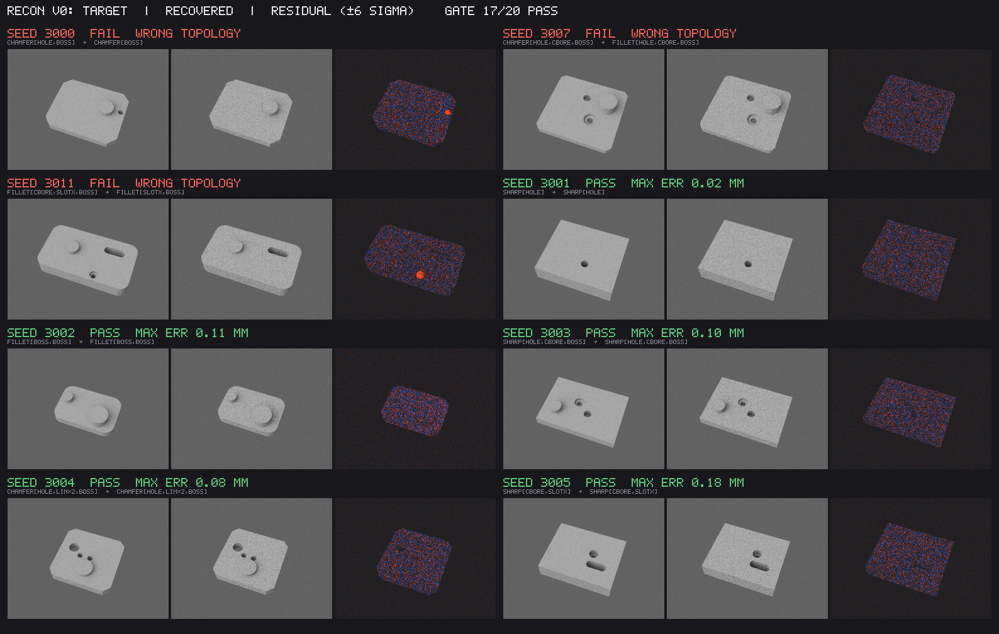
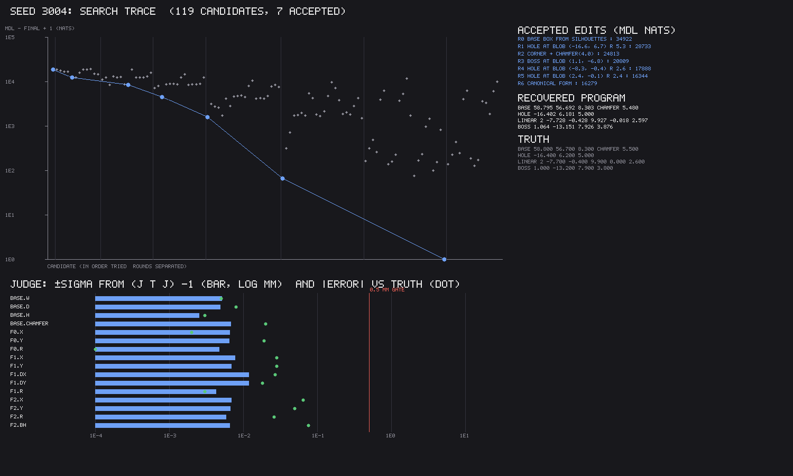

# Image to CAD, video to CAD

Research synthesis from 2026-10-18. v0 (sim-to-sim) is built: see "v0 results" at the end.

The goal is a photo in and an editable vcad program out; later, a video in and vcad plus a phyz scene out.

## The one equation

    score(program, θ) = −log p(photo | irys(phyz(vcad(program, θ))))   residual
                      + ½ log det F(θ)                                  parameter cost (Laplace)
                      + −log p(program)                                 program length (LLM / grammar)

Each term is in nats, so the shortest true description of the photo wins (MDL).
An edit to the program is accepted only if it shortens the description. That
stops the agent from adding a feature for every pixel.

## The loop

- Outer loop, discrete: an agent proposes edits to the vcad program. The program
  is canonicalised by an e-graph (Szalinski, 1909.12252) so equivalent programs
  are deduplicated. Programs with recurring structure are compressed into
  library primitives (DreamCoder, 2006.08381).
- Inner loop, continuous: Levenberg–Marquardt on SE(3) × shape params using irys
  Jacobians (bundle adjustment as the template; Solà 1812.01537). It runs
  coarse-to-fine as a blur homotopy, with OT or distance-transform edge losses
  for wide basins (this fixes the ±5° basin found in phase 2e). The implicit
  function theorem gives gradients through vcad's constraint solver and phyz's
  contact solver (Blondel 2105.15183). Relaxations (DiffCSG 2409.01421, soft
  CSG, Gumbel) are used for proposals only; every candidate is snapped back to
  an exact BRep before it is scored.
- Judge: the Fisher information F = JᵀΣ⁻¹J gives covariances (Cramér–Rao). Its
  near-null eigenvectors are exactly what the photo cannot determine. The next
  view or motion is chosen to maximise log det F (D-optimal).

## Identifiability

- One image: the scale gauge (fixed by an AprilTag; MoGe-2 2507.02546 as a
  prior), hidden faces, and hole depth.
- Video: gravity becomes a metric ruler. Masses come only as ratios unless a
  known force acts. Inertia shows only under rotation, friction only under sliding.

## Steps and gates

| step | input | gate |
|---|---|---|
| v0 sim-to-sim | an irys render of a random vcad part | dimensions within 0.5 mm, topology correct on 20 parts |
| v1 one photo + AprilTag | a printed part with known CAD | reprint it; calipers agree within 1 mm |
| v2 multi-view | 3–10 photos | the same gate on occluded features |
| v3 video → CAD + phyz | a moving mechanism | the re-simulated video matches; it predicts a new motion |

## Where we're ahead, where the literature is

No published image-to-CAD system refines through an exact BRep with a physical,
differentiable renderer, or reports parameter uncertainty. The closest are
CAD-Recode (2412.14042), CADCodeVerify (2410.05340), Img2CAD (2410.03417) and
Articulate-Anything (2410.13882), which are feed-forward or rely on gradient-free
VLM loops. gradSim (2104.02646) is the v3 architecture built on weaker physics.

The literature is ahead on learned proposal priors (DeepCAD 2105.09492, Fusion
360 Gallery 2010.02392), VLM articulation priors, and monocular metric depth.
Use those to initialise; don't rebuild them.

Metrics: Chamfer, IoU, invalid-program rate, and parameter error on the
e-graph canonical form. The last is the editability metric the field lacks.

## v0 results (sim-to-sim, 2026-10-18)

Built in `crates/irys-recon` (publish = false; it depends on irys-diff and
vcad-kernel 0.10, nothing in irys-core/light/prims/gpu learned about vcad).
`cargo run --release -p irys-recon --example recon_v0` runs the gate and
writes `out/recon_v0/report.{json,md}`; `--views 1` is the single-view run;
`examples/recon_figs` draws the two figures below.

**Gate verdict: 17/20 pass with three views; 17/20 with one.** A pass is
canonical topology equal to the truth's and every recovered dimension within
0.5 mm. On the 17 three-view passes the worst dimension error is 0.18 mm; over
their 186 parameters the median error is 0.014 mm and the 90th percentile
0.07 mm. With view 0 alone the worst dimension on a pass is 0.42 mm, the median
parameter error 0.031 mm and the 90th percentile 0.18 mm: one view loses
about a factor of two in precision (mostly counterbore depths and boss
heights, which a second view triangulates) but, on this family, not
topology. The per-part tables are `docs/recon-v0-report-3view.md` and
`docs/recon-v0-report-1view.md` (and their `.json`).

### What was built

- **The program family** (`dsl.rs`). A base plate `w × d × h` whose four
  vertical corner edges are sharp, filleted or chamfered (rounded in the
  sketch, then extruded — vcad 0.10's `fillet`/`chamfer` act on every edge and
  refuse faces with holes), then any of: through-hole, counterbore, through
  slot along x or y, cylindrical boss (a second extrusion, unioned), linear
  and circular patterns of holes. Cuts are `difference`, bosses `union`.
  Continuous parameters are mm and degrees; the discrete structure is the
  corner kind, the feature kinds, slot axis and pattern counts. "Which edges"
  is fixed to the four vertical corners for v0. Programs print and parse as a
  one-statement-per-line text form (`to_text`/`from_text`), which is also the
  surface an LLM proposer would edit.
- **The builder fails closed.** vcad 0.10's booleans sometimes drop a cutter
  depending on cut order (a slot cut after three holes can vanish); a stadium
  sketch extruded as one cutter, or a box unioned with two cylinders, loses
  faces for some sizes. The builder cuts slots as a bar and two cylinders,
  tries cut orders until the solid's volume matches the program's closed form
  to 0.3 %, and refuses otherwise. About 4 % of random slot programs still
  fail to build exactly; the fit treats that as an invalid step.
- **The generator** (`generate.rs`): seeded, 1–3 features, rejection-sampled
  for validity (inside the plate with a margin, no overlaps) and with hole
  radii of different features at least 0.6 mm apart, so the normal form never
  merges two features the generator meant as separate.
- **Normal form** (`canon.rs`), no e-graph: patterns normalised (linear runs
  +x/+y, circular phase in `[0, 360/n)`), plain holes and pattern members
  regrouped by radius into the circular or linear pattern they form, features
  sorted. Topology is equality of canonical signatures; dimension errors are
  matched per feature (a circular phase as arc length at its radius).
- **Rendering** (`render.rs`). irys-diff's CPU path tracer, grey Lambertian
  (albedo 0.6), a studio env (the sky gradient plus one broad key light,
  κ = 6, so shadows stay soft), NEE, two bounces, four hero wavelengths, no
  floor (the background is the sky, so silhouettes and through-holes carry
  signal). Targets are 256 × 192 at 64 spp; the model renders at 16 spp with a
  fixed seed (common random numbers across θ). **Intrinsics, extrinsics and
  the part's pose are known** (the part sits at the origin, axis-aligned);
  recovering SE(3) is not in v0. Three views (azimuth/elevation −70°/58°,
  20°/28°, 145°/72°, 215 mm out); view 0 alone is the single-view setting.
- **The Jacobian** (`geom.rs`, `jac.rs`). irys's primary-visibility edge term
  (2d) restated over per-vertex velocities instead of a rigid `Rig`, producing
  the per-pixel Jacobian LM needs rather than one loss's gradient: crease and
  silhouette edges projected, clipped and sampled ∝ length × importance; the
  two sides traced as a pair in irys's points mode; ownership by the inner
  ray's plane and, for creases, by which side faces the eye more squarely
  (this also keeps a crease counted once where vcad's tessellation splits one
  side with T-junctions). **d(vertices)/d(θ) is analytic**, not finite
  differences of the tessellation: every face the DSL makes lies on a plane or
  vertical cylinder whose placement is a closed form in θ; a vertex's velocity
  is the least-norm motion satisfying the normal speeds of every carrier it
  lies on. vcad's tessellation does not keep its topology under perturbation,
  so differences of vertex positions were not available. The same samples give
  ∂coverage/∂θ for the silhouette term.
- **Where the edge term is not enough.** The interior term (2e) carries only
  rigid placements, so it is not applied to shape parameters. For a grey
  Lambertian part that costs little on the plate's faces but a lot where
  occlusion of the sky is the signal: the edge column of a counterbore's
  depth had the wrong sign, and a boss's columns were half their true size
  (its soft shadow and sky occlusion on the plate move with it). Those six
  parameters (counterbore `r`, `cd`; boss `x, y, r, bh`) get forward-difference
  columns at the same seeds instead. `tests/recon.rs` checks the edge
  Jacobian against central differences of the rendered coverage (exact, every
  column within 10 %) and of the L2 image loss through vcad re-tessellation
  (the base's columns within 25 %; feature columns are typically 20–40 % low,
  which is the missing interior and secondary terms).
- **The inner fit** (`fit.rs`). Levenberg–Marquardt with Marquardt scaling;
  trial steps are judged on the image alone and the Jacobian is built only
  where a step is taken. The residual is the blurred image difference in units
  of the render noise plus a silhouette term `λ·D·(coverage − mask)`, `D` the
  distance transform of the target's background-subtracted mask. The schedule
  is a blur homotopy (σ = 3, 1.5, 0 px; λ annealed to 0), so the score is read
  on the unblurred image term alone.
- **The outer search** (`search.rs`). The `Proposer` trait is the seam; v0's
  `Algorithmic` proposer turns residual blobs on the model's top face (back-
  projected through the model's own hits, merged across views) into hole,
  slot, counterbore and boss candidates, triangulates raised features from
  their parallax across views, proposes patterns through equal blobs
  (including circular patterns with members the blobs missed), and always
  offers structural edits: remove, hole↔counterbore, hole↔slot, hole/
  counterbore→boss, slot axis, merge holes into a pattern, a pattern's count
  ±1, the corner finish. Each candidate gets a short warm-started fit and an
  MDL score; the best is accepted only if it shortens the description. A
  *combine* step fits the best interpretation of every blob at once, so a
  greedy round cannot lock in a joint explanation that is wrong for one of
  them. A fit that collapses onto a simpler program (a blend under 0.8 mm, a
  slot under 1.5 mm, a counterbore without a step) is refused: its optimum
  sits on a bound, where the Laplace term does not hold. The search runs at
  half resolution (the target box-downsampled, 8 spp); the winner is
  canonicalised and refitted at full resolution, and that is what is scored,
  judged and reported.
- **The score** (`mdl.rs`). Residual `½Σr²` in nats (σ_n from two seeds of the
  renderer, the target's share by its spp); parameter cost per eigen-direction
  `λ` of the range-whitened Fisher information `R F R`, `max(0, ½ log(λ/2π))`;
  program length from a grammar (corner kind over three, geometric feature
  count, kind over six, axis over two, pattern counts uniform) plus one nat
  per parameter. The first version used the bare `½ log det F`, which pays a
  program for parameters the photo cannot see (`−∞` for a null direction):
  it turned the far hole of a deep pattern into a blind counterbore with a
  0.4 mm through-hole. Floored per direction, a parameter the photo does not
  determine costs its writing and nothing else.
- **The judge.** `F⁻¹` gives per-parameter σ, and eigen-directions with
  σ > 0.5 mm are flagged. **Its σ are optimistic**: on the passes they are
  0.003–0.03 mm while the actual errors are a median 2.3 σ (90th percentile 8 σ). The
  noise model is one global variance and the model has bias the noise does not
  (tessellation chords, the missing interior and secondary terms, f32
  vertices), so `(JᵀJ)⁻¹` is a floor on the error, not its size. No
  direction was flagged with three views; none with one view either: every through-feature's depth is the plate's
height, which the silhouette gives, and the counterbore floors and boss tops
are seen from view 0's 58° elevation. Blind features would be the first
flags (below).

The trace above is seed 3004 (chamfered plate, a hole, a two-hole linear
pattern and a boss; 119 candidates in 7 rounds): the base box from
silhouettes, the largest blob as a hole, the corner, the boss, two more holes,
then the canonical form merging the two equal holes into a pattern. Below it,
every parameter's ±σ against its actual error.

### What fails, and why

Three of twenty three-view parts fail, and all three are **search** failures:
in each the truth's own MDL (scored at full resolution) is lower than the
recovered program's, so the score would have chosen the truth had it been
proposed. None is an identifiability failure and none a fit failure — on
every part whose topology is right, every dimension is within 0.18 mm.

| seed | truth | recovered | MDL rec. / truth | cause |
|---|---|---|---|---|
| 3000 | chamfer, hole, boss | chamfer, boss | 87015 / 74718 | the hole sits beside the boss; their residual blobs merged into one, which was explained as the boss, and the hole was never proposed alone |
| 3007 | chamfer 3.9, hole, counterbore, boss | fillet 6.1, … | 75360 / 74666 | at the search's half resolution a 6 mm fillet and a 3.9 mm chamfer score alike; the chamfer edit was offered every round and lost there, and only full resolution separates them |
| 3011 | fillet, counterbore, slot, boss | fillet, slot, boss | 92892 / 74558 | the 3.7 mm counterbore never became a blob at half resolution (round 1 saw only the slot and the boss), so it was never proposed; the full-resolution residual in the figure shows it plainly |

With one view the three failures are again search failures (truth's MDL
lower each time), and all three involve a boss: 3004 (a boss fitted 1.9 mm
off with a radius 1.5 mm too large, a spurious hole beside it, and the
linear pattern left as loose holes), 3006 (a 9.7 mm-tall boss explained as a
slot), 3007 (a 10 mm-tall boss never proposed). A raised feature's top disc
lands on the plate's top face shifted along the view ray by its height;
with one view the proposer cannot triangulate that (the parallax proposal
needs two), so its initial position is off by up to `bh · cot(58°)` ≈ 6 mm,
outside the fit's basin. 3000 and 3011, which three views failed, pass with
one: the search differs (other blobs, other rounds), not the evidence.

One single-view "failure" was a bug in the scorer, not the solver: seed
3014's linear pattern was recovered with its holes listed top to bottom
(`dy = −12`, `dx = +0.013`) and the normal form flipped direction only on
the sign of `dx`. The normal form now orders a run along its dominant axis;
both runs were re-scored from their saved programs with `--rescore` (the
three-view verdicts did not change).

Earlier failures on the development seeds were fixed on the way and are
the reason for several pieces above: the floored Laplace term (a blind
counterbore preferred to a through hole), the forward-difference columns (a
counterbore whose fitted depth ran away; a boss stepped away from its
target), the combine step (two blobs explained jointly as two holes when one
was a boss), and the sliver rule in the edge sampler (zero-area triangles
along boolean seams hid the base's silhouette creases, halving its column).

**Gate-set hygiene.** Seeds 1000–1019 were the first gate set and 2000–2019
the second; in each, the first failures were inspected and fixed, which makes
them development seeds. The reported gate is 3000–3019, run once after the
solver was frozen. The development set is 0–99 plus those.

### Timings

M-series, 16 cores, CPU only (no GPU path in recon). Three views: 5488 s for
twenty parts, median 190 s per part (38–820 s); median 33 candidates,
207 LM iterations and 608 renders per part. Most of a candidate is vcad (a
build with retried cut orders, then tessellation) and the 128 × 96 renders;
parts with patterns, bosses or counterbores are the slow ones (more cuts,
forward-difference columns). One view: 6764 s, median 249 s per part (40–1300 s) — fewer renders per
candidate, but more rounds and more candidates when the evidence is
thinner.

### What v1 (one real photo + an AprilTag) needs

- **Pose.** v0 knows the camera and the part's placement. A tag gives the
  camera's intrinsics-plus-extrinsics and the metric scale; the part's SE(3)
  on the table still has to be fitted. irys already has the rigid pieces
  (`vis::Rig`, `Tangents::rig`, `CameraRig`): the part's pose is one rigid
  placement, so its six columns come from the existing edge *and* interior
  terms, unlike the shape columns.
- **Appearance.** A real print is not grey Lambertian under a known studio:
  an OpenPBR material with a fitted albedo and roughness, an environment
  captured or fitted (a light probe, or the background plate the tag frame
  gives), and a camera response. The residual must be robust (Huber or a
  learned noise model) because the real noise is not the renderer's.
- **Secondary terms.** Shadows and sky occlusion moved enough here to need
  forward differences; with a real key light they get sharper. Wire 2f's
  secondary edge sampling to vertex velocities (the same carrier velocities
  feed it) and drop the differences.
- **Segmentation.** v0's mask is background subtraction against a rendered
  empty studio. A real photo needs a segmenter (or a turntable shot with and
  without the part).
- **Search at full resolution for the finalists.** Two of three failures are
  decisions the half-resolution score cannot make. Refit the best few
  candidates of the last rounds at full resolution before stopping, and keep
  a beam of two states rather than one.
- **A proposer with a prior.** Blob detection misses features beside other
  features. The `Proposer` trait takes the program text, the score's terms,
  the judge's weak directions and the residual blobs (or the residual images
  for a vision model) and returns edited program text; the fit and the MDL
  verdict stay in the loop, so a hallucinated feature costs one fit and is
  refused unless the photo pays for it. The agent's −log p(text) would replace
  the grammar prior.
- **A wider family.** Through-features and one boss height are what v0
  covers. Blind holes and pockets need views into them (identifiability: from
  58° elevation no view reaches the floor of a 3.6 mm hole in a 16 mm plate),
  which is v2's multi-view gate.
