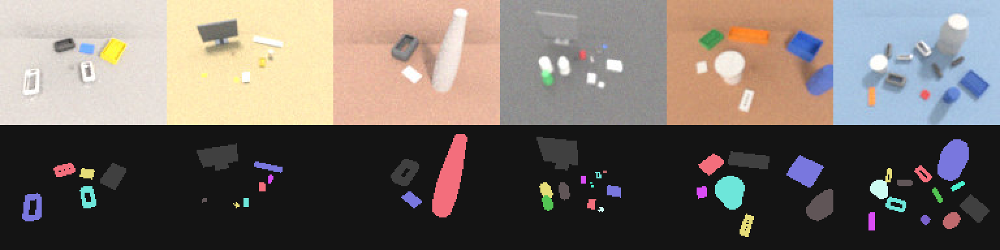
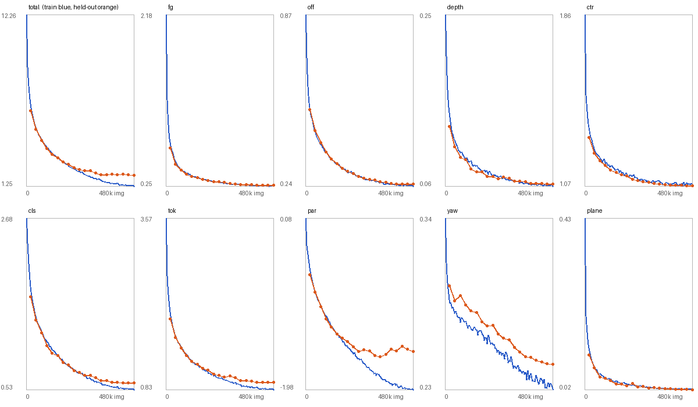
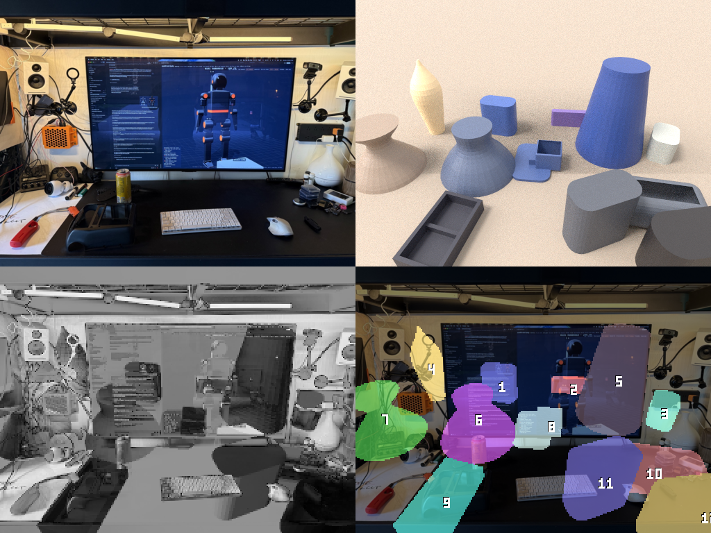

# Image to CAD, video to CAD

Research synthesis from 2026-10-18. v0 (sim-to-sim) is built: see "v0 results" at the end.

The goal is a photo in and an editable vcad program out; later, a video in and vcad plus a phyz scene out.

## The one equation

    score(program, θ) = −log p(photo | irys(phyz(vcad(program, θ))))   residual
                      + ½ log det F(θ)                                  parameter cost (Laplace)
                      + −log p(program)                                 program length (LLM / grammar)

Each term is in nats, so the shortest true description of the photo wins (MDL).
An edit to the program is accepted only if it shortens the description. That
stops the agent from adding a feature for every pixel.

## The loop

- Outer loop, discrete: an agent proposes edits to the vcad program. The program
  is canonicalised by an e-graph (Szalinski, 1909.12252) so equivalent programs
  are deduplicated. Programs with recurring structure are compressed into
  library primitives (DreamCoder, 2006.08381).
- Inner loop, continuous: Levenberg–Marquardt on SE(3) × shape params using irys
  Jacobians (bundle adjustment as the template; Solà 1812.01537). It runs
  coarse-to-fine as a blur homotopy, with OT or distance-transform edge losses
  for wide basins (this fixes the ±5° basin found in phase 2e). The implicit
  function theorem gives gradients through vcad's constraint solver and phyz's
  contact solver (Blondel 2105.15183). Relaxations (DiffCSG 2409.01421, soft
  CSG, Gumbel) are used for proposals only; every candidate is snapped back to
  an exact BRep before it is scored.
- Judge: the Fisher information F = JᵀΣ⁻¹J gives covariances (Cramér–Rao). Its
  near-null eigenvectors are exactly what the photo cannot determine. The next
  view or motion is chosen to maximise log det F (D-optimal).

## Identifiability

- One image: the scale gauge (fixed by an AprilTag; MoGe-2 2507.02546 as a
  prior), hidden faces, and hole depth.
- Video: gravity becomes a metric ruler. Masses come only as ratios unless a
  known force acts. Inertia shows only under rotation, friction only under sliding.

## Steps and gates

| step | input | gate |
|---|---|---|
| v0 sim-to-sim | an irys render of a random vcad part | dimensions within 0.5 mm, topology correct on 20 parts |
| v1 one photo + AprilTag | a printed part with known CAD | reprint it; calipers agree within 1 mm |
| v2 multi-view | 3–10 photos | the same gate on occluded features |
| v3 video → CAD + phyz | a moving mechanism | the re-simulated video matches; it predicts a new motion |

## Where we're ahead, where the literature is

No published image-to-CAD system refines through an exact BRep with a physical,
differentiable renderer, or reports parameter uncertainty. The closest are
CAD-Recode (2412.14042), CADCodeVerify (2410.05340), Img2CAD (2410.03417) and
Articulate-Anything (2410.13882), which are feed-forward or rely on gradient-free
VLM loops. gradSim (2104.02646) is the v3 architecture built on weaker physics.

The literature is ahead on learned proposal priors (DeepCAD 2105.09492, Fusion
360 Gallery 2010.02392), VLM articulation priors, and monocular metric depth.
Use those to initialise; don't rebuild them.

Metrics: Chamfer, IoU, invalid-program rate, and parameter error on the
e-graph canonical form. The last is the editability metric the field lacks.

## v0 results (sim-to-sim, 2026-10-18)

Built in `crates/irys-recon` (publish = false; it depends on irys-diff and
vcad-kernel 0.10, nothing in irys-core/light/prims/gpu learned about vcad).
`cargo run --release -p irys-recon --example recon_v0` runs the gate and
writes `out/recon_v0/report.{json,md}`; `--views 1` is the single-view run;
`examples/recon_figs` draws the two figures below.

**Gate verdict: 17/20 pass with three views; 17/20 with one.** A pass is
canonical topology equal to the truth's and every recovered dimension within
0.5 mm. On the 17 three-view passes the worst dimension error is 0.18 mm; over
their 186 parameters the median error is 0.014 mm and the 90th percentile
0.07 mm. With view 0 alone the worst dimension on a pass is 0.42 mm, the median
parameter error 0.031 mm and the 90th percentile 0.18 mm: one view loses
about a factor of two in precision (mostly counterbore depths and boss
heights, which a second view triangulates) but, on this family, not
topology. The per-part tables are `docs/recon-v0-report-3view.md` and
`docs/recon-v0-report-1view.md` (and their `.json`).

### What was built

- **The program family** (`dsl.rs`). A base plate `w × d × h` whose four
  vertical corner edges are sharp, filleted or chamfered (rounded in the
  sketch, then extruded — vcad 0.10's `fillet`/`chamfer` act on every edge and
  refuse faces with holes), then any of: through-hole, counterbore, through
  slot along x or y, cylindrical boss (a second extrusion, unioned), linear
  and circular patterns of holes. Cuts are `difference`, bosses `union`.
  Continuous parameters are mm and degrees; the discrete structure is the
  corner kind, the feature kinds, slot axis and pattern counts. "Which edges"
  is fixed to the four vertical corners for v0. Programs print and parse as a
  one-statement-per-line text form (`to_text`/`from_text`), which is also the
  surface an LLM proposer would edit.
- **The builder fails closed.** vcad 0.10's booleans sometimes drop a cutter
  depending on cut order (a slot cut after three holes can vanish); a stadium
  sketch extruded as one cutter, or a box unioned with two cylinders, loses
  faces for some sizes. The builder cuts slots as a bar and two cylinders,
  tries cut orders until the solid's volume matches the program's closed form
  to 0.3 %, and refuses otherwise. About 4 % of random slot programs still
  fail to build exactly; the fit treats that as an invalid step.
- **The generator** (`generate.rs`): seeded, 1–3 features, rejection-sampled
  for validity (inside the plate with a margin, no overlaps) and with hole
  radii of different features at least 0.6 mm apart, so the normal form never
  merges two features the generator meant as separate.
- **Normal form** (`canon.rs`), no e-graph: patterns normalised (linear runs
  +x/+y, circular phase in `[0, 360/n)`), plain holes and pattern members
  regrouped by radius into the circular or linear pattern they form, features
  sorted. Topology is equality of canonical signatures; dimension errors are
  matched per feature (a circular phase as arc length at its radius).
- **Rendering** (`render.rs`). irys-diff's CPU path tracer, grey Lambertian
  (albedo 0.6), a studio env (the sky gradient plus one broad key light,
  κ = 6, so shadows stay soft), NEE, two bounces, four hero wavelengths, no
  floor (the background is the sky, so silhouettes and through-holes carry
  signal). Targets are 256 × 192 at 64 spp; the model renders at 16 spp with a
  fixed seed (common random numbers across θ). **Intrinsics, extrinsics and
  the part's pose are known** (the part sits at the origin, axis-aligned);
  recovering SE(3) is not in v0. Three views (azimuth/elevation −70°/58°,
  20°/28°, 145°/72°, 215 mm out); view 0 alone is the single-view setting.
- **The Jacobian** (`geom.rs`, `jac.rs`). irys's primary-visibility edge term
  (2d) restated over per-vertex velocities instead of a rigid `Rig`, producing
  the per-pixel Jacobian LM needs rather than one loss's gradient: crease and
  silhouette edges projected, clipped and sampled ∝ length × importance; the
  two sides traced as a pair in irys's points mode; ownership by the inner
  ray's plane and, for creases, by which side faces the eye more squarely
  (this also keeps a crease counted once where vcad's tessellation splits one
  side with T-junctions). **d(vertices)/d(θ) is analytic**, not finite
  differences of the tessellation: every face the DSL makes lies on a plane or
  vertical cylinder whose placement is a closed form in θ; a vertex's velocity
  is the least-norm motion satisfying the normal speeds of every carrier it
  lies on. vcad's tessellation does not keep its topology under perturbation,
  so differences of vertex positions were not available. The same samples give
  ∂coverage/∂θ for the silhouette term.
- **Where the edge term is not enough.** The interior term (2e) carries only
  rigid placements, so it is not applied to shape parameters. For a grey
  Lambertian part that costs little on the plate's faces but a lot where
  occlusion of the sky is the signal: the edge column of a counterbore's
  depth had the wrong sign, and a boss's columns were half their true size
  (its soft shadow and sky occlusion on the plate move with it). Those six
  parameters (counterbore `r`, `cd`; boss `x, y, r, bh`) get forward-difference
  columns at the same seeds instead. `tests/recon.rs` checks the edge
  Jacobian against central differences of the rendered coverage (exact, every
  column within 10 %) and of the L2 image loss through vcad re-tessellation
  (the base's columns within 25 %; feature columns are typically 20–40 % low,
  which is the missing interior and secondary terms).
- **The inner fit** (`fit.rs`). Levenberg–Marquardt with Marquardt scaling;
  trial steps are judged on the image alone and the Jacobian is built only
  where a step is taken. The residual is the blurred image difference in units
  of the render noise plus a silhouette term `λ·D·(coverage − mask)`, `D` the
  distance transform of the target's background-subtracted mask. The schedule
  is a blur homotopy (σ = 3, 1.5, 0 px; λ annealed to 0), so the score is read
  on the unblurred image term alone.
- **The outer search** (`search.rs`). The `Proposer` trait is the seam; v0's
  `Algorithmic` proposer turns residual blobs on the model's top face (back-
  projected through the model's own hits, merged across views) into hole,
  slot, counterbore and boss candidates, triangulates raised features from
  their parallax across views, proposes patterns through equal blobs
  (including circular patterns with members the blobs missed), and always
  offers structural edits: remove, hole↔counterbore, hole↔slot, hole/
  counterbore→boss, slot axis, merge holes into a pattern, a pattern's count
  ±1, the corner finish. Each candidate gets a short warm-started fit and an
  MDL score; the best is accepted only if it shortens the description. A
  *combine* step fits the best interpretation of every blob at once, so a
  greedy round cannot lock in a joint explanation that is wrong for one of
  them. A fit that collapses onto a simpler program (a blend under 0.8 mm, a
  slot under 1.5 mm, a counterbore without a step) is refused: its optimum
  sits on a bound, where the Laplace term does not hold. The search runs at
  half resolution (the target box-downsampled, 8 spp); the winner is
  canonicalised and refitted at full resolution, and that is what is scored,
  judged and reported.
- **The score** (`mdl.rs`). Residual `½Σr²` in nats (σ_n from two seeds of the
  renderer, the target's share by its spp); parameter cost per eigen-direction
  `λ` of the range-whitened Fisher information `R F R`, `max(0, ½ log(λ/2π))`;
  program length from a grammar (corner kind over three, geometric feature
  count, kind over six, axis over two, pattern counts uniform) plus one nat
  per parameter. The first version used the bare `½ log det F`, which pays a
  program for parameters the photo cannot see (`−∞` for a null direction):
  it turned the far hole of a deep pattern into a blind counterbore with a
  0.4 mm through-hole. Floored per direction, a parameter the photo does not
  determine costs its writing and nothing else.
- **The judge.** `F⁻¹` gives per-parameter σ, and eigen-directions with
  σ > 0.5 mm are flagged. **Its σ are optimistic**: on the passes they are
  0.003–0.03 mm while the actual errors are a median 2.3 σ (90th percentile 8 σ). The
  noise model is one global variance and the model has bias the noise does not
  (tessellation chords, the missing interior and secondary terms, f32
  vertices), so `(JᵀJ)⁻¹` is a floor on the error, not its size. No
  direction was flagged with three views; none with one view either: every through-feature's depth is the plate's
height, which the silhouette gives, and the counterbore floors and boss tops
are seen from view 0's 58° elevation. Blind features would be the first
flags (below).

The trace above is seed 3004 (chamfered plate, a hole, a two-hole linear
pattern and a boss; 119 candidates in 7 rounds): the base box from
silhouettes, the largest blob as a hole, the corner, the boss, two more holes,
then the canonical form merging the two equal holes into a pattern. Below it,
every parameter's ±σ against its actual error.

### What fails, and why

Three of twenty three-view parts fail, and all three are **search** failures:
in each the truth's own MDL (scored at full resolution) is lower than the
recovered program's, so the score would have chosen the truth had it been
proposed. None is an identifiability failure and none a fit failure — on
every part whose topology is right, every dimension is within 0.18 mm.

| seed | truth | recovered | MDL rec. / truth | cause |
|---|---|---|---|---|
| 3000 | chamfer, hole, boss | chamfer, boss | 87015 / 74718 | the hole sits beside the boss; their residual blobs merged into one, which was explained as the boss, and the hole was never proposed alone |
| 3007 | chamfer 3.9, hole, counterbore, boss | fillet 6.1, … | 75360 / 74666 | at the search's half resolution a 6 mm fillet and a 3.9 mm chamfer score alike; the chamfer edit was offered every round and lost there, and only full resolution separates them |
| 3011 | fillet, counterbore, slot, boss | fillet, slot, boss | 92892 / 74558 | the 3.7 mm counterbore never became a blob at half resolution (round 1 saw only the slot and the boss), so it was never proposed; the full-resolution residual in the figure shows it plainly |

With one view the three failures are again search failures (truth's MDL
lower each time), and all three involve a boss: 3004 (a boss fitted 1.9 mm
off with a radius 1.5 mm too large, a spurious hole beside it, and the
linear pattern left as loose holes), 3006 (a 9.7 mm-tall boss explained as a
slot), 3007 (a 10 mm-tall boss never proposed). A raised feature's top disc
lands on the plate's top face shifted along the view ray by its height;
with one view the proposer cannot triangulate that (the parallax proposal
needs two), so its initial position is off by up to `bh · cot(58°)` ≈ 6 mm,
outside the fit's basin. 3000 and 3011, which three views failed, pass with
one: the search differs (other blobs, other rounds), not the evidence.

One single-view "failure" was a bug in the scorer, not the solver: seed
3014's linear pattern was recovered with its holes listed top to bottom
(`dy = −12`, `dx = +0.013`) and the normal form flipped direction only on
the sign of `dx`. The normal form now orders a run along its dominant axis;
both runs were re-scored from their saved programs with `--rescore` (the
three-view verdicts did not change).

Earlier failures on the development seeds were fixed on the way and are
the reason for several pieces above: the floored Laplace term (a blind
counterbore preferred to a through hole), the forward-difference columns (a
counterbore whose fitted depth ran away; a boss stepped away from its
target), the combine step (two blobs explained jointly as two holes when one
was a boss), and the sliver rule in the edge sampler (zero-area triangles
along boolean seams hid the base's silhouette creases, halving its column).

**Gate-set hygiene.** Seeds 1000–1019 were the first gate set and 2000–2019
the second; in each, the first failures were inspected and fixed, which makes
them development seeds. The reported gate is 3000–3019, run once after the
solver was frozen. The development set is 0–99 plus those.

### Timings

M-series, 16 cores, CPU only (no GPU path in recon). Three views: 5488 s for
twenty parts, median 190 s per part (38–820 s); median 33 candidates,
207 LM iterations and 608 renders per part. Most of a candidate is vcad (a
build with retried cut orders, then tessellation) and the 128 × 96 renders;
parts with patterns, bosses or counterbores are the slow ones (more cuts,
forward-difference columns). One view: 6764 s, median 249 s per part (40–1300 s) — fewer renders per
candidate, but more rounds and more candidates when the evidence is
thinner.

### What v1 (one real photo + an AprilTag) needs

- **Pose.** v0 knows the camera and the part's placement. A tag gives the
  camera's intrinsics-plus-extrinsics and the metric scale; the part's SE(3)
  on the table still has to be fitted. irys already has the rigid pieces
  (`vis::Rig`, `Tangents::rig`, `CameraRig`): the part's pose is one rigid
  placement, so its six columns come from the existing edge *and* interior
  terms, unlike the shape columns.
- **Appearance.** A real print is not grey Lambertian under a known studio:
  an OpenPBR material with a fitted albedo and roughness, an environment
  captured or fitted (a light probe, or the background plate the tag frame
  gives), and a camera response. The residual must be robust (Huber or a
  learned noise model) because the real noise is not the renderer's.
- **Secondary terms.** Shadows and sky occlusion moved enough here to need
  forward differences; with a real key light they get sharper. Wire 2f's
  secondary edge sampling to vertex velocities (the same carrier velocities
  feed it) and drop the differences.
- **Segmentation.** v0's mask is background subtraction against a rendered
  empty studio. A real photo needs a segmenter (or a turntable shot with and
  without the part).
- **Search at full resolution for the finalists.** Two of three failures are
  decisions the half-resolution score cannot make. Refit the best few
  candidates of the last rounds at full resolution before stopping, and keep
  a beam of two states rather than one.
- **A proposer with a prior.** Blob detection misses features beside other
  features. The `Proposer` trait takes the program text, the score's terms,
  the judge's weak directions and the residual blobs (or the residual images
  for a vision model) and returns edited program text; the fit and the MDL
  verdict stay in the loop, so a hallucinated feature costs one fit and is
  refused unless the photo pays for it. The agent's −log p(text) would replace
  the grammar prior.
- **A wider family.** Through-features and one boss height are what v0
  covers. Blind holes and pockets need views into them (identifiability: from
  58° elevation no view reaches the floor of a 3.6 mm hole in a 16 mm plate),
  which is v2's multi-view gate.

## v1 (one photo + an AprilTag, synthetic photos, 2026-10-19)

Built in `crates/irys-recon` (new: `tag`, `photo`, `look`, `segment`,
`export`, `v1`; examples `recon_v1`, `recon_photo`, `recon_kit`,
`recon_jaccheck`). No real photo exists yet; v1 is validated on synthetic
phone photos. Per-part tables: `docs/recon-v1-report.md` (`.json`).

**Synthetic gate (seeds 3000–3019, v0's gate parts, one photo each): 2/20
pass at 0.5 mm, 6/20 at 1 mm; topology right on 11/20.** Pose on the tag
plane is the strong part: median |Δx|, |Δy| ≈ 0.25 mm, yaw within 0.15°
on every part whose base was right; focal from EXIF+tag within ±0.6 %.

### Method

- **Tag** (`tag.rs`): `kornia-apriltag` (pure Rust, Apache-2.0; the tag36h11
  table is AprilRobotics', BSD-2) finds the quad (tried at decimation 2, 3, 4,
  1: at full resolution it misses large tags); corners are matched to the tag
  frame by decoding all eight assignments, refined by line fits to the
  gradient maximum along each side **on linear light** (on sRGB values the
  edge shifts to the dark side: the camera came out 0.6 % far), and the camera
  (pose + focal, principal point at the centre) is solved by LM with the EXIF
  35 mm-equivalent focal as a 2 % prior (one tag trades focal against
  distance; free, it drifted 1.4 %).
- **Pose** (`photo.rs`, `Program::pose`): `(x, y, yaw)` on the tag plane,
  last in the parameter vector. The model renderer is deterministic: G-buffer
  (`ss²` rays/pixel), AO from 16 fixed rays, a soft key from 8 shadow rays,
  closed-form shading. Jacobian: v0's primary edge term on world vertex
  velocities (pose columns are rigid velocities), the **key's shadow edges on
  the same velocities** (2f's secondary term: `dS = v − (m·v / m·l) l`), and a
  yaw interior term. `recon_jaccheck` vs central differences: with the shadow
  term the base and pose columns go from ratio 0.42–0.58 to 0.85–0.90
  (cosines 0.65–0.76 → 0.92–0.95); boss columns from 0.33–0.55 to 0.71–0.84.
  The counterbore depth stays wrong-signed (its signal is AO, not
  differentiated), so **the forward-difference columns stay** for
  counterbores and bosses (cheap now: a render is 0.25 s).
- **Appearance** (`look.rs`): OpenPBR glossy-diffuse at `base_color`,
  `specular_roughness`, `specular_ior` (Lambert under a GGX dielectric,
  single scatter); L2 SH irradiance × AO plus one key; table albedo as unit;
  sRGB then a fitted power. Robust IRLS linear solve for SH/key/albedo (ridge
  on SH orders > 0), grid + coordinate search for key direction, key radius,
  roughness, gamma; per-channel colour with the grey light's shape. Colour
  recovered well (seed 3001: 0.81, 0.60, 0.02 vs 0.80, 0.62, 0.04 after the
  backdrop's albedo).
- **Noise**: Huber (1.5σ), σ by MAD of the base fit's residual, scaled by the
  residual's integrated autocorrelation area on the table (the appearance
  model's misses are smooth, so pixels are not independent).
- **Segmentation** (`segment.rs`): backdrop = median chromaticity + robust
  quadratic luminance over table points (the tag plane gives every pixel's
  table point; the tag's 100 mm square excluded); part = far chromaticity or
  out-of-range luminance, edges joined, majority filter. Holes kept. Plus a
  **chromatic coverage term** in the fit: chromaticity projected on
  backdrop→part is an observed coverage, independent of shading, residual
  `cov − cov_obs` against the edge term's `∂cov/∂θ`.
- **Base**: one silhouette trades plate depth against height (and reads a
  boss as a taller plate), so `init_bases` gives the best box per height band
  and each is lit and fitted on the image; the lowest robust cost wins
  (a silhouette-only settle collapses all starts to the tall one).
- **Search fixes**: beam of 2, the best 4 distinct programs refitted at full
  resolution (degenerate refits refused), one-view boss proposals at three
  heights with the centre moved back along the view. `Options::v0()` keeps v0's.
- **Synthetic photos** (`recon_v1 render`): `look::scene_gpu`, PLA OpenPBR in
  six saturated colours (roughness 0.35–0.6), a 90 mm tag sheet (textured) on
  a grey paper backdrop, the pavilion world turned at random or a synthetic
  room (window + ceiling panel), a key disc 3–10°, phone camera (26 mm eq.,
  2016×1512), defocus σ 0.7 px, Poisson–Gaussian noise, sRGB × extra power
  0.9–1.1, JPEG 85–92, EXIF focal. 320 spp; some fireflies survive on faces
  lit by the room's window.

### Where it fails

- **Search/topology (9/20)**: counterbores read as plain holes (3011, 3017,
  3018: the step's AO shading is what the model gets least right), features
  never proposed (3005, 3013, 3019 recover the bare base: residual blobs from
  lighting mismatch outrank them), hallucinated bosses from highlights
  (3002, 3003).
- **Boss height / plate height trade (4/20 with right topology but > 1 mm)**:
  3006, 3008, 3010 pick a too-tall plate (by 5–13 mm); 3007's boss 6 mm short.
  One view cannot separate them except through shading, and the shading
  model is where the bias is.
- **Bias floor**: on passing parts errors are 0.3–0.9 mm, mostly heights and
  depths. Self-consistency (target rendered by the model itself) recovers h to
  0.04 mm, so the floor is appearance mismatch (interreflection, the window's
  sharp reflection, contact shading), not the solver.
- Fisher σ remain optimistic even after the correlation scaling.

### What the real photo will test, and risks

- EXIF/phone processing (HDR tone curves, sharpening, lens distortion:
  none modelled; principal point assumed centred).
- Real light: several sources, a coloured room; the SH+key model is the
  weakest link already in synthetic.
- Print reality: layer lines, elephant's foot (bottom edge +0.2–0.4 mm),
  translucency of thin PLA (no subsurface in the model).
- Segmentation needs colour contrast: white/grey/black parts on white paper
  will not segment.
- Single view: plate height vs boss/plate-depth ambiguity; three photos
  (supported: shared pose, one look per photo) are the recommended capture.
- Runtime 30 s–20 min per part under load (CPU only).

### Next

Multi-view on the real kit photos first; an AO derivative (secondary edges for
the AO rays) to drop the counterbore FD columns; a two-light or
environment-map appearance; a proposer with a prior (the v0 list stands).

## v2: neural (a learned scene proposer, 2026-10-19)

Built in `crates/irys-recon-net` (publish = false). The goal: one photo,
maybe from a robot's eyes, in; a parametric inventory of everything in it
out. The network makes the guess and the MDL search is supposed to add the
precision. Short version: the proposer works on synthetic scenes. The search
and the renderer-as-teacher both lower the description length, but on this
model they do not lower the dimension error. The desk photo is mostly
not recovered.

### The scene language (`scene.rs`)

A scene is many objects on a support plane. Each object has a family, four
structure tokens, continuous parameters (mm), a pose `(x, y, yaw)` and an
OpenPBR substance, and one line of text describes it, e.g.
`keyboard grid rows=5 w=412.30 d=125.10 h=18.20 pitch=19.05 key_h=7.90 @ 41.0 -12.5 8.0`.

| family | tokens | parameters | classes |
|---|---|---|---|
| plate (v0's `dsl::Program`) | grid n×m or circle of k holes | w d h r hole_r pitch | bracket, gear plate |
| lathe (revolved Catmull–Rom profile) | — | h r0..r3 | soda can, bottle, cup, humidifier |
| product (filleted box) | vertical / all edges, stand | w d h r lift | monitor, power strip, speaker, mouse, webcam |
| grid (base + key caps at a pitch) | rows | w d h pitch key_h | keyboard |
| shell (walls + floor) | open with 0–4 ribs / honeycomb lid | w d h wall cell | tray, honeycomb case |

The known-size objects (scale gauges) are the 12 oz can at 122 mm and the
key pitch at 19.05 mm. Plates mesh through vcad for the photos. The search
uses a boolean-free mesher instead (ear clipping, holes bridged to the
outline), which matches the program volume within 2 %.

### Data engine (`data.rs`, `render.rs`, `examples/neural_data`)

Each scene has 3–12 objects, placed by rejection on bounding circles (45 %
are desk-scale, with a monitor, keyboard and power strip). The camera looks
along +y from 28–65° above the plane with a 58–72° horizontal FOV. Lighting
is a procedural equirect with a window and a key light; materials are
plastic, PLA colours, aluminium and wood/grey/black tables. irys's OpenPBR
kernel path traces each scene on the device at 256×192 and 16 spp. Then
the camera stage runs (defocus, exposure, Poisson–Gaussian noise, tone,
JPEG 82–95) and the frame is downsampled to 128×96. The dense labels come
from an irys TLAS cast: instance ids, metric depth, normals, and which
gauges are in view. The labels also hold the program text, the poses and
the camera. Domain B is the shifted, unlabelled-use slice: lower and
wider cameras, harder lights and stronger post.

- 40 000 training scenes (301 k objects, 7.5 per scene, a gauge in 63 % of
  scenes), 400 held-out A, 1 000 B for tuning and 300 held-out B. 4.4 GB.
- Rate: 12–19 scenes/s on this Mac. The CPU stages (sampling, meshing,
  labels) run in parallel and the device renders one frame at a time.
  M1's batched sensor path was not merged when this was built, so this
  uses the existing per-scene `GpuLook` path.
- Deterministic: a seed fixes the whole sample (tested).

### The network (`net.rs`, `train.rs`)

- An MLP-Mixer over 8×8 patches (192 tokens): d 128, 6 blocks, token-MLP
  256, channel-MLP 384, **1.28 M parameters**.
- Heads, per pixel: foreground, the offset to the instance centre, and
  log metric depth. Per patch: CenterNet heat, class (14), structure
  tokens (4 × 8), parameter mean and log σ (Gaussian NLL), and
  (cos 2ψ, sin 2ψ). Per image: camera height and pitch over the plane,
  which sets the metric scale. Instances come from heat peaks, with each
  pixel's centre vote deciding its instance.
- One tang tensor-IR graph holds the forward and the loss. The gradient is
  `TensorGraph::backward`'s, and there is no hand-written backward pass.
  The graph runs as compiled C (f32) through `irys_diff::ir::Program`,
  with 12 workers × 4 images. `neural_check`: native agrees with the
  interpreter to 9e-4 relative, and backward agrees with central
  differences to 6e-7. tang has no usable GPU path here, because tang-gpu
  is on wgpu 25 and irys is on 30. tang's `merge_reduce_dims` pass lowers
  this graph to invalid C at bfc8003, so the pass list stops at
  `merge_siblings`.
- Training: 10 000 steps of 48 images (480 k images, flips and photometric
  jitter), Adam at 1e-3 with cosine decay and weight decay 3e-4. **60 min**
  on 12 CPU cores (~130 images/s). The first run used 20 k scenes, 12 k
  steps and no jitter. It overfit: held-out loss fell to 2.66 at step 7.5 k
  and then rose to 3.80, almost all of it in the parameter NLL as σ
  collapsed. Doubling the data fixed it, with held-out loss falling to
  1.94 at the end.

### Synthetic results (`examples/neural_eval`)

Held-out domain A. A detection matches when its base centre lands within
max(4 px, 0.6 · object radius) of the truth's in the image. Dimension
errors count only matched objects whose topology is right.

| | net (200 scenes) | net (15) | net + search (15) | net + search, true camera (15) | search only, true camera (15) |
|---|---|---|---|---|---|
| inventory recall | 0.78 | 0.89 | 0.90 | 0.89 | 0.19 |
| inventory precision | 0.90 | 0.98 | 0.99 | 0.98 | 0.25 |
| class accuracy | 0.81 | 0.79 | 0.78 | 0.73 | 0.06 |
| topology accuracy | **0.75** | 0.68 | 0.55 | 0.44 | 0.12 |
| dims within 0.5 mm | 9 % | 9 % | 8 % | 4 % | 10 % |
| dims within 1 mm | 17 % | 20 % | 14 % | 10 % | 10 % |
| objects with every dim ≤ 1 mm | 0 % | 0 % | 0 % | 0 % | 0 % |
| median dim error | 4.8 mm (11 %) | 3.9 mm (9 %) | 6.1 mm (15 %) | 5.3 mm (10 %) | 18.7 mm (31 %) |
| median position error | 25 mm | 19 mm | 17 mm | **8.8 mm** | 12 mm |
| median yaw error | 15° | 10° | **1.0°** | 1.7° | 1.2° |
| mean scene MDL (nats) | 325 k | 254 k | 163 k | 161 k | 321 k |
| wall clock per scene | 0.02 s forward, < 1 s with decoding | | 20 s | 19 s | 91 s |

What this says:

- **The net is the inventory.** It detects 78 % of objects (precision 0.90)
  and gets topology right for 75 % of matches, in one 20 ms forward pass.
  Search alone, given the true camera, finds 19 %: colour segmentation
  merges neighbours and shadows, and its seven default structures rarely
  match a token-level truth.
- **The search buys pose, not shape.** Yaw goes from 15° to 1°, position
  (true camera) from 19 to 9 mm, and the MDL falls 35 %. Topology still
  drops from 0.68 to 0.55 and dimension error rises, even though the
  structure prior is the net's (`−log p(structure)` is the program-length
  term). At 128×96 (about 5 mm a pixel on a desk) with a linear appearance
  and no shadows, a *shorter description* is often a wrong part: a wider
  box covers a shadow, and a lathe with a flared top explains the shading.
  The objective is misaligned with the truth here. The fix is in the model
  image (shadows, a real BSDF, higher resolution, irys's edge-term
  Jacobian in place of finite differences), not in more search.
- **The 0.5 mm / 1 mm gates are out of reach** for one 128×96 view of
  half-metre scenes; no mode passes an object on all dimensions. v0's
  0.5 mm came from 215 mm-distance renders of a single part.

### Renderer as teacher (`examples/neural_finetune`)

Fine-tuning reads only the photo and its field of view, never a label.
Each detection is cast through irys (the TLAS with the linear appearance)
and compared with the photo.

- The continuous heads (parameter means, yaw, plane) get `∂L/∂head` by
  central differences of that render loss and feed it to the graph as
  upstream gradients, so `backward` carries it into the weights. These
  are not PRB edge gradients: the scene families are not v0's carrier
  surfaces, so irys-recon's edge Jacobian does not apply.
- The structure tokens are a policy. Six structures are sampled per
  detection under the grammar, each object scored by its MDL, and
  REINFORCE with a mean baseline (advantage-weighted cross-entropy in the
  graph) pushes the shorter descriptions up.
- An optional anchor mixes in supervised domain-A batches, which carry
  the synthetic stream's own labels.

Held-out unlabelled domain B (200 scenes; the labels are used only to
score):

| | before | tune 150 steps (teacher 1, plane on) | tune 100 steps (teacher 0.3, plane off) |
|---|---|---|---|
| mean scene MDL (nats) | 363 k | **316 k (−13 %)** | 350 k (−4 %) |
| recall / precision | 0.67 / 0.78 | 0.60 / 0.71 | 0.66 / 0.78 |
| topology accuracy | 0.67 | 0.60 | 0.66 |
| median dim error | 6.4 mm | 10.8 mm | 8.3 mm |
| median position error | 39 mm | 80 mm | 41 mm |

The teacher does what it is told: held-out MDL falls without labels. **It
does not lower the error**, and so fails half of its brief. The plane head
in particular learns to trade scale for residual. This is the same
misalignment the search shows, now amplified by a learner. The domain gap
itself is real (A→B costs recall 0.78→0.67 and dims 4.8→6.4 mm). Closing
it needs a model image whose minimum is the truth.

### The desk photo (`examples/neural_desk`)

`desk-IMG_0579.jpg`, 1600×1200 (iPhone 16 Pro, 24 mm equivalent, 71.6°).
The net sees it at 128×96 and the search works at 256×192. The figure is
photo | irys OpenPBR re-render of the recovered scene (colours from the
photo) | residual against the linear-appearance model | labelled
inventory. The inventory, with a by-eye check, is in
[neural-recon-inventory.md](neural-recon-inventory.md).

The net found 12 instances in 29 ms and the search took 18 s. The result
is mostly wrong. The tray at the left foreground (the black printed
bracket) is the only good correspondence; the monitor, keyboard, mouse,
can, controller and honeycomb case are not recovered. No gauge fired, so
the scale is the plane head's guess. The photo breaks the training
distribution's assumptions: the camera is low, half the frame is wall,
and the monitor, speakers, webcams and power strip hang on that wall,
off the support plane. Cables, the screen content, soft items and the
pegboard are outside the language and are left unmodelled; there is no
splat or mesh fallback yet. Tuning on the desk photo itself was not run,
since the synthetic B result says it would lower its MDL and not its error.

### Next

1. A model image whose best fit is the truth: shadows and the OpenPBR
   kernel in the compare loop (M1's batched cameras and AOVs make that
   affordable), 2–4× resolution, and edge-term gradients. Then re-measure
   search and teacher; they are the right shape and the wrong objective.
2. Walls and vertical supports in the scene language (a second plane, wall
   mounts), low cameras, clutter and cables as distractors, and a splat
   fallback label, so the desk is in-distribution.
3. Detection at the photo's resolution (crops from proposals at 128×96)
   for the small objects, plus gauge-aware training (the can and the keys
   are often in view but rarely recognised as gauges).
4. A proper search-only baseline using v0's proposer moves per object, so
   the comparison is with v1's search rather than with a straw man.
